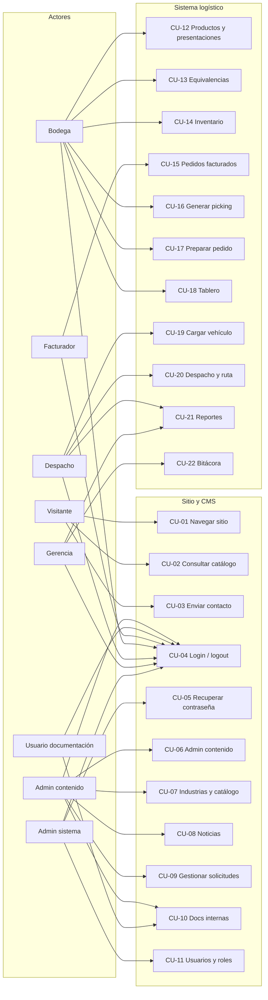

# Diagrama de casos de uso — vista Mermaid

Fuente editable draw.io: `casos-de-uso.drawio`  
Responsable: Carlos Hugo Escobar Gómez (tarea 1.12)

Exportar a PNG desde draw.io para el Anexo de diagramas del Documento 1.
