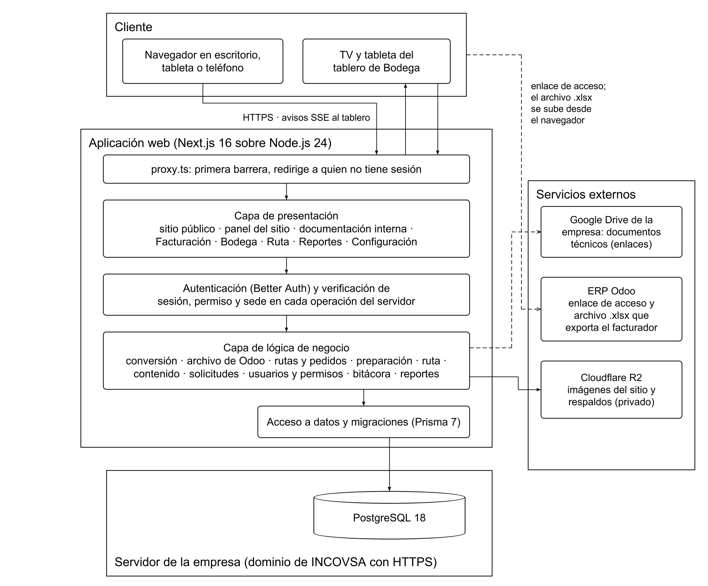
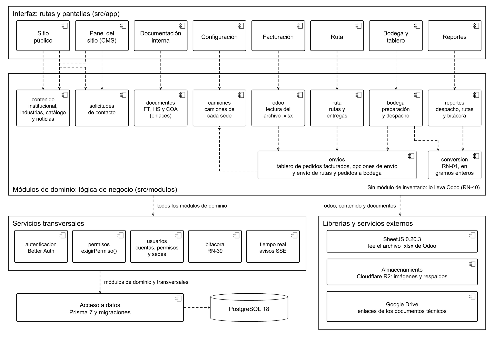

# Introducción técnica

Este documento explica cómo está construida la solución del proyecto «Sitio web institucional autoadministrable y sistema de control logístico de bodega INCOVSA». Está dirigido a futuros desarrolladores y al personal técnico de INCOVSA. Su propósito es que una persona que no participó en el proyecto pueda comprender la arquitectura, instalar el sistema, mantenerlo y ampliarlo sin depender del equipo original.

## Alcance de esta versión

La versión 0.2 corresponde al Entregable No. 2 y está alineada con la especificación del proyecto (carpeta `specs/`, versión 1.2, del 14/10/2026), que incorpora los cambios que pidió INCOVSA en las reuniones del 29/09/2026 y del 13/10/2026. Describe el diseño con el que se construye la aplicación: arquitectura general, componentes, clases, diagramas de secuencia de los procesos principales, modelo entidad-relación, diccionario de datos, tecnologías y versiones, dependencias, estructura del repositorio, migraciones, seguridad y lógica de negocio. También incluye la matriz de trazabilidad y los casos de prueba iniciales (Anexo F).

El avance funcional de este entregable es el **prototipo de simulación**, aprobado por el Ing. William Ambrossio el 13/10/2026, que el Ing. Manuel Rojas autorizó presentar como avance. El prototipo ejecuta en el navegador las reglas de negocio de este documento (lectura del archivo de Odoo, conversión, armado de rutas y pedidos, preparación, cambios de estado, permisos y bitácora) y guarda los datos en el navegador para simular la base de datos. La aplicación definitiva se construye con la arquitectura y el modelo de datos de este documento.

Las secciones de configuración, despliegue, mantenimiento y extensión del sistema se completan en el Entregable No. 3, junto con el manual técnico de instalación (Documento 5).

## Fuentes y relación con los demás documentos

- La especificación vigente del sistema está en la carpeta `specs/` del repositorio. Si este documento y `specs/` dicen cosas distintas, vale `specs/`.
- La aplicación se construye a partir del prototipo de simulación aprobado, con los cambios de las reuniones del 29/09/2026 y del 13/10/2026. El prototipo es la referencia de diseño visual y de comportamiento.
- El Documento 1 (memoria general y especificación) contiene el análisis, los requerimientos, las reglas de negocio y los casos de uso. Este documento cita sus códigos: requerimientos funcionales del sitio (RF-SW-xx) y del sistema logístico (RF-SL-xx), requerimientos no funcionales (RNF-xx), reglas de negocio (RN-xx) y casos de uso (CU-xx), con la numeración vigente de `specs/`.

## Componentes de la solución

La solución tiene dos componentes que conviven en una sola aplicación web:

1. **Sitio web corporativo e institucional autoadministrable.** Sitio público (Inicio, Quiénes somos, Industrias, Productos, Noticias y Contacto), panel administrativo para actualizar el contenido sin modificar el código, y área protegida de documentación interna (enlaces a fichas técnicas, hojas de seguridad y certificados de análisis).
2. **Sistema de control logístico de bodega (picking).** Cinco módulos: Facturación (carga del archivo de Odoo y armado de rutas y pedidos), Bodega (tablero de preparación), Ruta, Reportes y Configuración (camiones y usuarios).

# Arquitectura general

La solución es **una sola aplicación web monolítica, organizada por módulos de dominio**, que se publica bajo el dominio de INCOVSA. El sitio público, el panel, la documentación interna y los cinco módulos del picking comparten el mismo servidor, la misma base de datos y la misma autenticación, pero cada módulo tiene su propio código de negocio.

## Estilo arquitectónico

Se eligió un **monolito modular en capas** por tres razones:

- **Tamaño del equipo y del sistema.** Una sola aplicación es más fácil de instalar, desplegar y mantener por una persona que no participó en el desarrollo (RNF-07). No hay servicios separados que coordinar.
- **Reglas de negocio compartidas.** La conversión de kilogramos a unidades, la verificación de permisos y sedes y la bitácora se usan desde varias pantallas. En un solo proyecto se escriben una vez y se prueban solas.
- **Renderizado en el servidor.** Next.js genera las páginas en el servidor. El sitio público se indexa bien en buscadores y los datos internos nunca salen del servidor sin pasar por la verificación de permisos.

## Capas

Tabla: Capas de la aplicación {#tab:capas}

| Capa | Responsabilidad | Tecnología |
|---|---|---|
| Presentación | Rutas, páginas y componentes de cada área: sitio público, panel del sitio, documentación interna y módulos del picking | Next.js 16 (App Router), React 19, Tailwind CSS y shadcn/ui con los tokens del design system aprobado |
| Primera barrera | Redirigir a quien no tiene sesión | `proxy.ts` de Next.js 16 (antes llamado middleware) |
| Autenticación y autorización | Acceso personal, inicio de sesión, sesiones y verificación de sesión, permiso y sede **en cada operación del servidor** | Better Auth y la función `exigirPermiso` |
| Lógica de negocio | Reglas del sistema: conversión, lectura del archivo de Odoo, rutas y pedidos, preparación, ruta, contenido, documentación, solicitudes, usuarios y permisos, bitácora y reportes | Módulos de TypeScript en `src/modulos/`, validados con Zod |
| Acceso a datos | Consultas, transacciones y migraciones | Prisma 7 |
| Datos | Almacenamiento persistente | PostgreSQL 18 y Cloudflare R2 (imágenes) |

La lógica de negocio no depende de las pantallas: la conversión, la lectura del archivo de Odoo y la verificación de permisos se comportan igual desde cualquier pantalla y se prueban de forma automática.

## Elementos de la arquitectura

Tabla: Elementos de la arquitectura {#tab:elementos}

| Elemento | Descripción |
|---|---|
| Frontend | Páginas de Next.js generadas en el servidor, con componentes de React para la interacción: seleccionar y arrastrar pedidos facturados en Facturación, marcar y ordenar líneas en Bodega, reordenar clientes en Ruta y rotar las galerías de imágenes del sitio. El diseño es el del prototipo aprobado y se adapta a escritorio, tableta y teléfono (RNF-01) |
| Backend | Acciones del servidor (*server actions*) y rutas de la API de Next.js, que se ejecutan en Node.js 24. Toda operación pasa por la verificación de permisos antes de llamar a la lógica de negocio |
| Base de datos | PostgreSQL 18, con el esquema y las migraciones de Prisma |
| CMS o panel administrativo | Panel propio dentro de la misma aplicación. Permite editar la portada, los logotipos, el contenido institucional y los valores, las industrias, el catálogo informativo, las noticias y la información de contacto; gestionar la bandeja de solicitudes, la documentación interna y los usuarios del sitio, sin tocar el código (RF-SW-07) |
| Almacenamiento | Datos en PostgreSQL. Imágenes del sitio en Cloudflare R2; en la base de datos solo se guarda su dirección. Los documentos técnicos están en el Google Drive de la empresa; el sistema guarda sus enlaces y **no guarda archivos PDF** |
| Servicios externos | Cloudflare R2, Google Drive de la empresa y Odoo (solo un enlace y el archivo .xlsx que exporta el facturador). El sistema no envía correos |

## Comunicación entre componentes

- **Navegador y aplicación:** HTTPS en todo el sitio (RNF-12). Las pantallas llaman a acciones del servidor y a rutas de la API.
- **Tiempo real en Bodega (RNF-13):** cada pantalla del tablero mantiene abierta una conexión de eventos enviados por el servidor (SSE). Cuando alguien marca una línea, reordena, ordena por peso o despacha, el servidor avisa «cambió la sede X» y cada pantalla vuelve a pedir el estado. Si la conexión se cae, la pantalla consulta cada pocos segundos hasta reconectarse.
- **Aplicación y base de datos:** Prisma, con consultas parametrizadas y transacciones. El envío de una ruta o un pedido a bodega es una sola transacción (RNF-06).
- **Aplicación y Cloudflare R2:** API compatible con S3, con credenciales en variables de entorno.
- **Navegador y Google Drive:** la ventana de un producto documentado muestra la vista previa de Google Drive dentro de un marco y el enlace de descarga, solo a quien tiene el permiso correspondiente. El servidor no descarga ni guarda los documentos.
- **Odoo:** el facturador exporta el archivo .xlsx desde Odoo y lo sube desde el navegador. La aplicación lo lee en el servidor.

## Seguridad

La seguridad se aplica en varias capas. El detalle de cada medida está en las secciones de autenticación, roles y permisos, manejo de archivos y manejo de errores.

Tabla: Medidas de seguridad de la arquitectura {#tab:seguridad}

| Riesgo | Medida |
|---|---|
| Acceso sin permiso | Cada operación del servidor verifica sesión, permiso y sede con una sola función, `exigirPermiso`. `proxy.ts` es solo una primera barrera: en 2025 se publicó una vulnerabilidad de Next.js (CVE-2025-29927) que permitía saltarse el middleware |
| Robo o adivinación de contraseñas | Contraseñas con scrypt (RNF-03), mínimo de 8 caracteres y límite de intentos de inicio de sesión (RNF-15). El paso del usuario del acceso personal, que dice si un usuario existe por pedido de INCOVSA, cuenta en el límite de intentos por dirección IP y queda en la bitácora |
| Datos de entrada maliciosos | Todo lo que llega al servidor se valida con Zod (RNF-05). Solo se usan consultas parametrizadas de Prisma; no se arman consultas SQL uniendo textos |
| Archivos y enlaces maliciosos | El .xlsx de Odoo y las imágenes se validan por su contenido y no solo por la extensión; el servidor genera el nombre con que se guarda cada imagen. Los enlaces de documentos solo se aceptan si son de Google Drive |
| Inserción de código en las páginas (XSS) | El contenido escrito por los usuarios y los datos del archivo de Odoo (clientes, sectores, productos y lotes) se muestran siempre escapados |
| Peticiones falsificadas (CSRF) | Las acciones del servidor de Next.js y las rutas de la API que cambian datos verifican el origen de la petición |
| Interceptación y suplantación del sitio | HTTPS con HSTS (RNF-12) y cabeceras de seguridad: `Content-Security-Policy`, `X-Content-Type-Options: nosniff`, `Referrer-Policy` y `frame-ancestors` (RNF-16) |
| Filtración de secretos | Claves y credenciales solo en variables de entorno, fuera del repositorio (RNF-10) |
| Dependencias vulnerables | Archivo de bloqueo, Dependabot, `npm audit` en cada pull request y revisión manual de SheetJS (RNF-16) |
| Pérdida de datos | Respaldos automáticos diarios de la base de datos fuera del servidor y prueba de restauración (RNF-09) |

# Diagrama de arquitectura

La {{fig:arquitectura}} muestra los elementos de la solución y cómo se comunican. Las flechas continuas son llamadas entre elementos; las discontinuas indican que no hay intercambio de datos directo: el sistema solo guarda enlaces (Google Drive) o recibe el archivo que sube el facturador (Odoo).

{#fig:arquitectura}

- **Cliente:** cualquier navegador en escritorio, tableta o teléfono, y la TV o la tableta donde se proyecta el tablero de Bodega.
- **Aplicación web:** una sola aplicación de Next.js 16 que corre en Node.js 24. Toda petición pasa primero por `proxy.ts` y después por la verificación de sesión, permiso y sede de cada operación.
- **Servidor de la empresa:** la base de datos PostgreSQL 18, bajo el dominio de INCOVSA con HTTPS. El hosting definitivo lo define la empresa (P-10).
- **Servicios externos:** Google Drive de la empresa, Odoo y Cloudflare R2.

# Diagrama de componentes

La {{fig:componentes}} muestra los componentes de software y sus dependencias principales, en notación UML: cada línea discontinua con punta abierta significa «depende de». La {{tab:componentes}} lista todas las dependencias.

{#fig:componentes}

Tabla: Componentes y sus dependencias {#tab:componentes}

| Componente | Carpeta | Responsabilidad | Depende de |
|---|---|---|---|
| Sitio público | `src/app/(sitio)/` | Inicio, Quiénes somos, Industrias, Productos, Noticias, Contacto y acceso personal | contenido, solicitudes, usuarios |
| Panel del sitio | `src/app/panel/` | Administración del contenido, de la bandeja de solicitudes y de los usuarios del sitio | contenido, solicitudes, usuarios |
| Documentación interna | `src/app/panel/documentos/` | Productos documentados y sus enlaces de FT, HS y COA | documentos |
| Facturación | `src/app/picking/facturacion/` | Carga del archivo de Odoo, tablero de pedidos facturados y las dos opciones de envío | odoo, envios, camiones |
| Bodega y tablero | `src/app/picking/bodega/` | Preparación, prioridad, orden por peso, marcado, detalle y despacho; tablero en pantalla completa | bodega, tiempo-real |
| Ruta | `src/app/picking/ruta/` | Rutas en curso del piloto y registro de la entrega | ruta |
| Reportes | `src/app/picking/reportes/` | Despacho por producto, rutas realizadas y bitácora | reportes, bitacora |
| Configuración | `src/app/picking/configuracion/` | Camiones y usuarios del picking | camiones, usuarios |
| contenido | `src/modulos/contenido/` | Portada, logotipos, contenido institucional, valores, industrias, catálogo informativo, noticias, información de contacto y galerías de imágenes | almacenamiento (R2) |
| solicitudes | `src/modulos/solicitudes/` | Formulario de contacto, bandeja y estados de las solicitudes. Solo guarda; no envía correos | — |
| documentos | `src/modulos/documentos/` | Productos documentados, validación de enlaces de Google Drive y opciones según permisos | — |
| camiones | `src/modulos/camiones/` | Camiones de cada sede | — |
| odoo | `src/modulos/odoo/` | Lectura y validación del archivo .xlsx de Odoo | SheetJS, envios |
| envios | `src/modulos/envios/` | Tablero de pedidos facturados, opciones de envío, numeración diaria y envío de rutas y pedidos a bodega | camiones |
| bodega | `src/modulos/bodega/` | Líneas de preparación, prioridad, orden por peso, marcado y despacho | envios, conversion |
| ruta | `src/modulos/ruta/` | Rutas, orden de los clientes y entrega | envios |
| reportes | `src/modulos/reportes/` | Indicadores, rutas realizadas, bitácora y exportaciones | envios, ruta, conversion, bitacora |
| conversion | `src/modulos/conversion/` | Conversión de kilogramos a unidades (RN-01) | — |
| autenticacion | `src/lib/` | Acceso personal, inicio de sesión y sesiones | Better Auth |
| permisos | `src/modulos/permisos/` | Verificación de sesión, permiso y sede (`exigirPermiso`) | usuarios |
| usuarios | `src/modulos/usuarios/` | Cuentas por sistema, contraseñas, roles, permisos y sedes | — |
| bitacora | `src/modulos/bitacora/` | Registro de las operaciones (RN-39) | — |
| tiempo-real | `src/modulos/tiempo-real/` | Avisos SSE a las pantallas de Bodega | — |

Todos los módulos de dominio usan `permisos`, `bitacora` y el acceso a datos de Prisma. El sistema no tiene módulo de inventario: el inventario de todas las bodegas lo lleva Odoo (RN-40).

# Diagrama de despliegue

Esta sección se completa en el Entregable No. 3, cuando INCOVSA defina el hosting (P-10).
