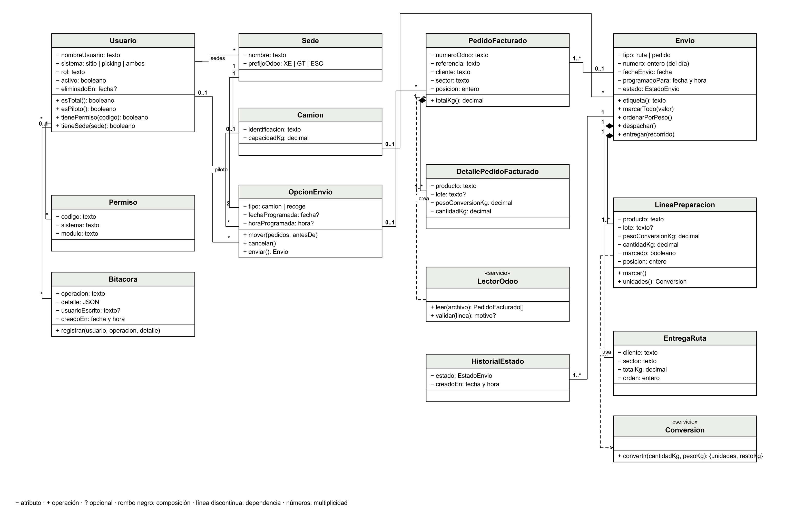
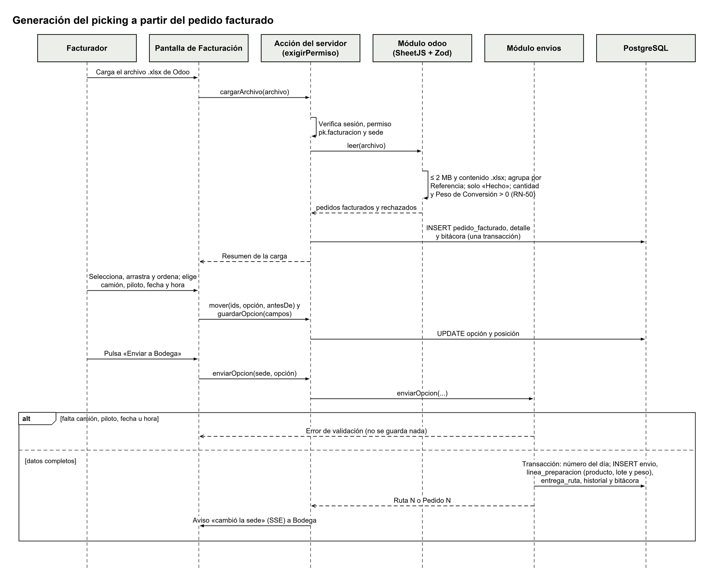
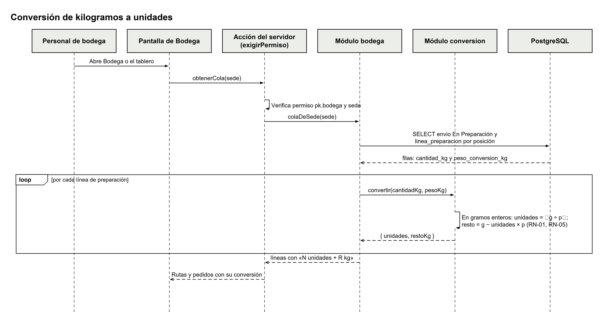
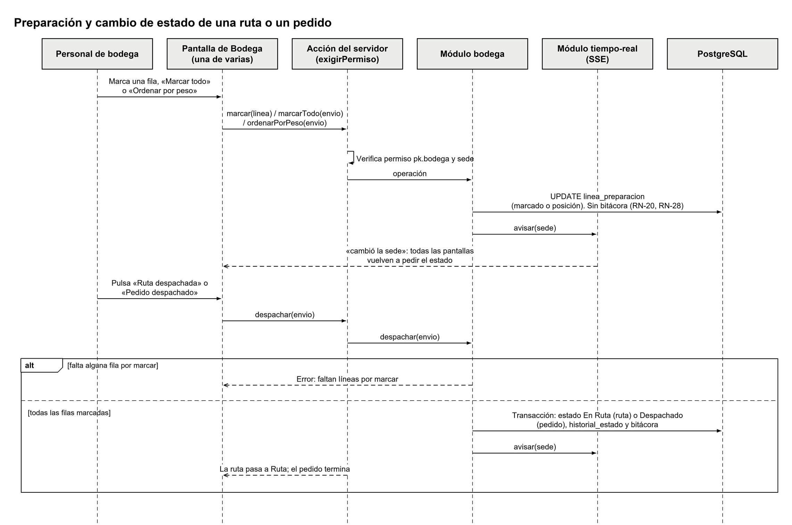
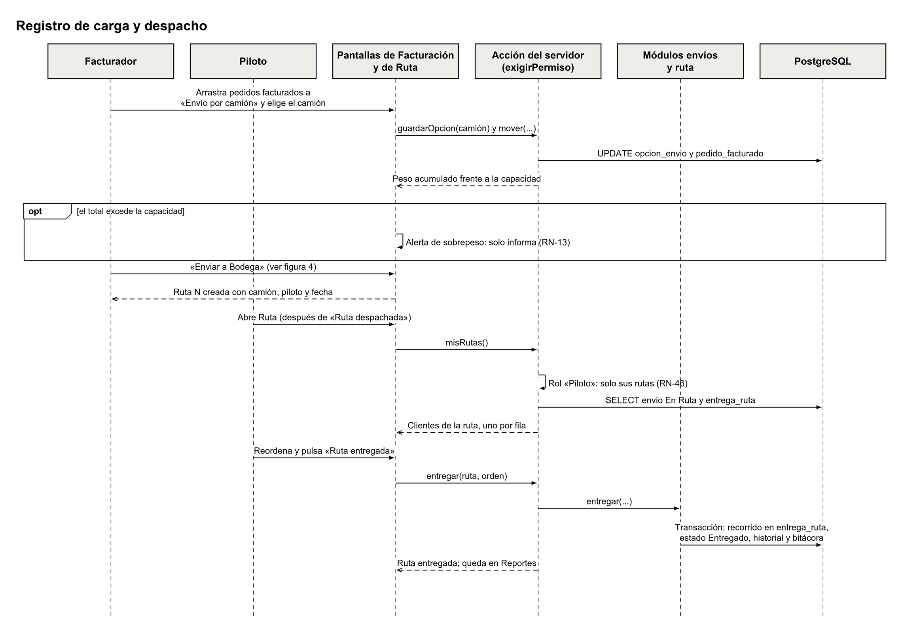
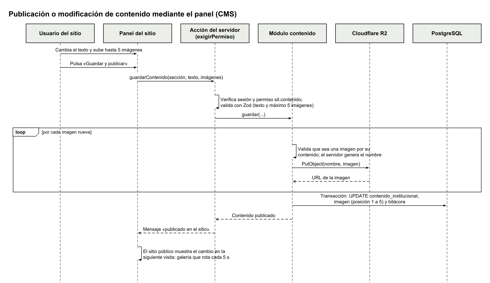
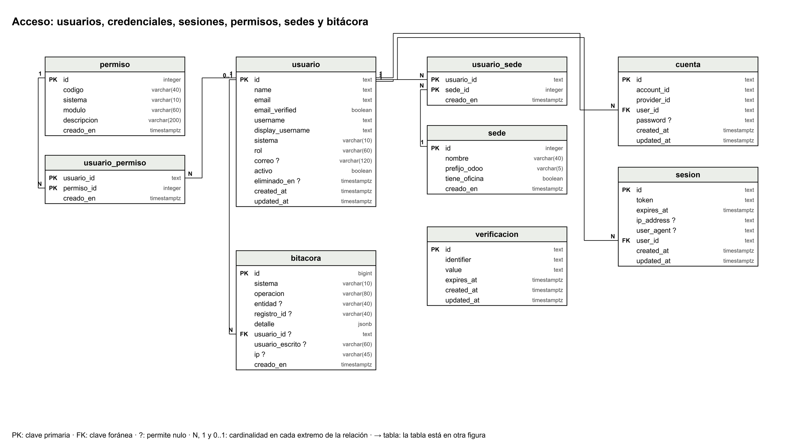
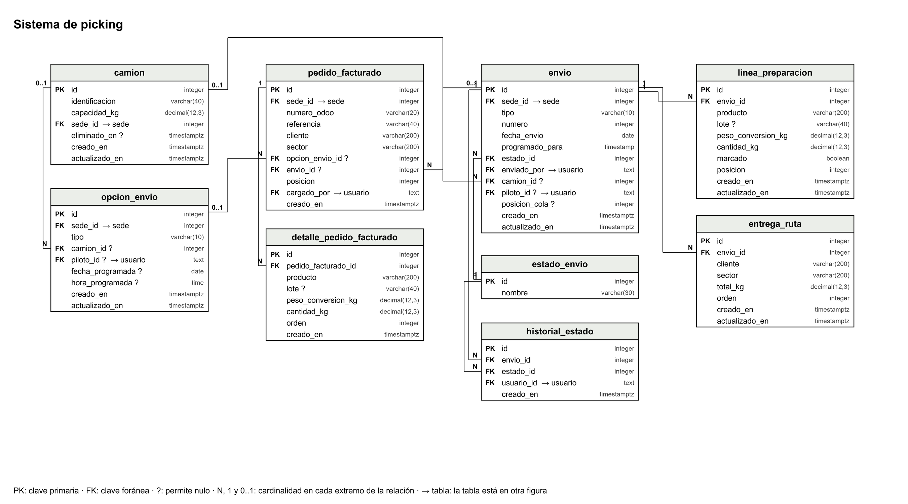
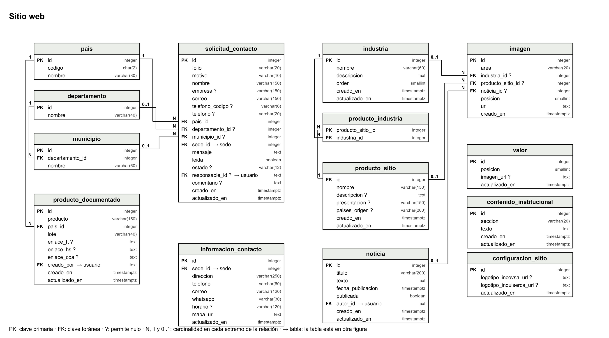

# Diagrama de clases

La {{fig:clases}} muestra las clases y estructuras principales del dominio del sistema de picking y del acceso, con sus atributos, sus operaciones y sus relaciones. Cada clase corresponde a una entidad del modelo de datos (sección «Modelo entidad-relación») o a un servicio de la capa de negocio (`src/modulos/`). No se documentan los componentes visuales de la interfaz.

{#fig:clases}

Tabla: Clases del dominio {#tab:clases}

| Clase | Responsabilidad | Módulo |
|---|---|---|
| Usuario | Cuenta de uno de los dos sistemas: rol en texto libre, permisos y sedes. Gerencia y Soporte tienen acceso total (RN-38) | `usuarios`, `permisos` |
| Permiso | Autorización por módulo y acción, que se marca con una casilla | `permisos` |
| Sede | Quetzaltenango, Guatemala o Escuintla, con su prefijo de Odoo | `permisos` |
| Camion | Camión de una sede, con su capacidad en kg | `camiones` |
| OpcionEnvio | Cada una de las dos opciones de envío de una sede. Guarda el camión, el piloto y la fecha y hora programadas; mueve, ordena, cancela y envía los pedidos facturados | `envios` |
| PedidoFacturado y DetallePedidoFacturado | Una referencia de Odoo de un cliente y sus líneas, con los datos tal como vienen en el archivo: producto, lote, Peso de Conversión y cantidad | `odoo`, `envios` |
| LectorOdoo | Servicio que lee el archivo .xlsx y valida cada línea (RN-35 a RN-37, RN-50) | `odoo` |
| Envio | Ruta (envío por camión) o pedido (cliente recoge), con su número del día y su fecha y hora programadas. Despacha y entrega | `envios`, `bodega`, `ruta` |
| LineaPreparacion | Fila de Bodega: producto, lote y Peso de Conversión, con la suma de los clientes y su marcado | `bodega` |
| EntregaRuta | Cliente de una ruta y su orden; al entregar, el recorrido | `ruta` |
| HistorialEstado | Cada cambio de estado, con fecha, hora y usuario | `envios` |
| Conversion | Servicio que convierte kilogramos a unidades en gramos enteros (RN-01) | `conversion` |
| Bitacora | Registro de las operaciones de los dos sistemas (RN-39) | `bitacora` |

Las clases del sitio web (contenido institucional, industrias, productos públicos, noticias, galerías de imágenes, productos documentados y solicitudes de contacto) son estructuras de datos sin reglas complejas; están en el modelo entidad-relación de la {{fig:er-sitio}}.

# Diagramas de secuencia

Los diagramas muestran la interacción entre el usuario, la interfaz, las acciones del servidor (que verifican sesión, permiso y sede con `exigirPermiso`), los módulos de la lógica de negocio, la base de datos y los servicios externos.

## Generación del picking a partir del pedido facturado

El facturador carga el archivo de Odoo, arma la ruta o el pedido en una opción de envío y lo envía a Bodega ({{fig:sec-picking}}). Al enviar, en una sola transacción se asigna el número del día, se crean las líneas de preparación agrupadas por producto, lote y Peso de Conversión, las filas de la ruta, el historial y la bitácora (RNF-06).

{#fig:sec-picking}

## Conversión de kilogramos a unidades

La {{fig:sec-conversion}} muestra cómo Bodega obtiene, para cada línea de preparación, las unidades completas y el resto en kg con el Peso de Conversión que vino en el archivo.

{#fig:sec-conversion}

## Preparación y cambio de estado del pedido

La {{fig:sec-preparacion}} muestra el marcado de filas (una por una o todas), el orden por peso y el despacho, que cambia el estado a En Ruta (ruta) o Despachado (pedido). El marcado y el orden se comparten en tiempo real con un aviso por SSE y no van a la bitácora (RN-20, RN-28).

{#fig:sec-preparacion}

## Registro de carga y despacho

La carga del vehículo se registra en Facturación, al armar la opción «Envío por camión» con el camión, el piloto y el control de peso; el despacho, en Bodega, y la entrega, en Ruta ({{fig:sec-carga}}).

{#fig:sec-carga}

## Publicación o modificación de contenido mediante el CMS

La {{fig:sec-cms}} muestra cómo un usuario del sitio con permiso de contenido cambia un texto y sus imágenes desde el panel. Las imágenes se validan por su contenido y se guardan en Cloudflare R2; en la base de datos queda su dirección.

{#fig:sec-cms}

## Actualización de inventario

Los lineamientos piden también el diagrama de secuencia de la actualización de inventario. **No se incluye** porque el sistema no lleva control de inventario: INCOVSA lo sacó del alcance el 29/09/2026, ya que el inventario de todas sus bodegas lo lleva Odoo (RN-40). La exclusión se explica en la sección «Lógica de inventario» y en la nota que acompaña a este entregable.

# Modelo entidad-relación

El modelo entidad-relación es el **esquema de base de datos diseñado** para PostgreSQL 18 a partir del modelo conceptual de la especificación (`specs/14-modelo-de-datos.md`). Se implementa con el esquema de Prisma 7 y sus migraciones. Por su tamaño se presenta en tres figuras: acceso ({{fig:er-acceso}}), sistema de picking ({{fig:er-picking}}) y sitio web ({{fig:er-sitio}}). Las claves foráneas hacia una tabla que se dibuja en otra figura se marcan con «→ tabla».

{#fig:er-acceso}

{#fig:er-picking}

{#fig:er-sitio}

Puntos principales del modelo:

- **Acceso:** `usuario`, `cuenta`, `sesion` y `verificacion` son las tablas de Better Auth. Una persona puede tener una cuenta en cada sistema con el mismo nombre de usuario (RN-54); por eso el nombre visible (`display_username`) es único junto con el sistema, y Better Auth recibe una clave interna única formada por el sistema y el nombre de usuario (`username`, por ejemplo `picking.maria.argueta`).
- **Picking:** el pedido facturado y sus líneas guardan los datos del archivo de Odoo tal como vienen; no hay tablas de productos, clientes ni sectores. Lo que se envía a Bodega es un `envio` de tipo ruta o pedido, con su número del día. Sus líneas de preparación y las filas de la ruta se crean al enviarlo.
- **Sitio:** las imágenes de las galerías están en la tabla `imagen` (hasta 5 por área o por dueño, RN-56). La documentación interna son los `producto_documentado`, con los enlaces de Google Drive.

\salto

## Reglas de integridad

Tabla: Reglas de integridad de la base de datos {#tab:integridad}

| Regla | Cómo se aplica |
|---|---|
| Claves primarias | Cada tabla tiene clave primaria. Las de Better Auth usan identificadores de texto; las demás, enteros autoincrementales. Las tablas de relación N:M (`usuario_permiso`, `usuario_sede`, `producto_industria`) usan la clave primaria compuesta por sus dos claves foráneas |
| Claves foráneas | Toda relación es una clave foránea declarada. Las líneas que dependen de su registro padre se borran en cascada (`detalle_pedido_facturado`, `linea_preparacion`, `entrega_ruta`, `imagen`, `cuenta`, `sesion`). Las demás impiden borrar el registro padre mientras tenga hijos |
| Unicidad | Nombre y prefijo de la sede; nombre de usuario por sistema (RN-54); clave interna y correo interno de Better Auth; código del permiso; una opción de envío de cada tipo por sede; número del día de la ruta o del pedido por sede, tipo y fecha (RN-52); una línea de preparación por producto, lote y Peso de Conversión en cada envío (RN-51); producto documentado por nombre, país y lote; folio de la solicitud. El número de Odoo **no** es único: tiene un índice para buscar (decisión técnica 4) |
| Eliminación de registros | Camiones y usuarios se eliminan de forma **lógica** (`eliminado_en`): desaparecen de listas y selectores, y su historial se conserva. Los pedidos facturados del tablero sí se borran, porque nunca llegaron a Bodega; sus datos quedan en la bitácora. La bitácora no se edita ni se borra |
| Actualización | Las tablas que se modifican guardan `actualizado_en`. Una ruta o un pedido enviado a Bodega no se edita (RF-SL-18): solo cambian su estado, el marcado y el orden de sus líneas, y el orden de sus clientes hasta la entrega |
| Validaciones relevantes | Cantidades y Peso de Conversión en `decimal(12,3)` y mayores que cero; capacidad del camión mayor que cero; fecha y hora programadas obligatorias para enviar (RN-53); lote del producto documentado obligatorio, solo letras y números (RN-41); enlaces de documentos solo de Google Drive; posición de las imágenes de 1 a 5. Todo se valida además con Zod en el servidor antes de llegar a la base de datos (RNF-05) |
| Transacciones | El envío a Bodega, el despacho, la entrega y la carga del archivo se guardan completos o no se guardan, con su registro de bitácora en la misma transacción (RNF-06) |
| Fechas | Todas en UTC (`timestamptz`), con la fecha y hora de creación puesta por la base de datos (RN-57). La fecha del día de una ruta o un pedido se calcula en la hora de Guatemala |
