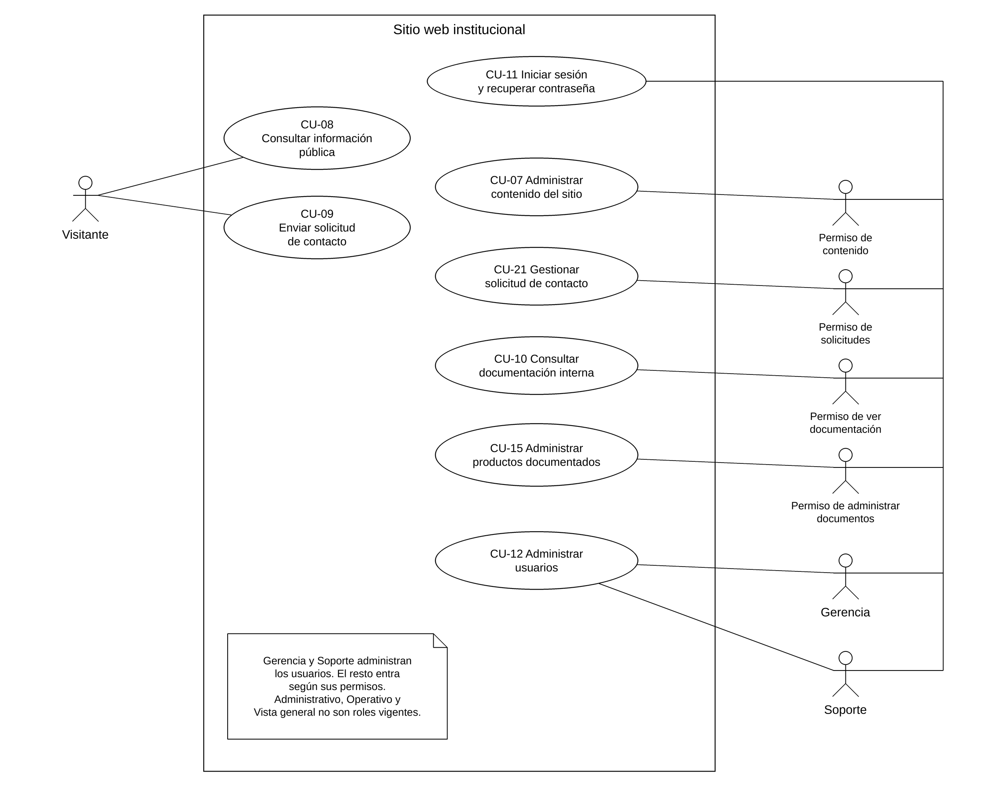
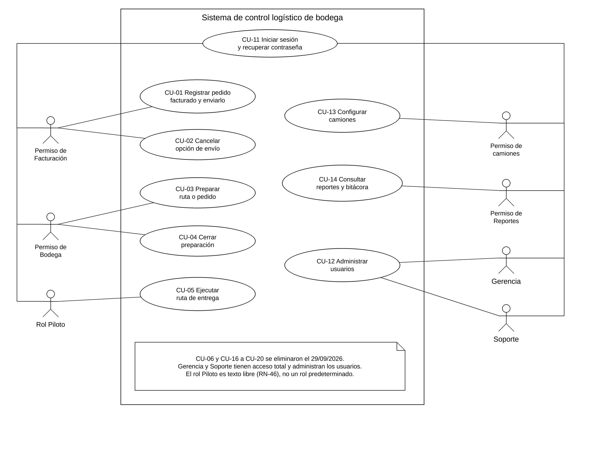
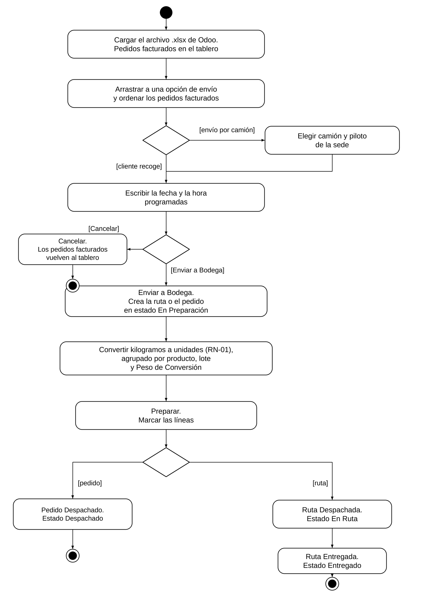
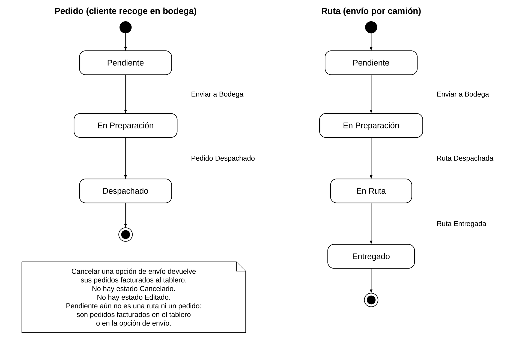
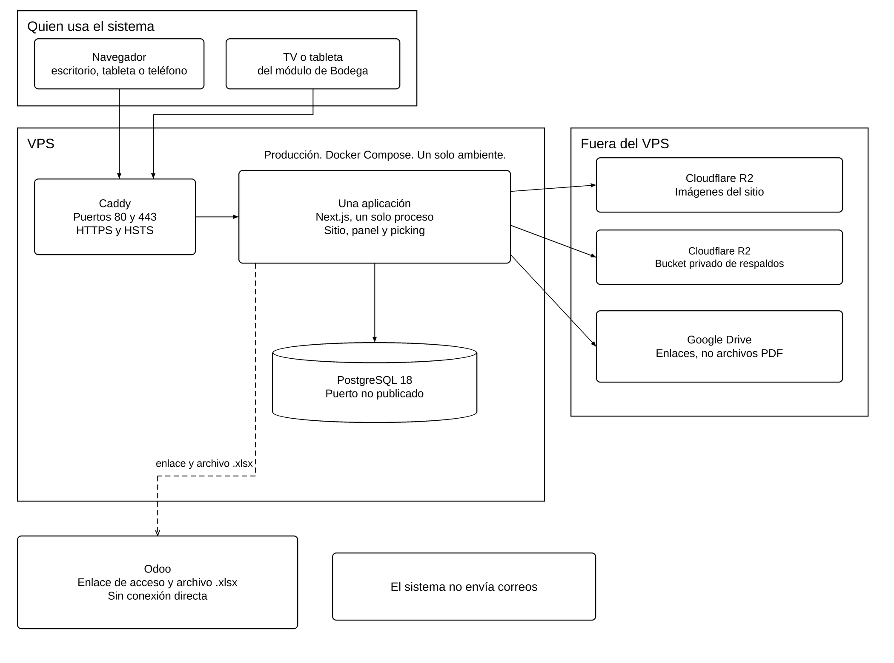
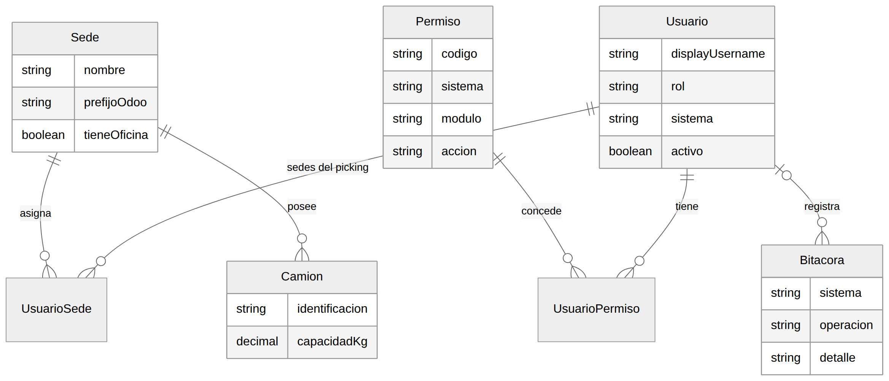
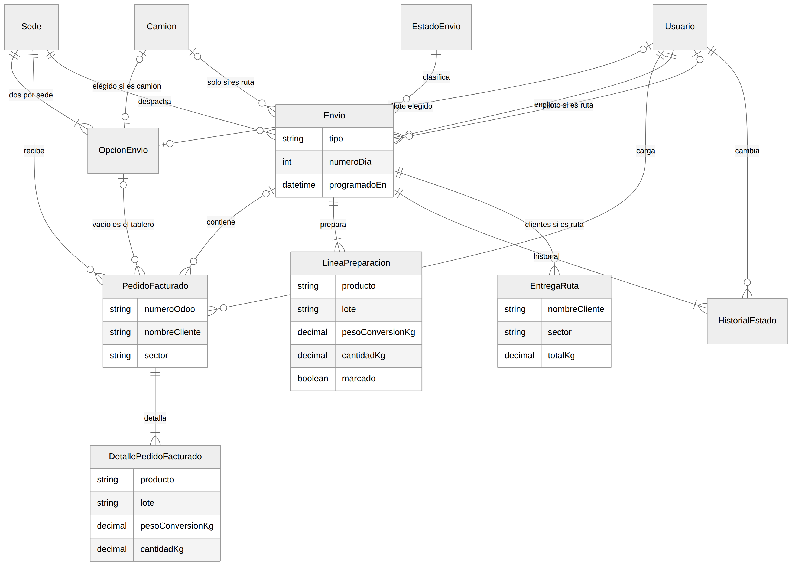
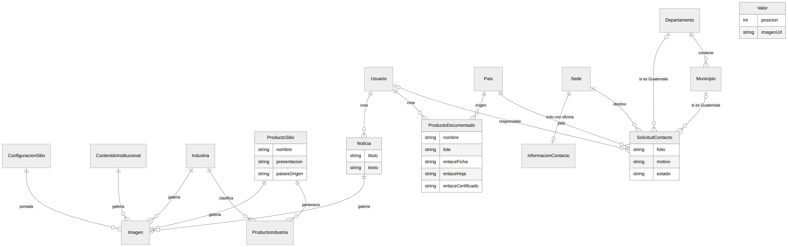

\vertical

# Modelado, diseño y arquitectura

Este capítulo describe el flujo, los estados, el despliegue y el modelo de datos vigentes en `specs/` 1.7. Las figuras 1 a 5 se generaron con los guiones de `entregable-1/diagramas/`. Las figuras 6 a 8 están actualizadas en Mermaid. Su PNG no se generó en esta copia.

## Casos de uso

La figura 1 reúne los casos de uso del sitio que no están eliminados: CU-07, CU-08, CU-09, CU-10, CU-11, CU-12, CU-15 y CU-21. El visitante consulta la información pública y envía la solicitud de contacto. El resto de los actores son usuarios según el permiso que tienen. Gerencia y Soporte administran los usuarios. Administrativo, Operativo y Vista general no aparecen como roles vigentes.

{#fig:casos-sitio}

La figura 2 reúne los casos de uso del picking que no están eliminados: CU-01, CU-02, CU-03, CU-04, CU-05, CU-11, CU-12, CU-13 y CU-14. CU-13 es configurar camiones. Los actores son el permiso de Facturación, el permiso de Bodega, el rol Piloto, el permiso de camiones, el permiso de Reportes, Gerencia y Soporte.

{#fig:casos-picking}

CU-06 y CU-16 a CU-20 se eliminaron el 29/09/2026. La nota de la figura 2 lo dice. Esos códigos no se dibujan.

## Flujo principal

El flujo vigente es pedido facturado, conversión, preparación y despacho. No hay un paso de inventario, ni de existencias, ni de captura manual del pedido.

1. Facturación carga el archivo .xlsx de Odoo. Los pedidos facturados quedan en el tablero.
2. El facturador los arrastra a Envío por camión o a Cliente recoge en bodega, y los ordena. En el camión elige camión y piloto.
3. Escribe la fecha y la hora programadas. Son obligatorias.
4. Cancelar devuelve esos pedidos facturados al tablero. Enviar a Bodega crea la ruta o el pedido en estado En Preparación.
5. Bodega convierte los kilogramos a unidades con RN-01, agrupando por producto, lote y Peso de Conversión.
6. Se marcan las líneas. Pedido Despachado deja el pedido en Despachado. Ruta Despachada deja la ruta en En Ruta. Ruta Entregada deja la ruta en Entregado.

{#fig:actividades}

## Estados

{{fig:estados}} separa el pedido del cliente que recoge y la ruta del camión. Los nombres son los de RN-11.

El pedido usa Pendiente, En Preparación y Despachado. La ruta usa Pendiente, En Preparación, En Ruta y Entregado. No hay estado Cancelado. No hay estado Editado. Cancelar una opción de envío devuelve los pedidos facturados al tablero.

{#fig:estados}

## Arquitectura y despliegue

Hay una sola aplicación web. Contiene el sitio público, el panel, la documentación interna y los cinco módulos del picking. Las capas son presentación, lógica de negocio, acceso a datos y PostgreSQL 18 (`specs/16-arquitectura-y-tecnologia.md`).

En las computadoras del equipo no se usa Docker. El desarrollo corre con Node.js 24 y PostgreSQL 18. La integración continua de GitHub Actions tiene su propio PostgreSQL 18. Producción es un solo ambiente, en el VPS, en incovsa.com. El primer despliegue está fijado para el lunes 02/11/2026, al integrar `develop` en `main`. Antes de esa fecha no se despliega. El VPS lo contrata INCOVSA (P-10). Lo que se le pide es Ubuntu Server 24.04 LTS, 2 vCPU, 4 GB de RAM, 80 GB SSD, dirección IP fija y SSH con llave.

En el VPS, Docker Compose levanta tres servicios.

Tabla: Servicios de producción {#tab:servicios-produccion}

| Servicio | Función |
|---|---|
| Caddy | HTTPS con certificado automático, HSTS y aviso en tiempo real (SSE). Publica los puertos 80 y 443 |
| Aplicación | Next.js compilado como servidor independiente, en un solo proceso |
| PostgreSQL 18 | Base de datos en un volumen de Docker. Su puerto no se publica |

`docker-compose.yml` de esta rama aplica ese despliegue. Caddy publica 80 y 443. El servicio de PostgreSQL no tiene `ports`. El comentario del archivo dice que no se publica su puerto.

Las imágenes del sitio se guardan en Cloudflare R2, plan gratuito. En la base solo se guarda la dirección. En producción se sirven desde `imagenes.incovsa.com`, si el DNS de incovsa.com pasa a Cloudflare (P-93). La dirección `r2.dev` no se usa en producción. Los respaldos van a otro bucket privado de R2. Los documentos técnicos no se guardan en el servidor. Son enlaces de Google Drive. Odoo no tiene conexión directa. El facturador sube el archivo .xlsx y el sitio solo enlaza al inicio de sesión. El sistema no envía correos.

{#fig:arquitectura}

El aviso en tiempo real de Bodega vive en la memoria de ese único proceso. Ante un cambio, el servidor avisa que cambió la sede y cada pantalla vuelve a pedir el estado. Si la conexión se cae, la pantalla consulta cada 5 segundos hasta reconectarse (decisión 10).

## Modelo de datos

El modelo conceptual está en `specs/14-modelo-de-datos.md`. Los nombres de las tablas en la aplicación son los modelos de `prisma/schema.prisma`. Si el diagrama antiguo de la v0.2 muestra inventario, sector, cliente o un catálogo de productos del picking, ese diagrama ya no vale.

Todas las entidades guardan la fecha y la hora de creación (RN-57). El rol no es una entidad. Es texto en Usuario. El producto, el lote, el cliente y el sector del picking son texto que llega en el archivo de Odoo. No hay entidades Producto, Cliente ni Sector en el picking.

La figura 6 muestra Sede, Usuario, Permiso, UsuarioPermiso, UsuarioSede, Camion y Bitacora. El fuente es `entregable-1/diagramas/figura-6-modelo-er-catalogos.mmd`.

{#fig:er-acceso}

La figura 7 muestra OpcionEnvio, PedidoFacturado, DetallePedidoFacturado, Envio, LineaPreparacion, EstadoEnvio, HistorialEstado y EntregaRuta, con Sede, Usuario y Camion. No incluye existencia, traslado, devolución, ruta como entidad aparte, ni un catálogo de productos. El fuente es `entregable-1/diagramas/figura-7-modelo-er-pedidos.mmd`.

{#fig:er-picking}

La figura 8 muestra los modelos del sitio: ConfiguracionSitio, ContenidoInstitucional, Valor, Industria, ProductoSitio, ProductoIndustria, Noticia, Imagen, ProductoDocumentado, SolicitudContacto, InformacionContacto, Pais, Departamento y Municipio. El fuente es `entregable-1/diagramas/figura-8-modelo-er-sitio.mmd`.

{#fig:er-sitio}

Quedaron fuera del modelo, con la fecha en que salieron (`specs/14-modelo-de-datos.md`).

Tabla: Entidades que el modelo vigente no usa {#tab:entidades-fuera}

| Entidad o atributo | Desde |
|---|---|
| Existencia, movimiento de inventario, traslado, devolución y la marca de devolución del pedido | 29/09/2026 |
| Rol como entidad, y una sola sede fija en el usuario | 29/09/2026 y 11/10/2026 |
| Producto, cliente y sector del picking | 13/10/2026 |
| Pedido y ruta como entidades distintas. Los reemplaza Envio | 13/10/2026 |
| Documento interno en PDF. Lo reemplaza ProductoDocumentado, con enlaces | 13/10/2026 |
