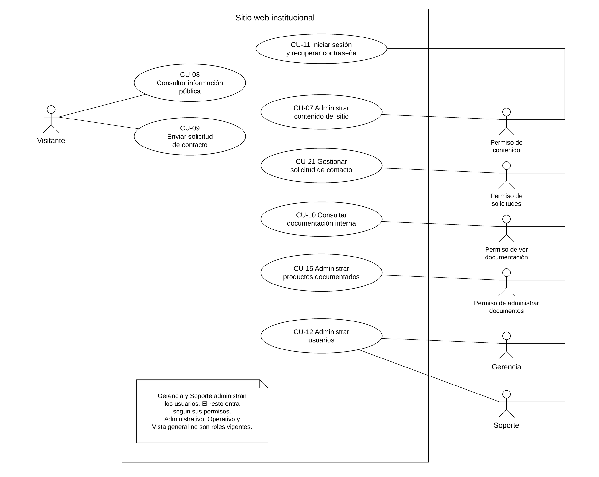
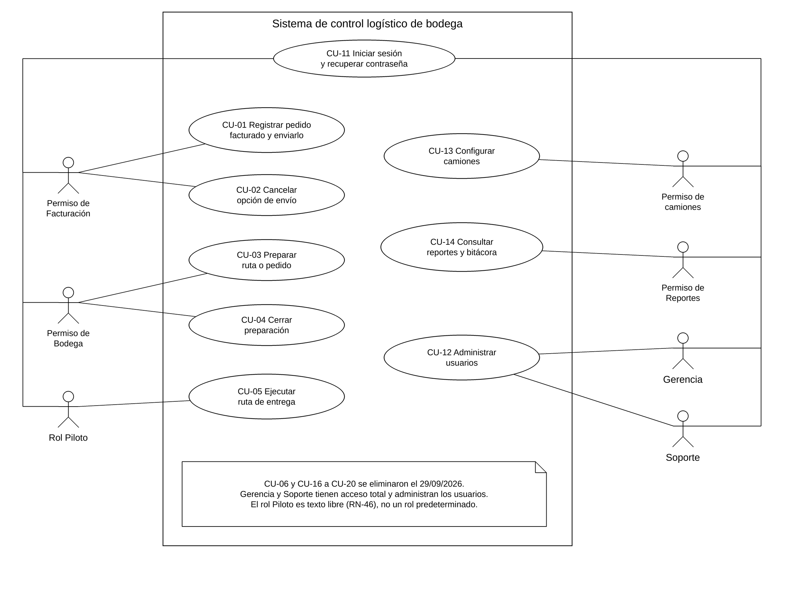
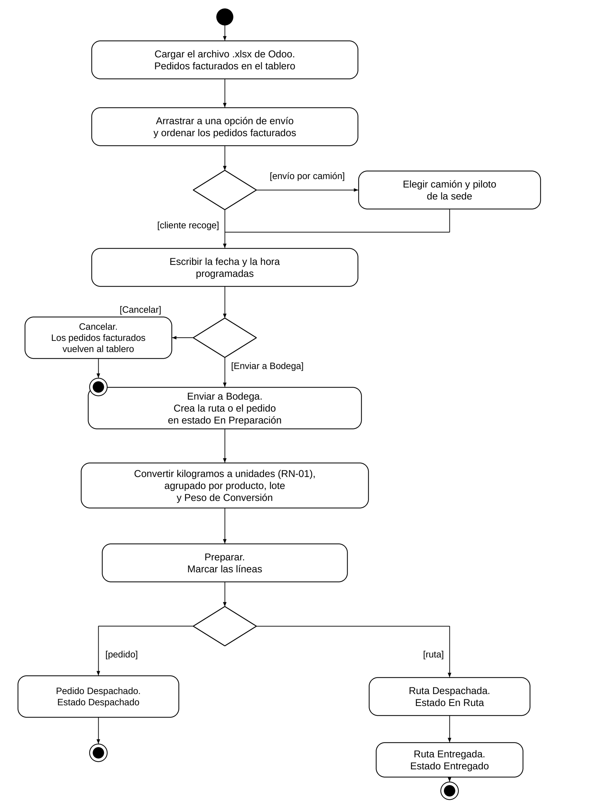
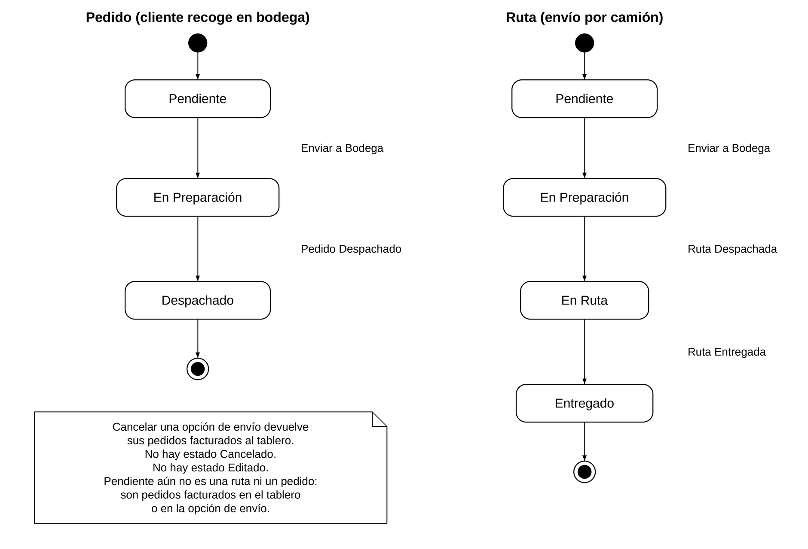
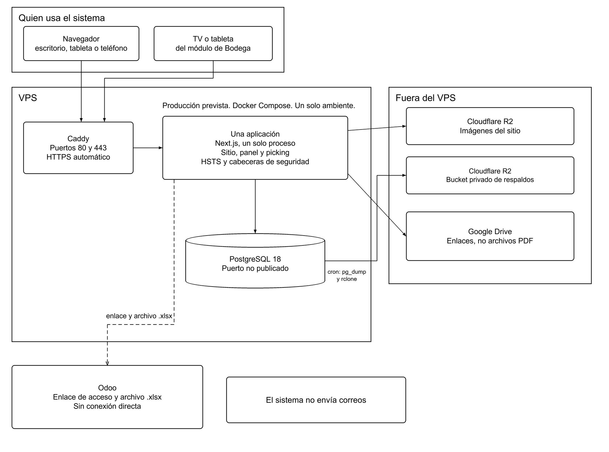
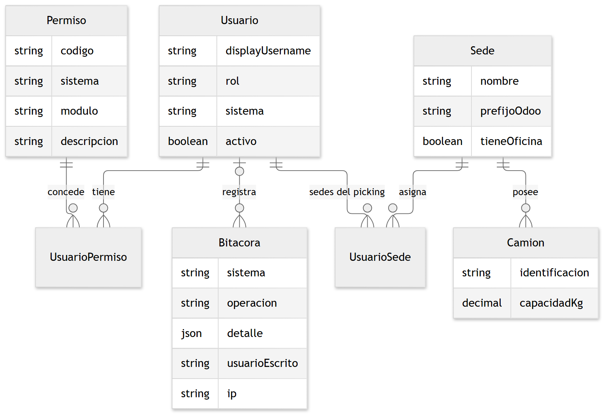
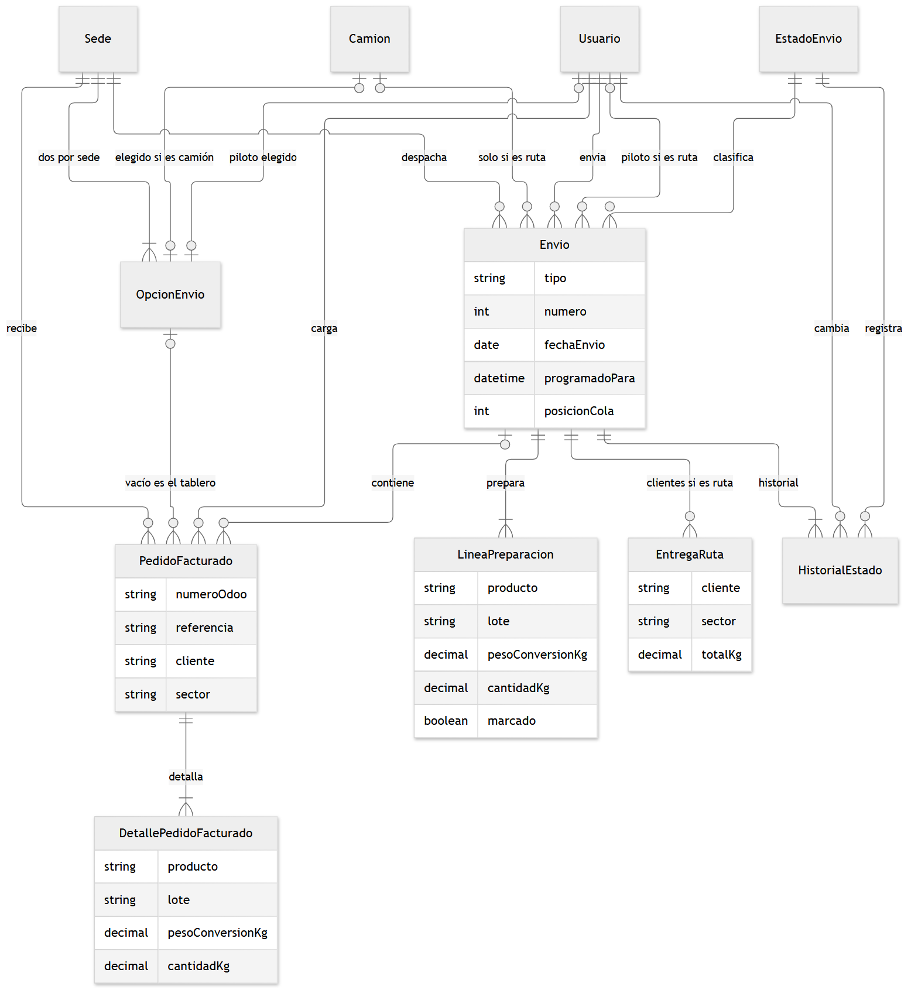
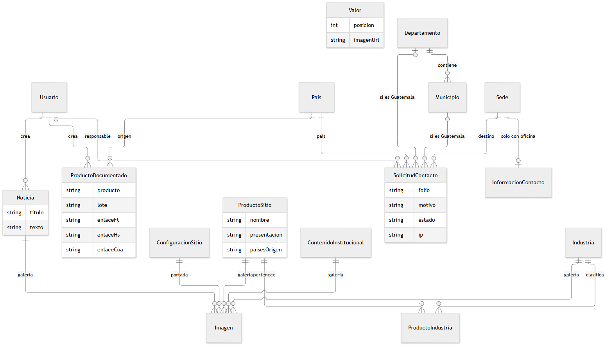

\vertical

# Modelado, diseño y arquitectura

Este capítulo describe el flujo, los estados, la arquitectura, el despliegue previsto y el modelo de datos de `specs/` 1.7, con los cambios hasta el 03/11/2026. Las figuras 1 a 5 se generan con los guiones de Python de `entregable-1/diagramas/`. Las figuras 6 a 8 son diagramas Mermaid de esa misma carpeta, con los nombres de `prisma/schema.prisma`.

## Casos de uso

{{fig:casos-sitio}} reúne los casos de uso del sitio que no están eliminados: CU-07, CU-08, CU-09, CU-10, CU-11, CU-12, CU-15 y CU-21. El visitante consulta la información pública y envía la solicitud de contacto. El resto de los actores son usuarios según el permiso que tienen. Gerencia y Soporte administran los usuarios. Administrativo, Operativo y Vista general no aparecen como roles vigentes.

{#fig:casos-sitio}

{{fig:casos-picking}} reúne los casos de uso del picking que no están eliminados: CU-01, CU-02, CU-03, CU-04, CU-05, CU-11, CU-12, CU-13 y CU-14. CU-13 es configurar camiones. Los actores son el permiso de Facturación, el permiso de Bodega, el rol Piloto, el permiso de camiones, el permiso de Reportes, Gerencia y Soporte.

{#fig:casos-picking}

CU-06 y CU-16 a CU-20 se eliminaron el 29/09/2026. La nota de {{fig:casos-picking}} lo dice. Esos códigos no se dibujan.

## Flujo principal

El flujo vigente es pedido facturado, conversión, preparación y despacho. No hay un paso de inventario, ni de existencias, ni de captura manual del pedido.

{{fig:actividades}} muestra el flujo.

1. Facturación carga el archivo .xlsx de Odoo. Los pedidos facturados quedan en el tablero.
2. El facturador los arrastra a Envío por camión o a Cliente recoge en bodega, y los ordena. En el camión elige camión y piloto.
3. Escribe la fecha y la hora programadas. Son obligatorias.
4. Cancelar devuelve esos pedidos facturados al tablero. Enviar a Bodega crea la ruta o el pedido en estado En Preparación.
5. Bodega convierte los kilogramos a unidades con RN-01, agrupando por producto, lote y Peso de Conversión.
6. Se marcan las líneas. Pedido Despachado deja el pedido en Despachado. Ruta Despachada deja la ruta en En Ruta. Ruta Entregada deja la ruta en Entregado.

{#fig:actividades}

## Estados

{{fig:estados}} separa el pedido del cliente que recoge y la ruta del camión. Los nombres son los de RN-11.

El pedido usa Pendiente, En Preparación y Despachado. La ruta usa Pendiente, En Preparación, En Ruta y Entregado. No hay estado Cancelado. No hay estado Editado. Cancelar una opción de envío devuelve los pedidos facturados al tablero.

{#fig:estados}

## Arquitectura y despliegue

Hay una sola aplicación web monolítica, con renderizado en el servidor. Contiene el sitio público, el panel, la documentación interna y los cinco módulos del picking: Facturación, Bodega, Ruta, Reportes y Configuración. Las capas son presentación, lógica de negocio, acceso a datos y la base de datos PostgreSQL 18 (`specs/16-arquitectura-y-tecnologia.md`). La conversión y la lectura del archivo de Odoo viven en la capa de negocio. Se comportan igual desde cualquier pantalla.

Tabla: Tecnologías de la aplicación {#tab:stack}

| Capa | Tecnología |
|---|---|
| Entorno de ejecución | Node.js 24 LTS |
| Aplicación | Next.js 16 (App Router) con TypeScript |
| Base de datos y acceso a datos | PostgreSQL 18, con Prisma 7 y sus migraciones |
| Autenticación | Better Auth 1.7, con nombre de usuario y contraseña, y sesiones en la base |
| Interfaz | Tailwind CSS y shadcn/ui, con los tokens del prototipo aprobado |
| Validación y formularios | Zod, en el navegador y en el servidor, y React Hook Form |
| Archivo de Odoo y reportes | SheetJS 0.20.3 para leer el .xlsx y generar el Excel, y pdfmake para el PDF |
| Imágenes | `file-type` para validar el formato y `sharp` para volver a codificarlas |
| Pruebas | Vitest contra un PostgreSQL real, y Playwright en Chromium, Firefox y WebKit |

### Ambientes

En las computadoras del equipo no se usa Docker. El desarrollo corre con Node.js 24 y PostgreSQL 18. La integración continua de GitHub Actions tiene su propio PostgreSQL 18. Cada día, GitHub Actions recorre el flujo completo sobre `develop` con el servidor de producción y Playwright (decisión 67). Producción será un solo ambiente, en un VPS, en incovsa.com. No hay ambiente de pruebas en internet.

### Despliegue previsto

El despliegue a producción todavía no se hizo. Depende de tres accesos que INCOVSA no ha entregado: el VPS (P-10), el DNS de incovsa.com (P-93) y las cuentas de Cloudflare y R2 (P-94). Se pidieron para el 28/10/2026. Según la decisión 90 de `specs/16`, el primer despliegue se hace después de la entrega académica del 04/11/2026 y antes de la entrega a la empresa del 12/11/2026, en cuanto INCOVSA entregue los accesos. Mientras no haya despliegue, la demostración es en local, como lo aceptó el docente.

El VPS lo contrata INCOVSA. Lo que se le pide es Ubuntu Server 24.04 LTS, 2 vCPU, 4 GB de RAM, 80 GB SSD, dirección IP fija y SSH con llave. En el VPS, Docker Compose levantará tres servicios.

Tabla: Servicios de producción previstos {#tab:servicios-produccion}

| Servicio | Función |
|---|---|
| Caddy | HTTPS con certificado automático y su renovación. Pasa los avisos en tiempo real sin búfer y agrega la dirección IP del usuario en una cabecera. Publica los puertos 80 y 443 |
| Aplicación | Next.js compilado como servidor independiente, en un solo proceso. Envía HSTS y las demás cabeceras de seguridad |
| PostgreSQL 18 | Base de datos en un volumen de Docker. Su puerto no se publica |

La configuración ya está en el repositorio: `docker-compose.yml`, `Caddyfile`, `Dockerfile`, la plantilla de variables de producción, el flujo de despliegue y el script de respaldo. Caddy publica 80 y 443. El servicio de PostgreSQL no tiene `ports`. Un flujo de GitHub Actions construye la imagen de producción y la levanta detrás de Caddy. Comprueba que llegan las cabeceras de seguridad, con una sola HSTS, y el primer aviso en tiempo real. Otro flujo prueba el respaldo y la restauración con un destino local, mientras no exista la cuenta de R2.

Después del primer despliegue, cada integración en `main` desplegará sola. GitHub Actions corre las revisiones, compila la imagen de Docker y la guarda en el registro privado de GitHub (GHCR). Luego entra al VPS por SSH, descarga la imagen, aplica las migraciones y reinicia la aplicación. El VPS no compila. Se conservan las últimas 5 imágenes para volver atrás.

Las imágenes del sitio se guardarán en Cloudflare R2, plan gratuito. En la base solo se guarda la dirección. En producción se servirán desde `imagenes.incovsa.com`, si el DNS de incovsa.com pasa a Cloudflare (P-93). Si no se pudiera, la aplicación las serviría desde una ruta propia (decisión 32). La dirección `r2.dev` no se usa en producción. En desarrollo y en GitHub Actions las imágenes se guardan en disco (decisión 78). Los respaldos irán a otro bucket privado de R2. Los documentos técnicos no se guardan en el servidor. Son enlaces de Google Drive. Odoo no tiene conexión directa. El facturador sube el archivo .xlsx y el sitio solo enlaza al inicio de sesión. El sistema no envía correos.

{#fig:arquitectura}

{{fig:arquitectura}} muestra ese despliegue. Una tarea de `cron` del VPS hará el respaldo diario. Ejecuta `pg_dump` dentro del contenedor de PostgreSQL y sube el archivo al bucket privado con `rclone`.

### Tiempo real

El aviso en tiempo real de Bodega y de Facturación vive en la memoria del único proceso de la aplicación. Ante un cambio, el servidor avisa que cambió la sede y cada pantalla vuelve a pedir el estado. Si la conexión se cae, la pantalla consulta cada 5 segundos hasta reconectarse (decisión 10).

## Modelo de datos

El modelo conceptual está en `specs/14-modelo-de-datos.md`. Los nombres de las tablas en la aplicación son los modelos de `prisma/schema.prisma`. Si el diagrama antiguo de la v0.2 muestra inventario, sector, cliente o un catálogo de productos del picking, ese diagrama ya no vale.

Todas las entidades guardan la fecha y la hora de creación (RN-57). El rol no es una entidad. Es texto en Usuario. El producto, el lote, el cliente y el sector del picking son texto que llega en el archivo de Odoo. No hay entidades Producto, Cliente ni Sector en el picking. Los diagramas muestran solo los atributos principales.

{{fig:er-acceso}} muestra Sede, Usuario, Permiso, UsuarioPermiso, UsuarioSede, Camion y Bitacora. El fuente es `entregable-1/diagramas/figura-6-modelo-er-catalogos.mmd`.

{#fig:er-acceso}

{{fig:er-picking}} muestra OpcionEnvio, PedidoFacturado, DetallePedidoFacturado, Envio, LineaPreparacion, EstadoEnvio, HistorialEstado y EntregaRuta, con Sede, Usuario y Camion. No incluye existencia, traslado, devolución, ruta como entidad aparte, ni un catálogo de productos. El fuente es `entregable-1/diagramas/figura-7-modelo-er-pedidos.mmd`.

{#fig:er-picking}

{{fig:er-sitio}} muestra los modelos del sitio: ConfiguracionSitio, ContenidoInstitucional, Valor, Industria, ProductoSitio, ProductoIndustria, Noticia, Imagen, ProductoDocumentado, SolicitudContacto, InformacionContacto, Pais, Departamento y Municipio. Desde el 30/10/2026, SolicitudContacto guarda la dirección IP de quien la envía, para el límite de envíos de Contacto. El fuente es `entregable-1/diagramas/figura-8-modelo-er-sitio.mmd`.

{#fig:er-sitio}

Quedaron fuera del modelo, con la fecha en que salieron (`specs/14-modelo-de-datos.md`).

Tabla: Entidades que el modelo vigente no usa {#tab:entidades-fuera}

| Entidad o atributo | Desde |
|---|---|
| Existencia, movimiento de inventario, traslado, devolución y la marca de devolución del pedido | 29/09/2026 |
| Rol como entidad, y una sola sede fija en el usuario | 29/09/2026 y 11/10/2026 |
| Producto, cliente y sector del picking | 13/10/2026 |
| Pedido y ruta como entidades distintas. Los reemplaza Envio | 13/10/2026 |
| Documento interno en PDF. Lo reemplaza ProductoDocumentado, con enlaces | 13/10/2026 |
