# Anexo C. Prototipos {-}

El prototipo aprobado es el prototipo de simulación (`specs/20-prototipo-aprobado.md`). El código fuente está en `entregable-1/prototipos/simulacion/src/`. El HTML armado está en `entregable-1/prototipos/prototipo-simulacion-incovsa.html`. Se presentó el 29/09/2026 y el 13/10/2026. El Ing. William Ambrossio lo aprobó el 13/10/2026 con los cambios de la reunión 4, y pidió los de la reunión 5. El 15/10/2026 y el 16/10/2026 se aplicaron los ajustes posteriores que `specs/20` enumera.

Las capturas de este anexo salen de ese HTML, servido con `node scripts/servir-prototipo.mjs`, en una ventana de 1440 por 900. No son las imágenes de `entregable-1/figuras/prototipos/`. Esas son de la v0.2. El guion que las generaba ya no aplica, porque los archivos `.dc.html` y `canvas.json` se borraron el 14/10/2026. `figura-23-modulo-de-inventario.png` es histórica. El módulo de Inventario se eliminó el 29/09/2026 y no aparece en estas capturas.

En las capturas se ocultó el botón Demostración y se apagaron las notas amarillas de pendientes. `specs/20` los lista como herramientas de presentación y de validación, no como pantallas del sistema.

Las páginas públicas no tienen sesión. El panel, la documentación interna, Reportes y Configuración usan la cuenta de ejemplo `ejemplo.01`, rol Gerencia. Facturación usa `ejemplo.03`. Bodega y el tablero usan `ejemplo.05`. Ruta usa `ejemplo.06`, rol Piloto. La contraseña de demostración es `demo`. Esas cuentas son del prototipo.

La pantalla de acceso lista las cuentas de demostración del prototipo, entre ellas Administrativo, Operativo y Vista general. Esos nombres están en el HTML aprobado. No son roles vigentes del sistema. Los roles vigentes son Gerencia y Soporte.

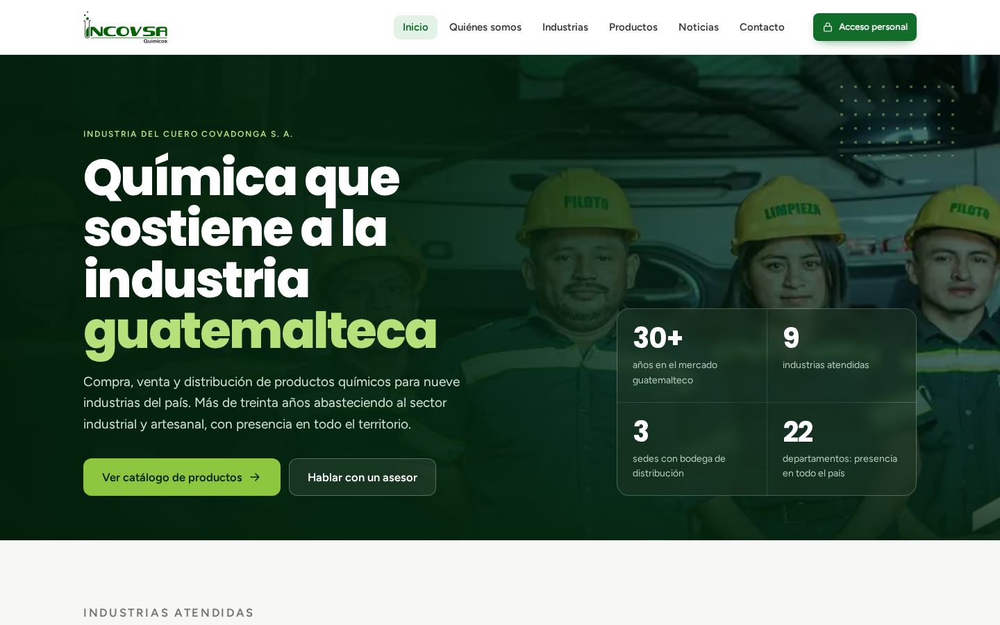{#fig:proto-inicio}

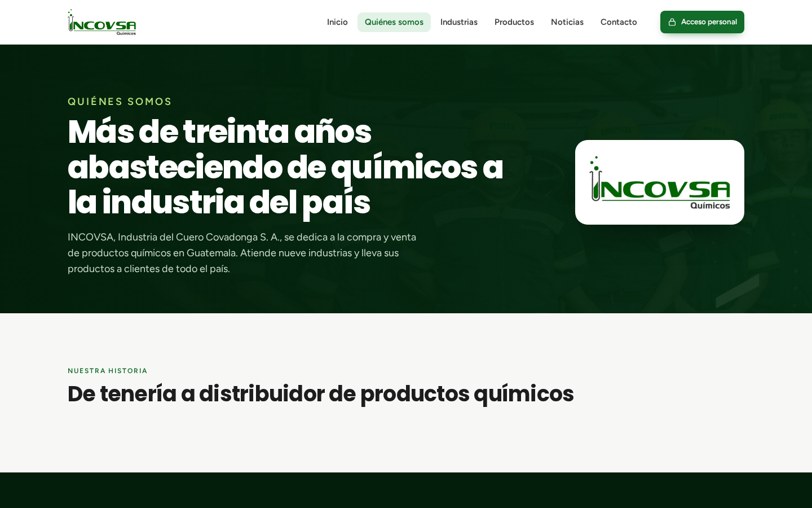{#fig:proto-nosotros}

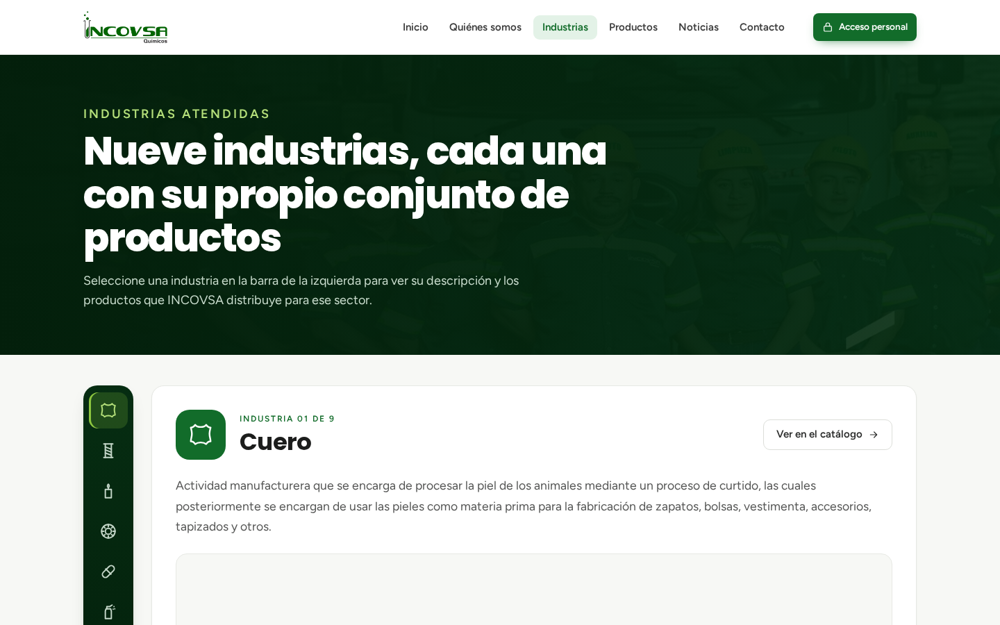{#fig:proto-industrias}

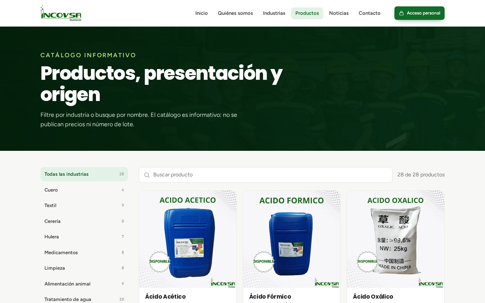{#fig:proto-catalogo}

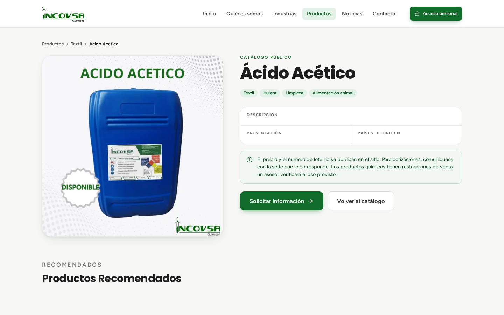{#fig:proto-detalle}

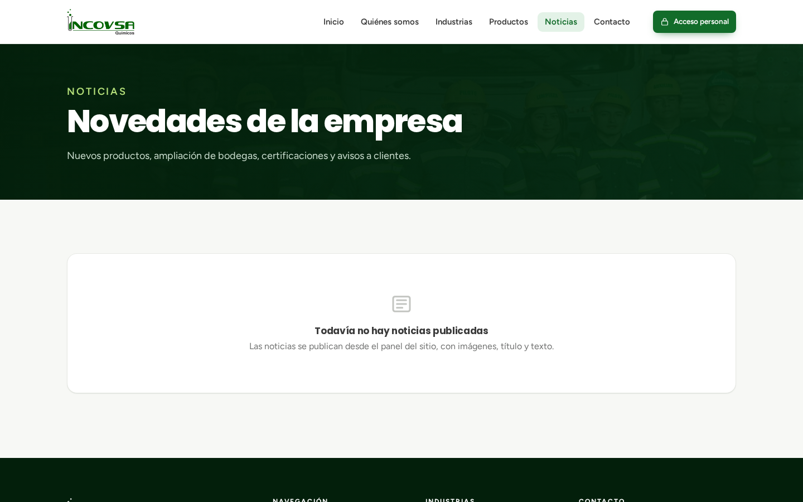{#fig:proto-noticias}

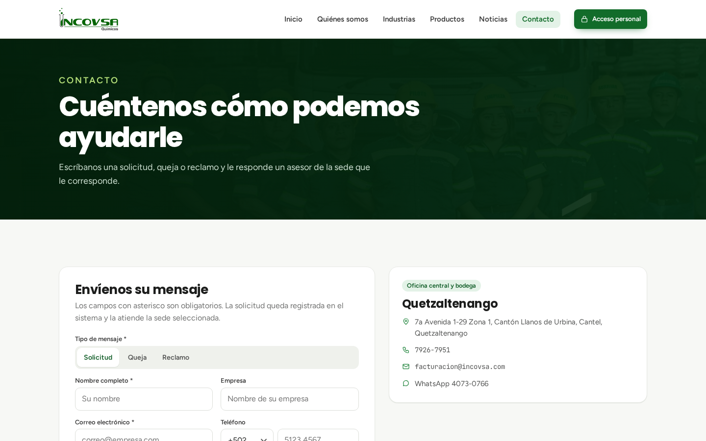{#fig:proto-contacto}

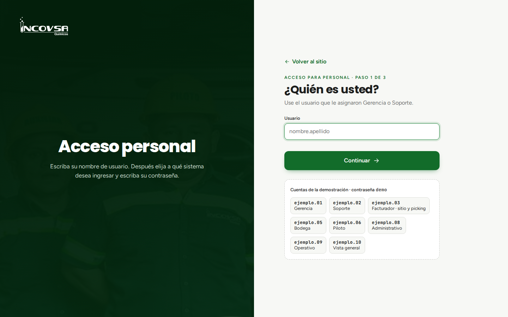{#fig:proto-acceso}

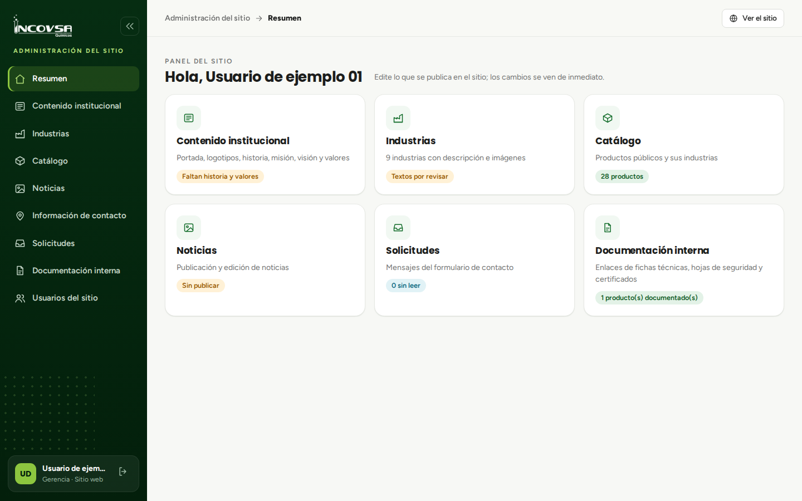{#fig:proto-panel}

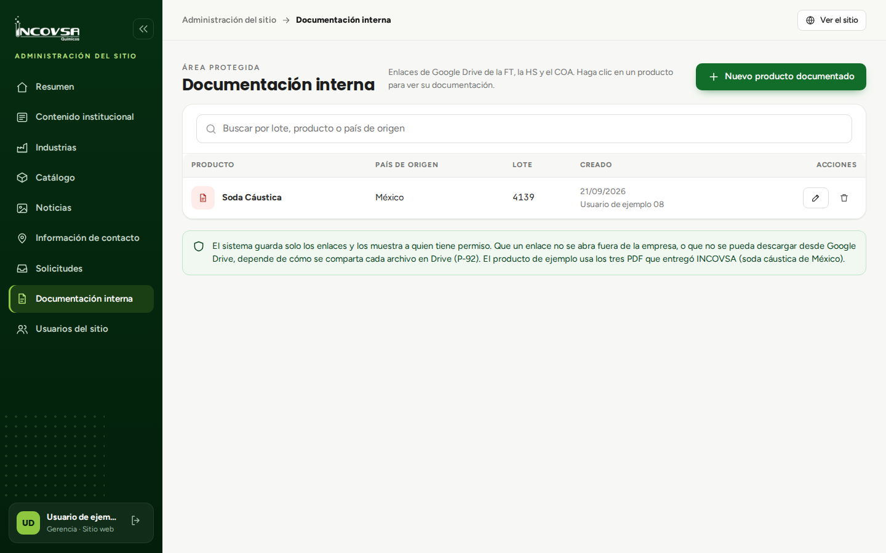{#fig:proto-documentos}

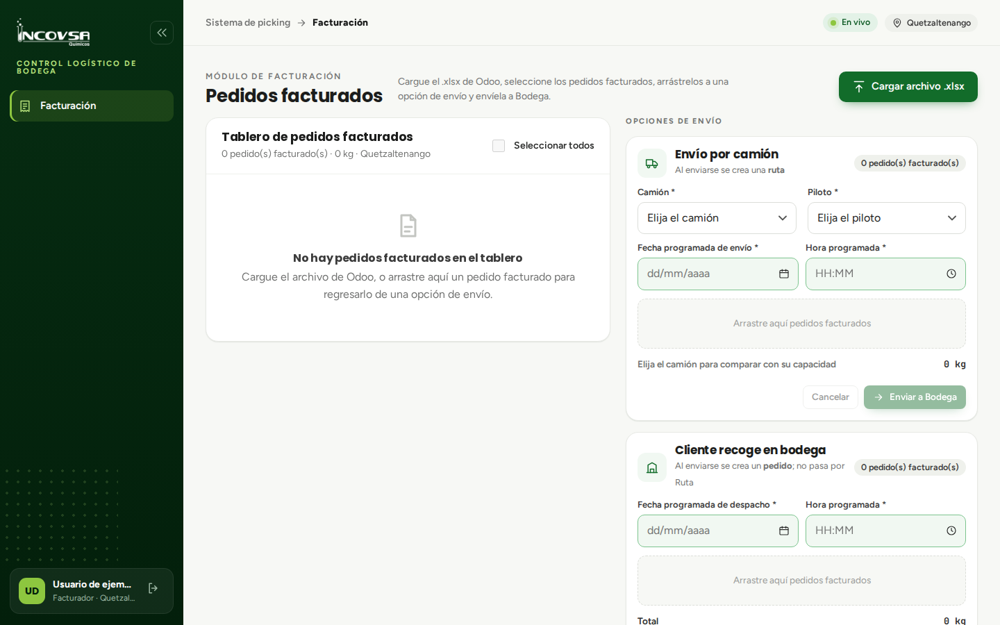{#fig:proto-facturacion}

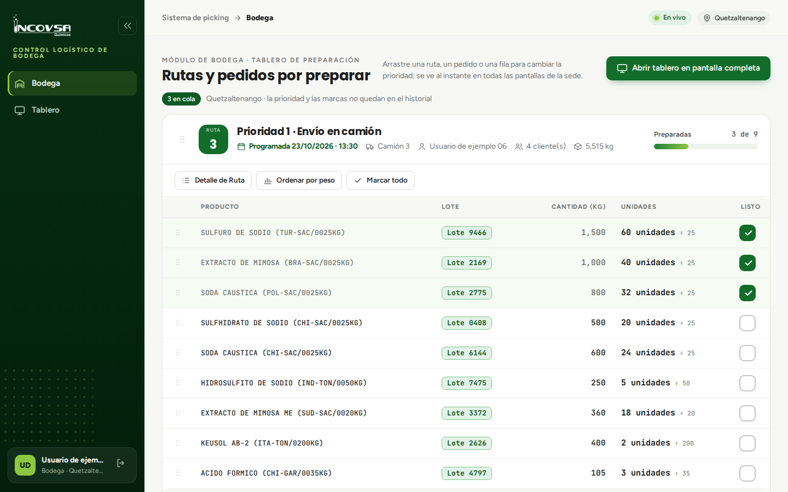{#fig:proto-bodega}

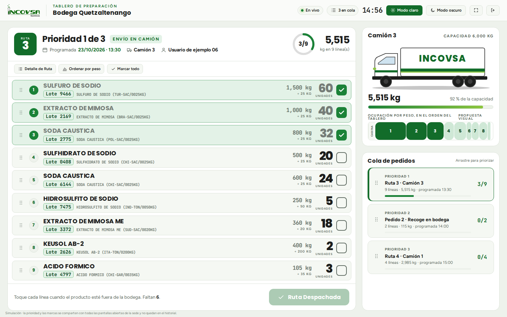{#fig:proto-tablero}

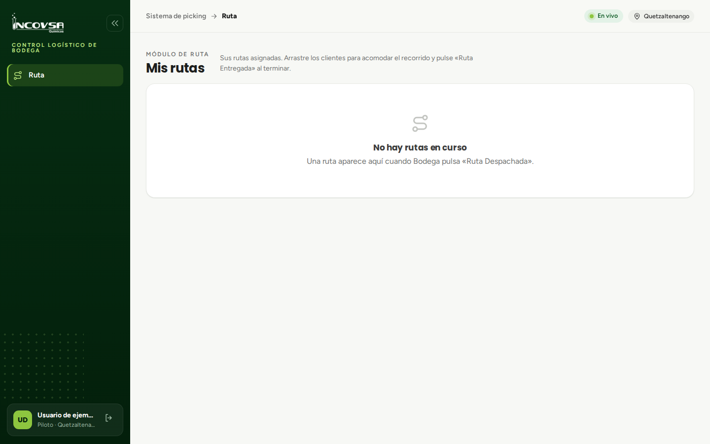{#fig:proto-ruta}

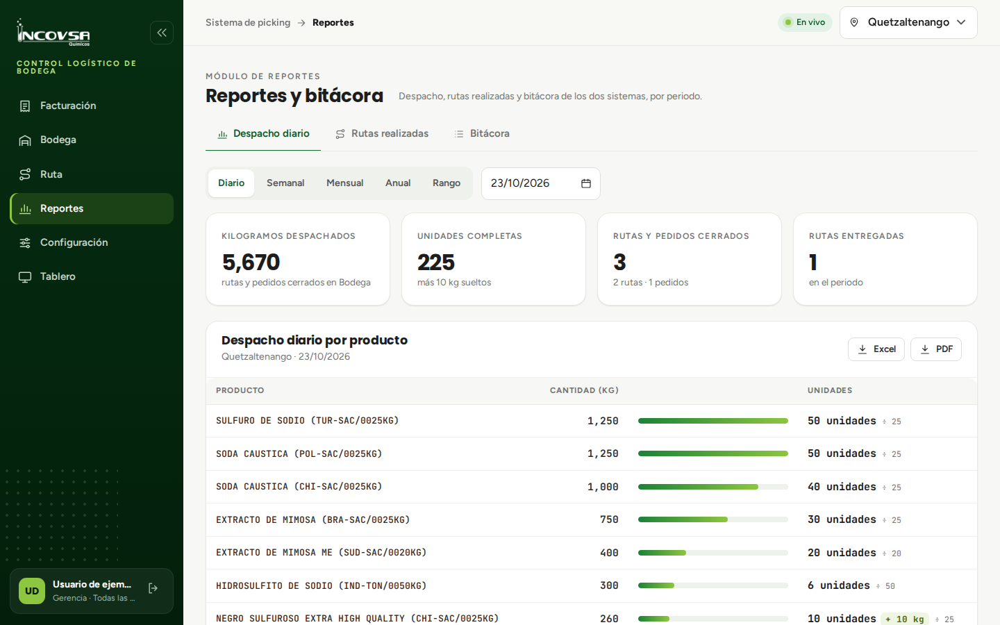{#fig:proto-reportes}

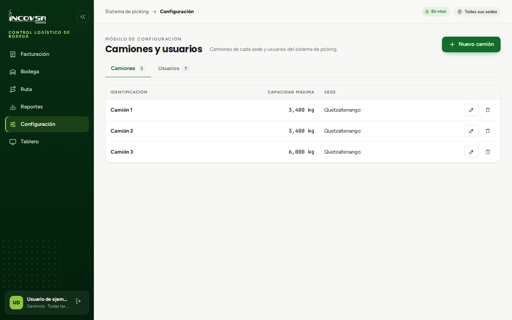{#fig:proto-configuracion}
