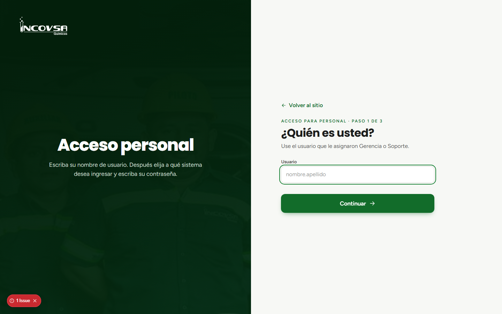
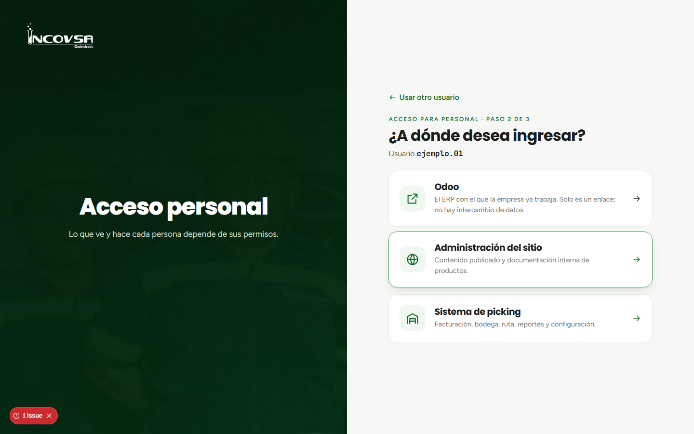
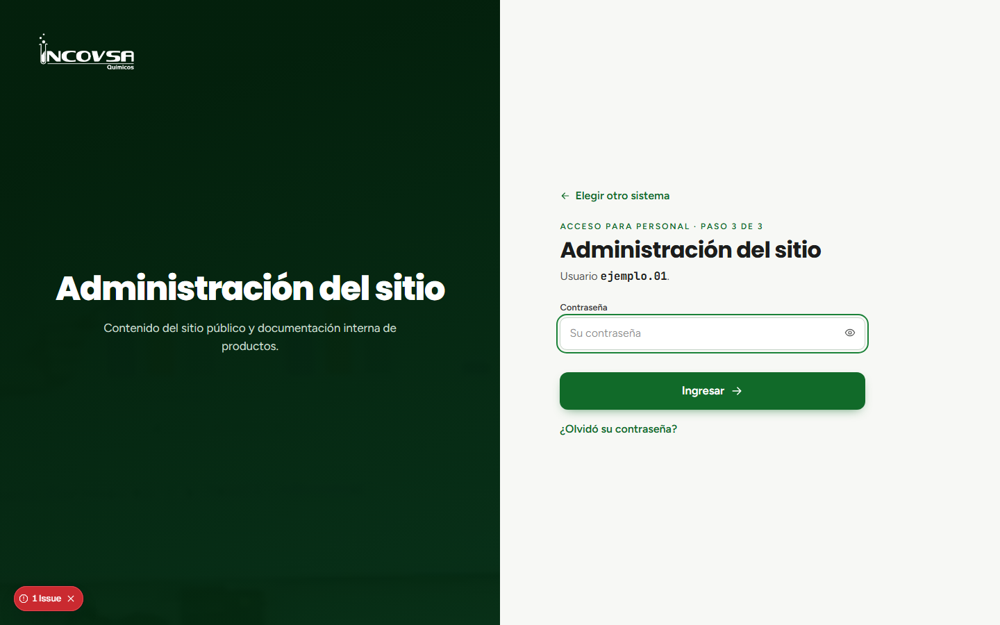

# Acceso personal

## Ingreso a la administración del sitio

### Objetivo
Entrar al panel administrativo con la cuenta personal que Gerencia o Soporte habilitó para la administración del sitio.

### Requisitos previos
- Tener una cuenta activa de la administración del sitio.
- Conocer el nombre de usuario y la contraseña de esa cuenta.
- Tener conexión a Internet y un navegador actualizado.

### Pasos
1. Abra el sitio institucional de INCOVSA.
2. Seleccione **Acceso personal**.
3. En la pantalla de identificación, escriba su **nombre de usuario** y seleccione **Continuar**. El sistema comprueba si la cuenta existe.
4. Seleccione **Administración del sitio** entre los sistemas disponibles. Si no aparece, solicite a Gerencia o Soporte que revise su cuenta.
5. Escriba la contraseña de la administración del sitio y presione **Ingresar**.
6. Al entrar, use únicamente las secciones que aparecen en el menú; dependen de los permisos asignados a su cuenta.

{#fig:acceso-usuario}

{#fig:acceso-sistema}

{#fig:acceso-contrasena}

### Resultado esperado
Se abre el panel del sitio y muestra las opciones autorizadas para su usuario.

> **Advertencia:** El acceso al sitio y el acceso al picking son sesiones separadas. Seleccione Administración del sitio para administrar contenido web. No comparta su contraseña.
