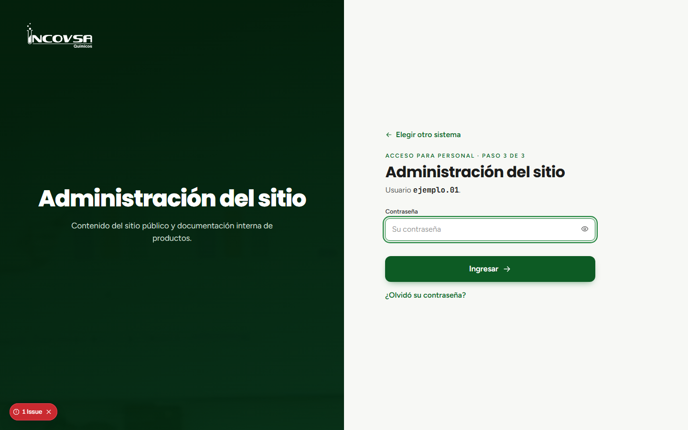

# Recuperación de contraseña

## Solicitar el restablecimiento

### Objetivo
Recuperar el acceso al panel cuando no recuerde su contraseña.

### Requisitos previos
- Poder identificar la cuenta cuyo acceso necesita recuperar.
- Contactar a una persona autorizada de **Gerencia o Soporte**.

### Pasos
1. En la pantalla de contraseña, no continúe probando claves si no recuerda la correcta.
2. Solicite a Gerencia o Soporte que restablezca la contraseña de su cuenta de **Administración del sitio**.
3. La persona autorizada actualizará la contraseña desde la administración de usuarios.
4. Reciba la contraseña nueva directamente de esa persona por el canal que INCOVSA indique.
5. Vuelva a **Acceso personal**, escriba su usuario, elija Administración del sitio e ingrese la nueva contraseña.

{#fig:recuperacion-contrasena}

### Resultado esperado
La nueva contraseña permite entrar al panel según los permisos vigentes de la cuenta.

> **Advertencia:** No existe recuperación por correo. Gerencia o Soporte restablecen la clave manualmente; el sistema no la envía por correo electrónico.
