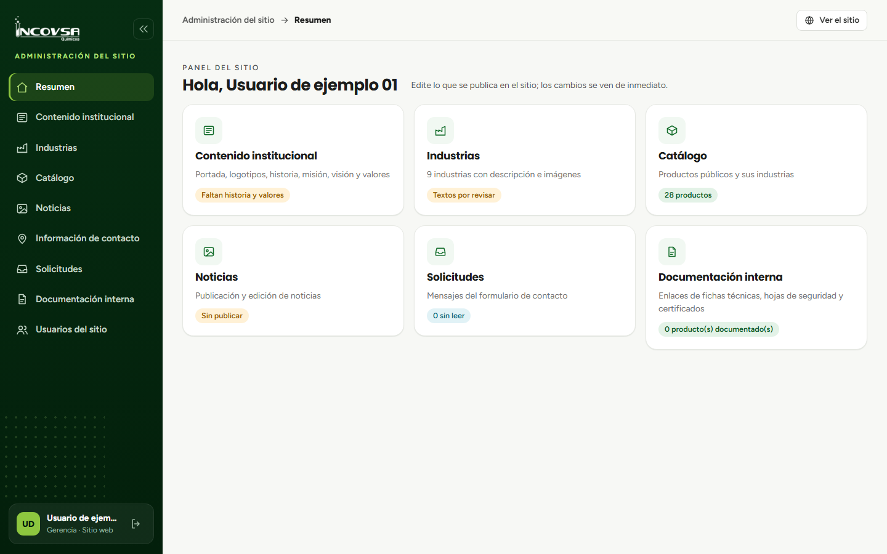

# Conociendo el panel

## Elementos principales

### Objetivo
Ubicar las áreas de navegación y comprender cómo se organiza la administración del sitio.

### Requisitos previos
- Haber iniciado sesión en la administración del sitio.

### Pasos
1. Observe el menú lateral izquierdo: muestra las secciones disponibles para su usuario.
2. Seleccione una sección para abrir su contenido.
3. Use el botón de reducir menú para dejarlo en íconos y ampliar el espacio de trabajo; vuelva a pulsarlo para expandirlo.
4. En la barra superior, use **Ver el sitio** para abrir la parte pública.
5. En teléfonos y tabletas, abra el menú con el botón **Menú**.
6. Consulte **Resumen** para ver accesos y el estado general de las secciones a las que tiene permiso.

{#fig:panel-principal}

### Resultado esperado
Puede reconocer la sección activa y navegar por las áreas autorizadas.

> **Advertencia:** Si una opción no aparece, su cuenta probablemente no tiene el permiso correspondiente. Solicite a Gerencia o Soporte que lo revise.
