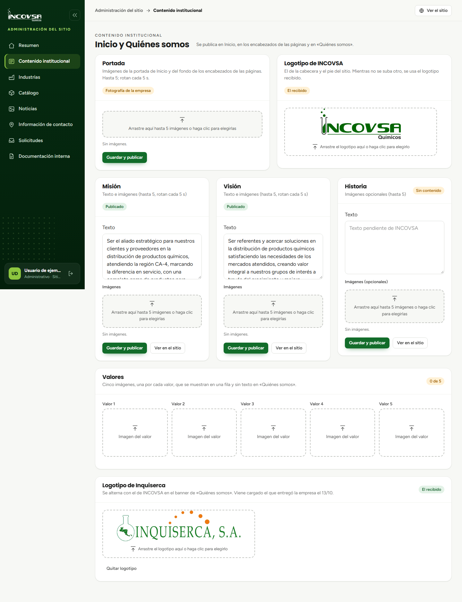

# Información institucional

## Editar los datos que identifican a INCOVSA

### Objetivo
Actualizar los textos e imágenes institucionales publicados en Inicio y Quiénes somos.

### Requisitos previos
- Permiso para editar contenido institucional.
- Textos e imágenes revisados y aprobados por INCOVSA.

### Pasos
1. En el menú, abra **Contenido institucional**.
2. Revise los bloques disponibles: Portada, Logotipo de INCOVSA, Misión, Visión, Historia, Valores y Logotipo de Inquiserca.
3. Seleccione el campo que desea cambiar y escriba o cargue el contenido aprobado.
4. Pulse **Guardar y publicar** cuando la sección lo indique.
5. Use **Ver en el sitio** para abrir la página relacionada y comprobar el resultado.

{#fig:contenido-institucional}

### Resultado esperado
El contenido guardado se muestra en las páginas públicas que utilizan ese bloque.

> **Advertencia:** No escriba información no confirmada por la empresa. Los textos extensos tienen un límite de 10 000 caracteres.
