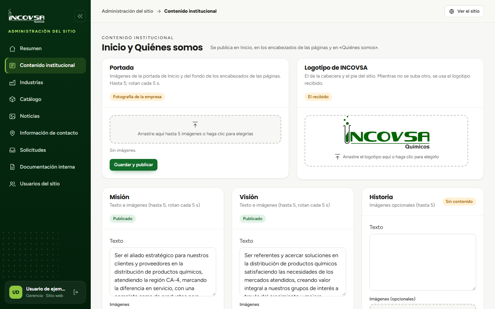

# Historia, misión, visión y valores

## Edición de los bloques de Quiénes somos

### Objetivo
Mantener actualizadas las secciones institucionales de Quiénes somos.

### Requisitos previos
- Permiso para editar contenido institucional.
- Texto validado por INCOVSA y, si corresponde, imágenes preparadas.

### Pasos
1. Abra **Contenido institucional** desde el menú.
2. Localice **Historia**, **Misión** o **Visión**.
3. Edite el campo **Texto** y agregue imágenes si están aprobadas.
4. Pulse **Guardar y publicar** en el bloque actualizado.
5. Para los valores, cargue una imagen en cada una de las cinco posiciones. No se agrega texto: la página pública muestra cinco imágenes.
6. Abra **Quiénes somos** en el sitio para revisar los cambios.

{#fig:textos-institucionales}

### Resultado esperado
El sitio presenta los textos publicados y, donde se hayan cargado, sus imágenes.

> **Advertencia:** Las imágenes de valores no llevan texto en el sitio. No cambie los textos por contenido de ejemplo.
