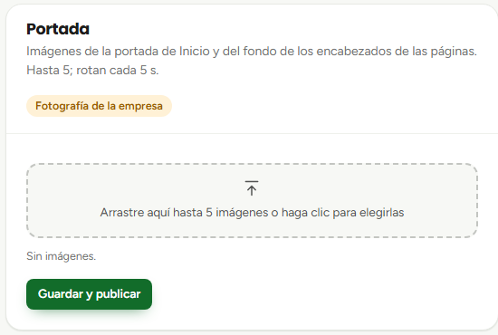

# Imágenes del sitio

## Cargar, ordenar o retirar imágenes

### Objetivo
Administrar imágenes de las galerías del sitio usando archivos compatibles.

### Requisitos previos
- Permiso de edición para la sección correspondiente.
- Imágenes aprobadas por INCOVSA en formato JPG, PNG o WebP, de hasta 5 MB cada una.

### Pasos
1. Abra la sección que contiene la galería.
2. Seleccione el área que indica **Arrastre aquí hasta 5 imágenes o haga clic para elegirlas**, o arrastre las imágenes desde su computadora.
3. Compruebe la vista previa y el orden de las imágenes.
4. Use las flechas de la miniatura para cambiar el orden; use el botón con icono de papelera, **Quitar la imagen N**, para retirarla.
5. En las galerías de Portada, Misión, Visión e Historia, seleccione **Guardar y publicar**. En Industrias, Catálogo y Noticias, use el botón de guardado de esa sección.
6. Compruebe la página pública después de guardar.

{#fig:galeria-imagenes}

### Resultado esperado
La galería guarda hasta cinco imágenes y el sitio muestra las imágenes guardadas.

> **Advertencia:** No cargue archivos mayores de 5 MB ni otros formatos. Las imágenes se procesan en el servidor y se convierten a WebP.
