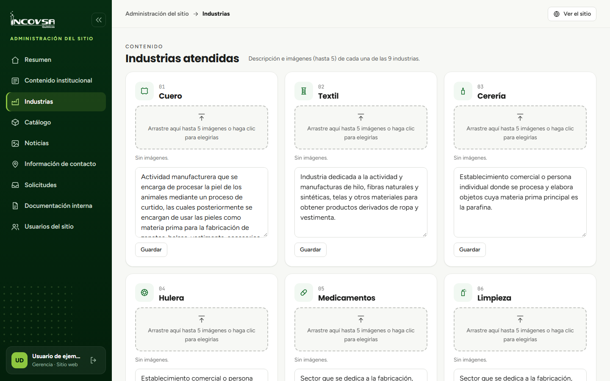

# Industrias atendidas

## Editar descripción e imágenes

### Objetivo
Mantener la descripción y la galería de cada industria que aparece en el sitio.

### Requisitos previos
- Permiso para editar Industrias.
- Descripción e imágenes aprobadas para publicación.

### Pasos
1. En el panel, abra **Industrias**.
2. Localice la tarjeta de la industria que desea actualizar.
3. Edite su descripción.
4. Agregue, quite o reordene hasta cinco imágenes en su galería.
5. Seleccione **Guardar** en esa tarjeta.
6. Abra la página pública de la industria y verifique el texto y la galería.

{#fig:industrias-panel}

### Resultado esperado
La descripción y las imágenes se publican en la página de la industria seleccionada.

> **Advertencia:** El catálogo público determina qué productos aparecen relacionados con cada industria. No agregue productos desde esta pantalla.
