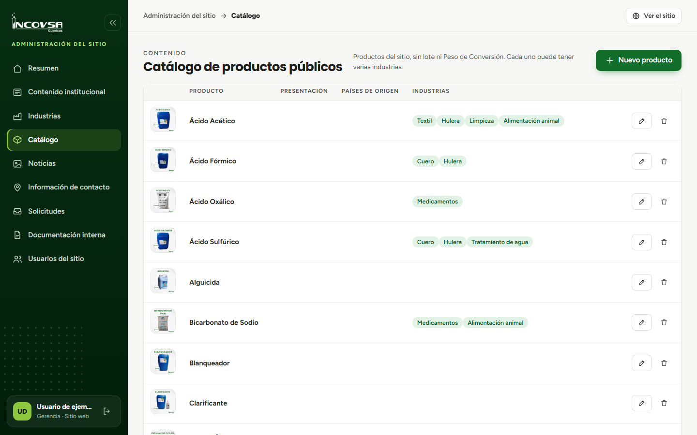

# Productos informativos

## Crear o actualizar un producto público

### Objetivo
Administrar los productos que se muestran en el catálogo informativo del sitio.

### Requisitos previos
- Permiso para crear, editar y eliminar productos públicos.
- Nombre, descripción, presentación, países de origen, imágenes e industrias confirmados.

### Pasos
1. Abra **Catálogo** en el panel.
2. Para crear, seleccione **Nuevo producto**; para cambiar uno, seleccione **Editar** en su tarjeta.
3. Complete o actualice el nombre, la descripción, la presentación y los países de origen.
4. Asigne una o varias industrias y agregue hasta cinco imágenes.
5. Seleccione **Guardar**.
6. Abra el producto en el sitio y compruebe su detalle y las industrias relacionadas.

{#fig:catalogo-productos}

### Resultado esperado
El producto aparece en el catálogo público y en las industrias que se le asignaron.

> **Advertencia:** El catálogo es informativo. No muestra precios ni lotes y no vende productos en línea. Para documentos técnicos use Documentación interna.
