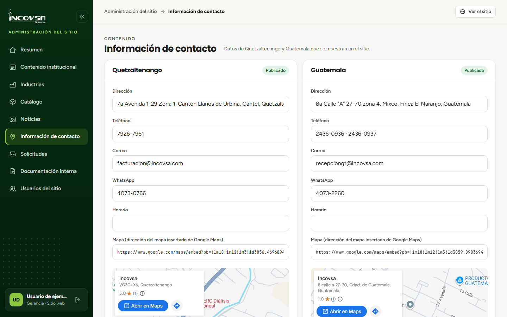

# Información de contacto

## Actualizar datos de las sedes

### Objetivo
Mantener vigentes los datos de contacto que el público consulta en el sitio.

### Requisitos previos
- Permiso para editar Información de contacto.
- Datos aprobados de las sedes Quetzaltenango y Guatemala.

### Pasos
1. Abra **Información de contacto** desde el menú del panel.
2. Elija los datos de la sede que debe actualizar.
3. Revise y edite dirección, teléfono, correo, WhatsApp, horario o ubicación del mapa, según los campos disponibles.
4. Compruebe que el correo tenga una estructura válida si escribe uno; el campo puede quedar vacío.
5. Seleccione **Guardar**.
6. Abra la página **Contacto** y confirme que el dato aparece correctamente.

{#fig:contacto-panel}

### Resultado esperado
El sitio público muestra los datos guardados de las sedes.

> **Advertencia:** El sitio presenta Quetzaltenango y Guatemala. No agregue datos de Escuintla.
