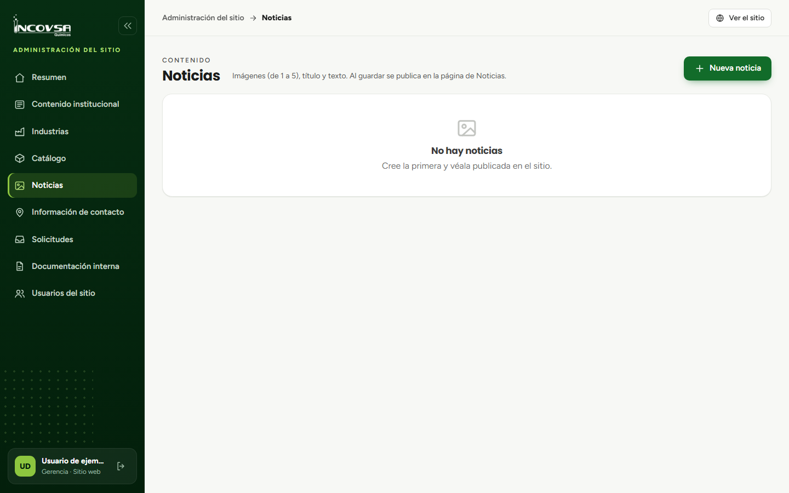

# Noticias

## Crear, editar o eliminar una noticia

### Objetivo
Publicar noticias institucionales con su texto e imágenes.

### Requisitos previos
- Permiso para crear, editar y eliminar noticias.
- Título, texto e imágenes autorizados para publicación.

### Pasos
1. Abra **Noticias** en el panel.
2. Seleccione **Nueva noticia** para crearla, o **Editar** en la noticia existente.
3. Escriba el título y el texto, y agregue hasta cinco imágenes.
4. Seleccione **Guardar**. La noticia se publica al guardarse.
5. Compruebe la página pública **Noticias**.
6. Para retirar una noticia, seleccione **Eliminar** y confirme la acción.

{#fig:noticias-panel}

### Resultado esperado
La noticia guardada aparece públicamente; la eliminada deja de aparecer.

> **Advertencia:** No hay un estado para ocultar noticias. Toda noticia guardada se publica y para retirarla hay que eliminarla.
