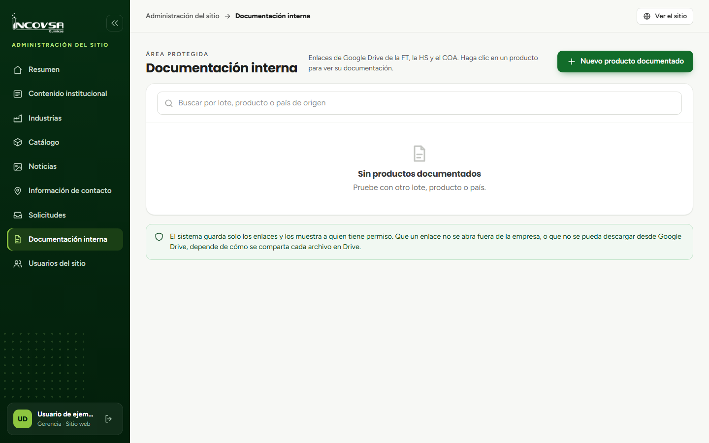

# Documentos internos

## Consultar la documentación técnica

### Objetivo
Encontrar los documentos técnicos que correspondan a un producto y abrirlos según los permisos de su cuenta.

### Requisitos previos
- Haber iniciado sesión en el panel.
- Tener permiso para ver documentos en el navegador o descargarlos.

### Pasos
1. Abra **Documentación interna**.
2. Busque por nombre del producto, país de origen o lote.
3. Seleccione la fila del producto documentado.
4. En la ventana, elija **Ver** para abrir la vista previa o **Descargar** si su permiso permite la descarga.

{#fig:documentacion-interna}

### Resultado esperado
Puede abrir únicamente las opciones permitidas por los permisos de su cuenta.

> **Advertencia:** Los archivos están alojados en Google Drive. La posibilidad de acceso fuera del sistema depende también de cómo INCOVSA comparta cada archivo.
