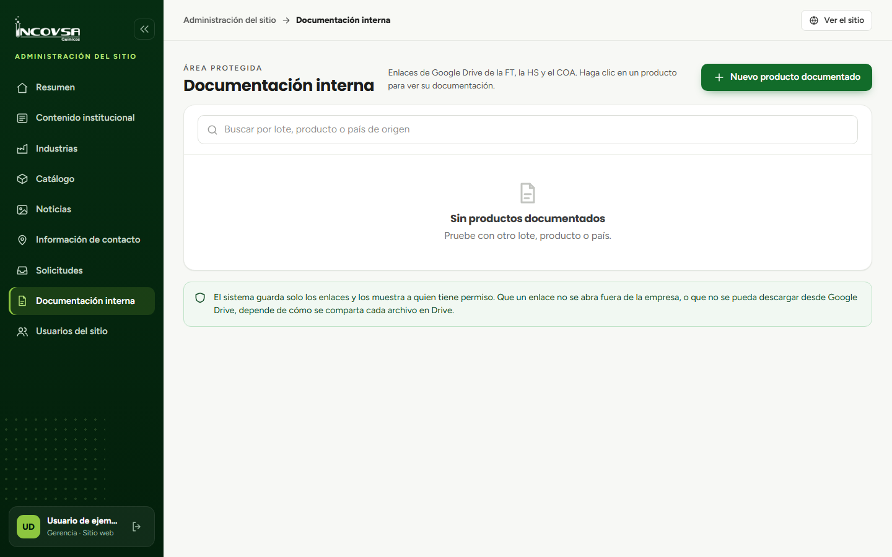

# Cargar fichas técnicas, hojas de seguridad y certificados

## Registrar enlaces de Google Drive

### Objetivo
Asociar la ficha técnica, la hoja de seguridad y el certificado de análisis de un producto documentado.

### Requisitos previos
- Permiso para crear, editar y eliminar productos documentados.
- Producto, país de origen, lote y enlaces compartidos según las reglas de INCOVSA.

### Pasos
1. En Documentación interna, seleccione **Nuevo producto documentado**.
2. Escriba el nombre del producto, seleccione su país de origen e indique el lote.
3. Pegue, en los campos correspondientes, los enlaces de Google Drive para ficha técnica, hoja de seguridad y certificado de análisis. Los enlaces son opcionales.
4. Revise los datos y seleccione **Guardar**.
5. Abra la fila creada para comprobar que se muestra cada documento disponible.

{#fig:producto-documentado}

## Compartir documentos de forma restringida en Google Drive

### Requisitos previos
- Acceso autorizado al archivo en la cuenta de Google Drive administrada por INCOVSA.
- Dirección de las cuentas de INCOVSA que deben consultar el documento.

### Pasos
1. En Google Drive, seleccione el archivo y abra **Compartir**.
2. En **Acceso general**, seleccione **Restringido**.
3. Agregue únicamente las cuentas de INCOVSA que deban acceder y asigne el nivel de acceso aprobado por la empresa.
4. Abra la configuración del uso compartido y desmarque **Los lectores y comentaristas pueden ver la opción para descargar, imprimir y copiar**. Esta opción se aplica a cada archivo y puede no estar disponible si la política de Google Workspace lo impide.
5. Guarde los cambios y pruebe el enlace con una cuenta autorizada.
6. Copie el enlace y regístrelo en el campo del documento correspondiente en el panel.

### Resultado esperado
El producto documentado contiene los enlaces correctos y el archivo de Drive queda limitado a las cuentas autorizadas por INCOVSA.

> **Advertencia:** El permiso del panel y el permiso de Google Drive son controles distintos. Revise también el acceso de la carpeta que contiene el archivo: sus permisos pueden conceder acceso heredado. Google puede limitar las opciones según la cuenta de Workspace. La restricción de descarga evita las opciones de copiar, imprimir y descargar en Drive; no impide que alguien comparta el contenido por otros medios.

Para ampliar los pasos, consulte [Ayuda de Google Drive: compartir archivos y administrar el acceso](https://support.google.com/drive/answer/7166529?hl=es) y [Ayuda de Google Drive: detener, limitar o cambiar el uso compartido](https://support.google.com/drive/answer/2494893?hl=es).
