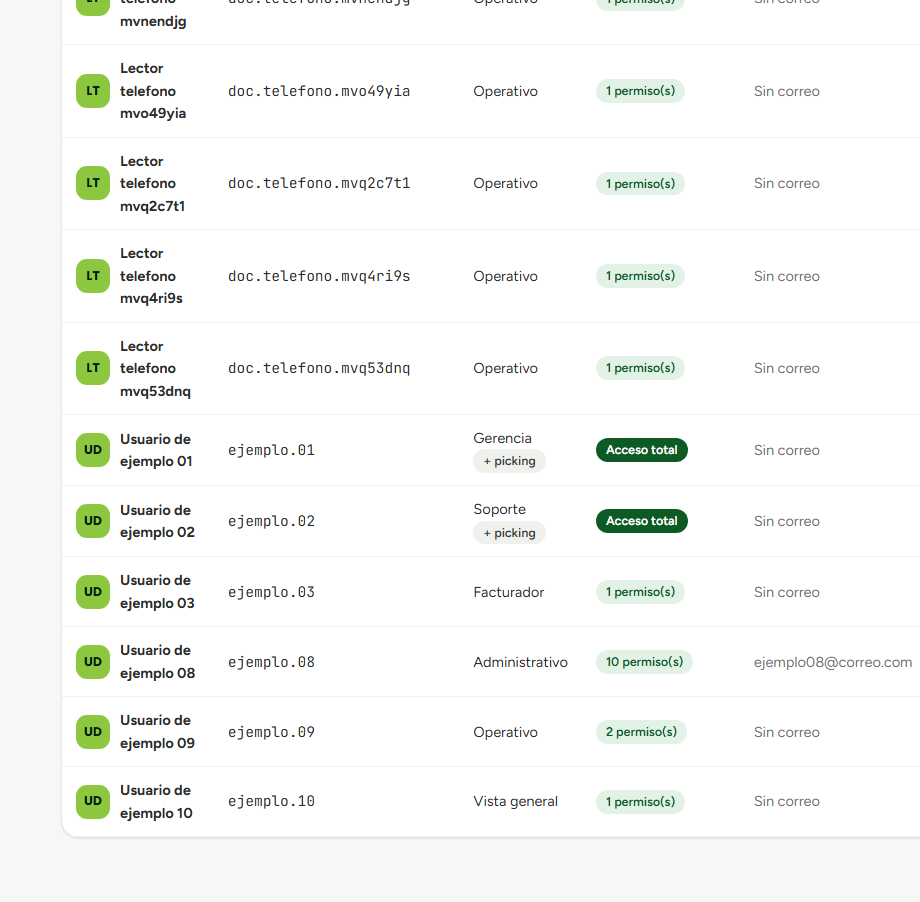

# Acceso al contenido restringido

## Comprender los permisos del sitio

### Objetivo
Reconocer por qué algunas secciones o acciones están disponibles solo para ciertas cuentas.

### Requisitos previos
- Cuenta activa en la administración del sitio.
- Conocer a quién acudir para solicitar un acceso.

### Pasos
1. Entre al panel y observe qué módulos aparecen en su menú.
2. Para consultar documentos, su cuenta necesita el permiso de ver documentos.
3. Para descargar documentos, necesita además el permiso de descarga.
4. Para crear, editar o eliminar productos documentados, necesita el permiso de administración de documentos.
5. Para otras áreas, Gerencia o Soporte asignan el permiso específico de Contenido institucional, Industrias, Catálogo, Noticias, Información de contacto o Solicitudes.
6. Si necesita otro acceso, indique a Gerencia o Soporte su nombre de usuario y la tarea que debe realizar.

{#fig:permisos-panel}

### Resultado esperado
La cuenta muestra las secciones que tiene autorizadas y las operaciones permitidas en cada sección.

> **Advertencia:** Un rol distinto de Gerencia o Soporte no concede acceso por sí solo; se asignan permisos específicos. No use la cuenta de otra persona.
