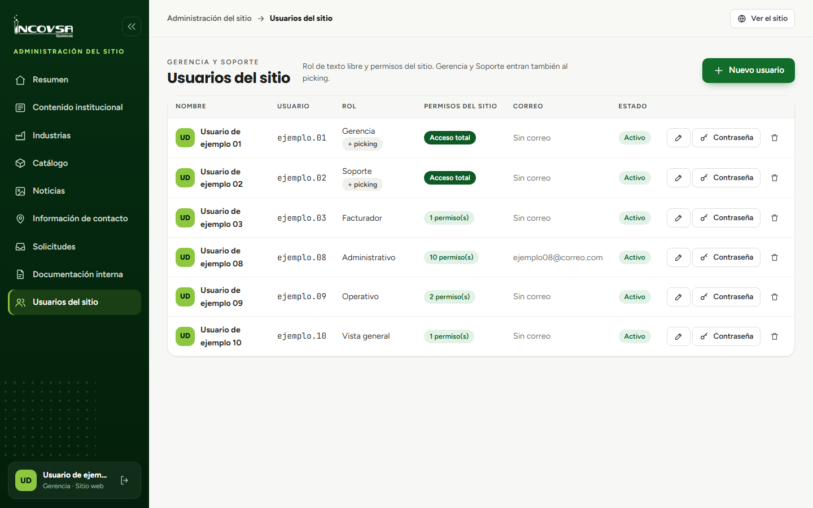

# Administración de usuarios

## Crear y actualizar una cuenta

### Objetivo
Solicitar la creación, modificación o desactivación de una cuenta del sitio.

### Requisitos previos
- Tener rol de **Gerencia** o **Soporte**.
- Contar con el nombre, usuario, rol y permisos que necesita la persona.

### Pasos
1. Abra **Usuarios del sitio** en el menú.
2. Para crear una cuenta, seleccione **Nuevo usuario**. Para cambiar una existente, seleccione el botón de edición de su fila.
3. Escriba el nombre completo, nombre de usuario y rol. Al crear la cuenta, también escriba y confirme la contraseña inicial.
4. Marque las casillas de los permisos que necesita la persona. Asigne solo los necesarios para su trabajo.
5. Seleccione **Guardar** y confirme que la cuenta aparezca como activa.
6. Entregue el usuario y contraseña inicial directamente a la persona por el canal aprobado por INCOVSA.
7. Para restablecer una contraseña, use el botón **Contraseña** de la fila y escriba una nueva.
8. Para retirar una cuenta, seleccione el control de eliminación y confirme.

{#fig:usuarios-sitio}

### Resultado esperado
La cuenta queda configurada con el acceso necesario para las tareas asignadas.

> **Advertencia:** Solo Gerencia y Soporte administran usuarios. Los permisos se asignan mediante casillas; un rol distinto de Gerencia o Soporte no concede acceso por sí solo. No comparta cuentas ni contraseñas.
