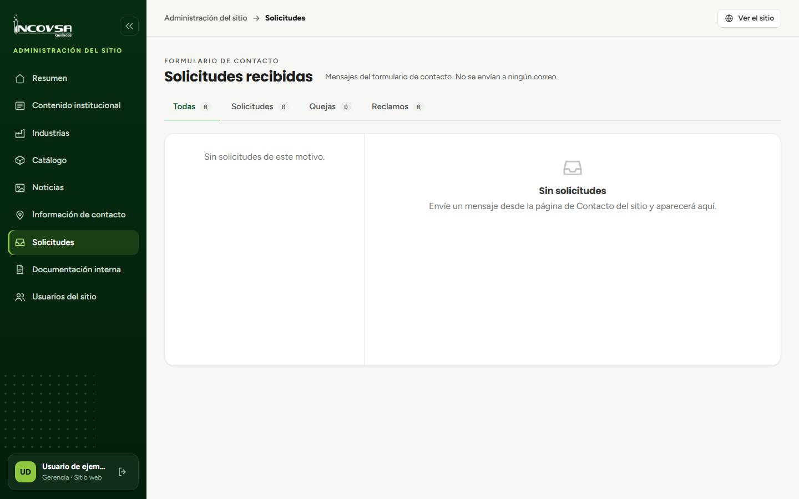

# Consultas y solicitudes recibidas

## Consultar y dar seguimiento a mensajes de Contacto

### Objetivo
Revisar los mensajes que llegan por el formulario público y dar seguimiento según las responsabilidades de INCOVSA.

### Requisitos previos
- Permiso para ver la bandeja de Solicitudes.
- Permiso de gestión si se asignará responsable, comentario o estado.

### Pasos
1. Abra **Solicitudes** en el panel.
2. Seleccione el motivo: Solicitud, Queja o Reclamo.
3. Abra un registro y lea el mensaje completo.
4. Si tiene permiso de gestión, seleccione el responsable y guarde el comentario correspondiente.
5. Use los botones **Asignado**, **En proceso** o **Solucionado** para registrar el estado.
6. Verifique que el cambio se muestre en la solicitud.

{#fig:solicitudes}

### Resultado esperado
El mensaje queda visible en la bandeja con el responsable, comentario y estado que se guardaron.

> **Advertencia:** El sistema no envía el mensaje ni notificaciones por correo. La coordinación con el responsable se realiza por los canales internos de INCOVSA.
