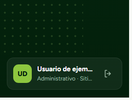

# Cerrar sesión

## Salir de forma segura

### Objetivo
Finalizar la sesión de administración del sitio al terminar el trabajo.

### Requisitos previos
- Haber iniciado sesión en el panel.

### Pasos
1. Localice su nombre y el control de salida en la parte inferior del menú lateral.
2. Seleccione **Cerrar sesión**.
3. Compruebe que el sitio vuelve a la página de inicio.
4. Si utilizó un equipo compartido, cierre también la ventana del navegador cuando sea apropiado.

{#fig:cerrar-sesion}

### Resultado esperado
La sesión de administración se cierra y aparece el sitio público.

> **Advertencia:** Cerrar sesión en la administración del sitio no cierra la sesión del sistema de picking.
