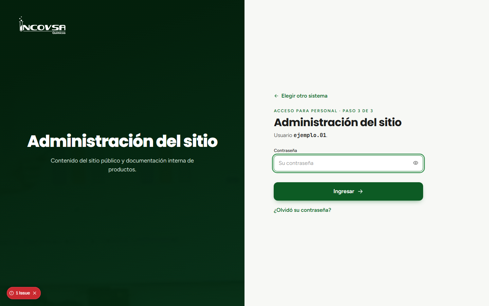

# Problemas frecuentes

## Soluciones iniciales

### Objetivo
Resolver consultas comunes de acceso y administración sin cambiar datos no autorizados.

### Requisitos previos
- Tener conexión a Internet y acceso al sitio.

### Pasos
1. **No puedo ingresar:** compruebe el nombre de usuario, confirme que eligió Administración del sitio y vuelva a escribir la contraseña.
2. **Olvidé la contraseña:** solicite el restablecimiento a Gerencia o Soporte; no hay recuperación por correo.
3. **No aparece una sección:** pida a Gerencia o Soporte que revise los permisos asignados a su cuenta.
4. **No se acepta una imagen:** compruebe que sea JPG, PNG o WebP y que no exceda 5 MB.
5. **No se guarda un texto largo:** revise que no supere 10 000 caracteres; el formulario indica el límite.
6. **No puedo abrir un documento:** confirme que tiene permiso en el panel y que la cuenta de Google Drive está autorizada por INCOVSA.
7. **No se refleja un cambio:** vuelva a cargar la página pública y compruebe que guardó el bloque correcto.
8. Si persiste el problema, comuníquese con Gerencia o Soporte e indique la sección y el mensaje que aparece. No envíe contraseñas.

{#fig:problemas}

### Resultado esperado
La persona identifica una comprobación inicial segura o sabe a quién escalar el problema.

> **Advertencia:** No incluya contraseñas, enlaces privados ni datos personales en una captura o mensaje de soporte.
