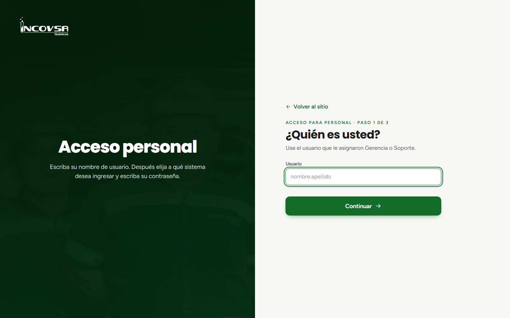
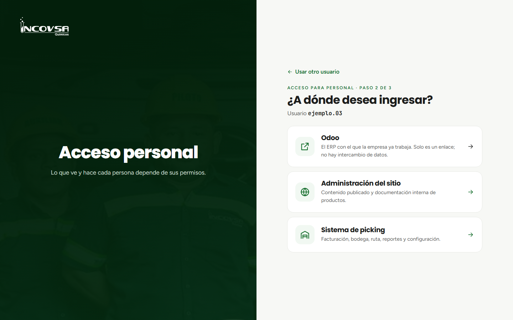
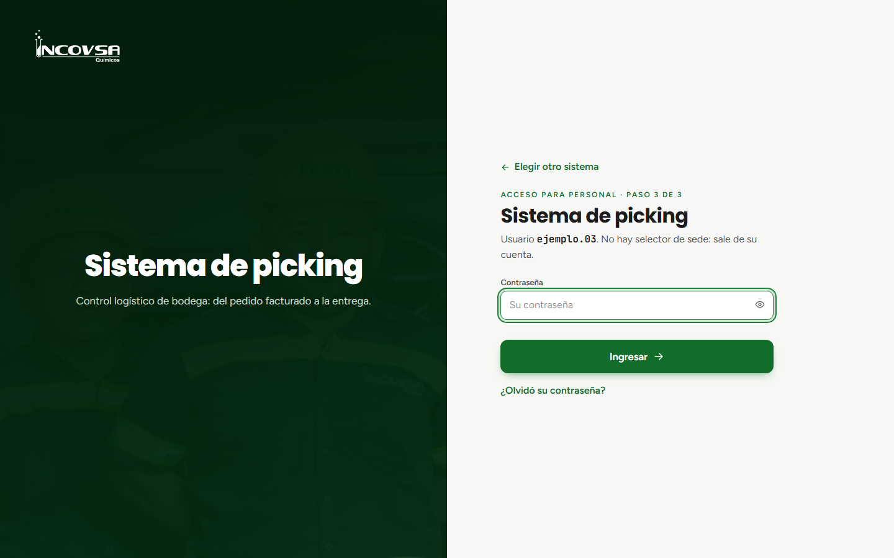

# Acceso al sistema logístico

## Procedimiento de ingreso

### Objetivo
Permitir que el personal operativo, administrativo y de transporte de INCOVSA acceda de manera segura e individual al sistema de control logístico de bodega (picking) utilizando sus credenciales autorizadas.

### Requisitos previos
- Disponer de una cuenta activa en el sistema de picking creada previamente por Gerencia o Soporte.
- Contar con un navegador web moderno (Google Chrome, Microsoft Edge, Mozilla Firefox o Safari) y conexión a la red de la empresa o datos móviles.
- Conocer su nombre de usuario y su contraseña personal.

### Pasos para iniciar sesión

1. Ingrese a la dirección web institucional de INCOVSA desde su computadora, tableta o teléfono móvil.
2. En la barra superior del sitio web, haga clic en el botón **Acceso personal**.
3. **Paso 1 (Identificación):** en la pantalla inicial se le solicitará su nombre de usuario. Escriba su usuario asignado (por ejemplo, `ejemplo.03`) en el campo correspondiente y presione el botón **Continuar** (véase la {{fig:acceso-usuario}}).

{#fig:acceso-usuario}

4. **Paso 2 (Selección del sistema):** el sistema comprobará la existencia de su usuario y mostrará las opciones disponibles a las que tiene autorización. Seleccione la tarjeta denominada **Sistema de picking** (véase la {{fig:acceso-sistemas}}).

{#fig:acceso-sistemas}

5. **Paso 3 (Autenticación):** escriba su contraseña en el campo de texto y presione el botón **Ingresar** (véase la {{fig:acceso-contrasena}}).

{#fig:acceso-contrasena}

6. Si las credenciales son correctas, el sistema cargará de inmediato el entorno de trabajo del sistema logístico.

### Pasos para cerrar sesión

1. Al concluir su jornada laboral o abandonar su equipo de trabajo, diríjase a la esquina superior derecha de la pantalla.
2. Haga clic sobre su nombre o el ícono de su cuenta para desplegar el menú de usuario.
3. Seleccione la opción **Cerrar sesión**. El sistema cerrará su sesión de forma segura y lo redirigirá a la página principal del sitio web público.

### Resultado esperado
El usuario ingresa al sistema logístico visualizando únicamente los módulos y las sedes para las cuales cuenta con permisos asignados.

> **Advertencia:** Por motivos de seguridad, nunca comparta su contraseña con otros compañeros. Si introduce una contraseña equivocada, el sistema mostrará el mensaje «Usuario o contraseña incorrectos». Tras varios intentos fallidos consecutivos, el acceso se bloqueará temporalmente para proteger la información de la empresa.

