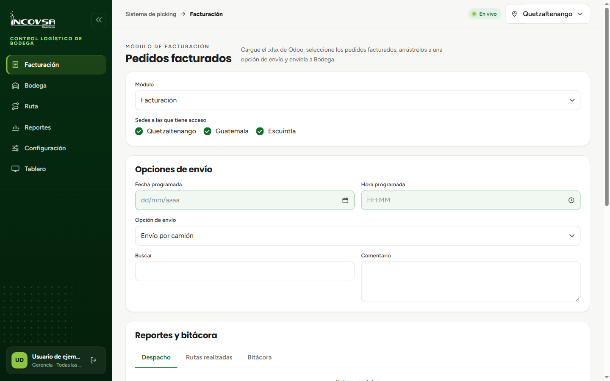

# Panel principal y entorno de trabajo

## Navegación y componentes del sistema

### Objetivo
Familiarizar al usuario con la interfaz general del sistema logístico, los controles de navegación entre módulos, el funcionamiento del selector de sede y la visualización adaptable en diferentes dispositivos.

### Requisitos previos
- Haber iniciado sesión satisfactoriamente en el sistema de picking.

### Estructura general de la pantalla

La interfaz del sistema logístico está diseñada para facilitar la operación ágil del personal y se compone de dos áreas fundamentales: la barra superior institucional y el menú lateral de navegación (véase la {{fig:panel-principal-picking}}).

{#fig:panel-principal-picking}

### Procedimiento para cambiar de sede

1. Localice el selector de sede ubicado en la parte central superior de la barra de navegación.
2. Haga clic sobre el nombre de la sede actual (por ejemplo, **Quetzaltenango**).
3. Si su cuenta tiene autorización sobre múltiples bodegas, se desplegará la lista con las opciones disponibles (**Quetzaltenango**, **Guatemala** y **Escuintla**).
4. Seleccione la bodega con la que desea operar. La pantalla se actualizará de inmediato, mostrando únicamente las rutas, pedidos y reportes correspondientes a esa ubicación geográfica.

### Menú lateral y acceso a módulos

El menú lateral izquierdo permite alternar entre las funciones operativas del sistema según los permisos de cada usuario:

- **Facturación:** carga de archivos exportados de Odoo, revisión de pedidos facturados y armado de opciones de envío (rutas y pedidos de recolección).
- **Bodega:** visualización de pedidos en preparación, agrupación de productos, marcas de alistamiento físico y despacho.
- **Tablero:** modo de pantalla completa optimizado para televisores y monitores dentro de la bodega física, con alternancia de tema claro y oscuro.
- **Ruta:** vista para pilotos donde se consultan las entregas asignadas, se ajusta el recorrido real y se registra la entrega final al cliente.
- **Reportes:** estadísticas consolidadas de kilogramos y unidades despachadas, historial de rutas realizadas y bitácora de auditoría.
- **Configuración:** administración de camiones y de cuentas de usuario del sistema de picking (exclusivo para Gerencia y Soporte).

### Adaptabilidad en dispositivos móviles y tabletas

- En pantallas de escritorio, el menú lateral puede contraerse haciendo clic en el botón de reducción para maximizar el área de trabajo de las tablas.
- En tabletas y teléfonos celulares, el menú lateral se oculta de forma automática. Para abrirlo, pulse el ícono de menú (tres líneas horizontales) situado en la esquina superior izquierda.

### Resultado esperado
El usuario reconoce la estructura de la aplicación, sabe en qué sede está trabajando y se desplaza con soltura entre los diferentes módulos autorizados.

> **Advertencia:** Verifique siempre que la sede seleccionada en la barra superior corresponda a la bodega física donde se están realizando los despachos antes de confirmar cualquier operación.

