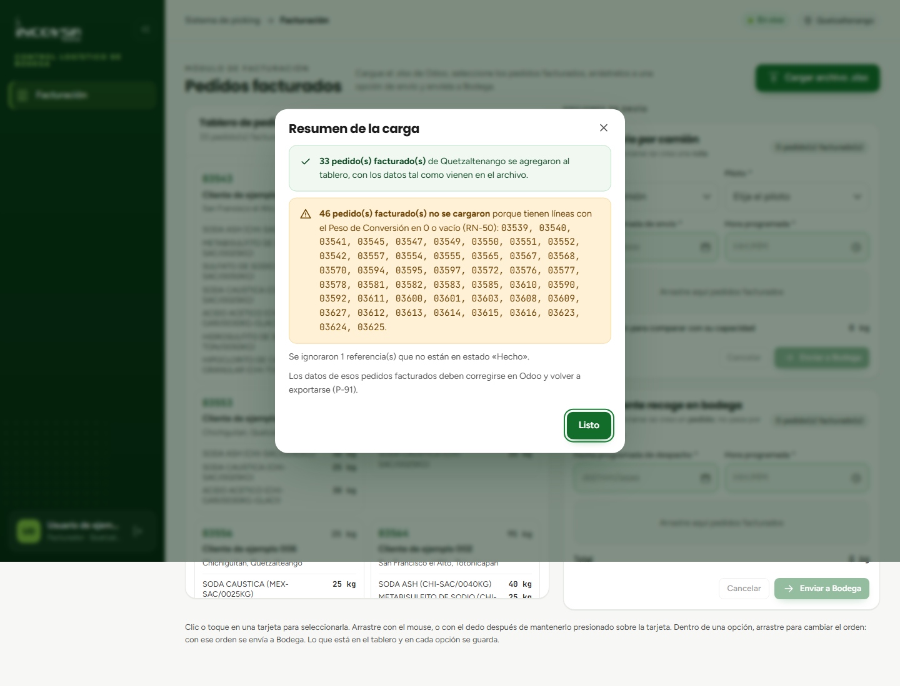

# Pedidos pendientes en Facturación

## Carga del archivo de Odoo y gestión del tablero

### Objetivo
Permitir que el encargado de facturación suba al sistema la planilla de salidas generada por el ERP Odoo, valide los datos automáticamente y visualice los pedidos facturados pendientes de asignación logística.

### Requisitos previos
- Disponer de una cuenta con permiso sobre el módulo de Facturación (`pk.facturacion`).
- Estar posicionado en la sede de trabajo correspondiente (por ejemplo, Quetzaltenango).
- Contar con el archivo en formato `.xlsx` exportado recientemente de Odoo con las salidas facturadas en estado "Hecho".

### Procedimiento para cargar el archivo de Odoo

1. En el menú lateral izquierdo del sistema de picking, haga clic en la opción **Facturación**.
2. En la parte superior de la pantalla, localice y presione el botón **Cargar archivo de Odoo**.
3. En la ventana de diálogo de su sistema operativo, seleccione el archivo Excel (`.xlsx`) correspondiente a los pedidos del día.
4. El sistema procesará el archivo aplicando las siguientes validaciones automáticas:
   - **Formato y seguridad:** comprueba que sea un archivo Excel legítimo, con peso menor a 2 MB y sin riesgo de compresión anómala (máximo 100 archivos internos y 50 MB descomprimido).
   - **Correspondencia de bodega:** verifica que el prefijo de las referencias coincida con la sede activa (`XE` para Quetzaltenango, `GT` para Guatemala o `ESC` para Escuintla). No se permite mezclar bodegas en un mismo archivo.
   - **Estado:** solo se extraen las líneas cuyo estado sea **Hecho**.
   - **Integridad de datos (RN-50):** valida que cada línea cuente con cantidad en kilogramos mayor que cero y Peso de Conversión válido mayor que cero.
5. Al finalizar la lectura, el sistema desplegará una ventana de resumen indicando cuántos pedidos facturados fueron importados y cuántos kilogramos totales representan (véase la {{fig:carga-odoo-resumen}}). En caso de existir líneas con errores o de otra bodega, se detallará el motivo exacto del descarte.

{#fig:carga-odoo-resumen}

6. Presione el botón **Entendido** para cerrar la ventana informativa.

### Gestión del tablero de pedidos facturados

Una vez cargado el archivo, los pedidos aparecen organizados en el lado izquierdo de la pantalla, denominado **Tablero de pedidos facturados** (véase la {{fig:tablero-facturacion}}):

{#fig:tablero-facturacion}

Cada tarjeta de pedido facturado muestra:
- **Número de pedido:** correlativo de Odoo (por ejemplo, `03539`).
- **Cliente:** nombre o razón social del comprador.
- **Sector:** municipio o zona de entrega (columna `Contacto/Ciudad`).
- **Peso total:** sumatoria en kilogramos de todos los productos incluidos en la orden.
- **Detalle de productos:** desglose de cada producto con su lote, Peso de Conversión y kilogramos ordenados.

### Búsqueda y selección de pedidos

- **Buscador:** escriba en la barra de búsqueda el nombre del cliente o el número de referencia para filtrar instantáneamente el tablero.
- **Selección individual o múltiple:** haga clic en la casilla de selección de una o varias tarjetas. También puede utilizar la opción «Seleccionar todos» para mover conjuntos de pedidos en bloque.

### Resultado esperado
Los pedidos facturados quedan listados de forma clara en el tablero, listos para ser organizados y despachados hacia la bodega.

> **Advertencia:** Si el archivo contiene pedidos con prefijos desconocidos o mezcla de bodegas, el sistema rechazará la importación por completo para evitar que órdenes de una sede terminen asignadas a otra.

