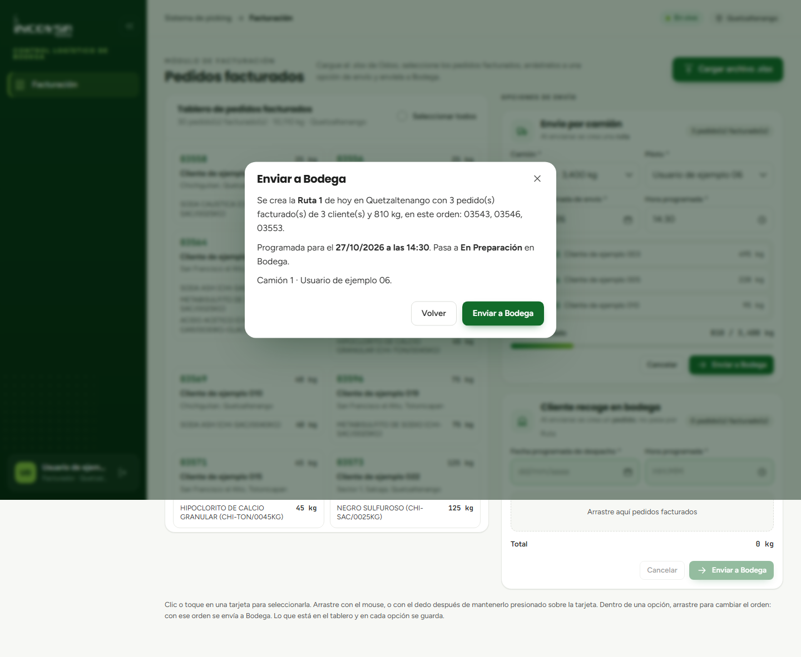
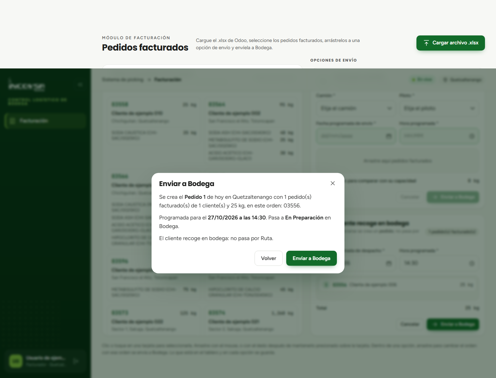

# Generación del picking y opciones de envío

## Configuración de rutas y pedidos de recolección

### Objetivo
Permitir que el facturador estructure la logística de despacho agrupando los pedidos facturados en las modalidades de transporte institucional o recolección en mostrador, y ordene la generación formal del picking en bodega.

### Requisitos previos
- Contar con pedidos facturados en el tablero de Facturación.
- Conocer la disponibilidad de camiones y pilotos de la sede.

### Las dos modalidades de envío

El sistema simplifica las operaciones logísticas dividiendo los envíos en dos únicas opciones (panel derecho de la pantalla):

1. **Envío por camión:** agrupa pedidos de uno o varios clientes que serán transportados y entregados en sus instalaciones mediante un vehículo de la empresa. Al enviarse a bodega genera una **Ruta**.
2. **Cliente recoge en bodega:** reúne órdenes de compra que el cliente retirará directamente en las instalaciones de INCOVSA con su propio vehículo. Al enviarse a bodega genera un **Pedido**.

### Procedimiento para armar un «Envío por camión»

1. Seleccione uno o varios pedidos facturados del tablero izquierdo y arrástrelos hacia la tarjeta **Envío por camión**.
2. En la lista desplegable **Camión**, elija el vehículo que realizará el flete (por ejemplo, `Camión 1 - 3,400 kg`). El sistema mostrará la barra de capacidad de carga.
3. En la lista desplegable **Piloto**, seleccione al conductor asignado para la ruta (véase la {{fig:opcion-camion}}).

{#fig:opcion-camion}

4. Ingrese la **Fecha programada** y la **Hora programada** estimada para la partida del vehículo.
5. Si es necesario, reordene los pedidos arrastrándolos hacia arriba o hacia abajo según la prioridad geográfica de entrega.
6. Haga clic en el botón **Enviar a Bodega**.
7. Se abrirá una ventana de confirmación detallando los clientes incluidos, el camión, el piloto y la sumatoria de peso (véase la {{fig:confirmar-ruta}}).

{#fig:confirmar-ruta}

8. Presione el botón **Enviar a Bodega** en la ventana de confirmación. El sistema asignará el número correlativo diario (por ejemplo, `Ruta 1`) y transferirá la orden en tiempo real al módulo de Bodega.

### Procedimiento para «Cliente recoge en bodega»

1. Arrastre los pedidos correspondientes a la tarjeta **Cliente recoge en bodega**.
2. Ingrese la **Fecha programada** y la **Hora programada** en que el cliente se presentará a retirar su mercadería.
3. Presione el botón **Enviar a Bodega**.
4. Revise el resumen en la ventana de confirmación (véase la {{fig:confirmar-pedido}}) y haga clic en **Enviar a Bodega**.

{#fig:confirmar-pedido}

5. El sistema generará el correlativo diario de recolección (por ejemplo, `Pedido 1`) y notificará a la bodega.

### Cancelación de opciones antes del envío

Si cometió un error o desea redistribuir los pedidos antes de enviarlos a bodega:
- Presione el botón **Cancelar** en la esquina superior de la opción de envío.
- Confirme en la ventana modal pulsando **Regresar al tablero**. Todos los pedidos asignados regresarán íntegros al tablero de facturación sin perder datos.

### Resultado esperado
Las rutas y pedidos son transferidos a la bodega física con su numeración oficial diaria, comenzando en 1 cada día por sede.

> **Advertencia:** Una vez confirmado el envío a bodega, la orden pasa a estado de alistamiento físico y ya no puede cancelarse desde la pantalla de Facturación.

