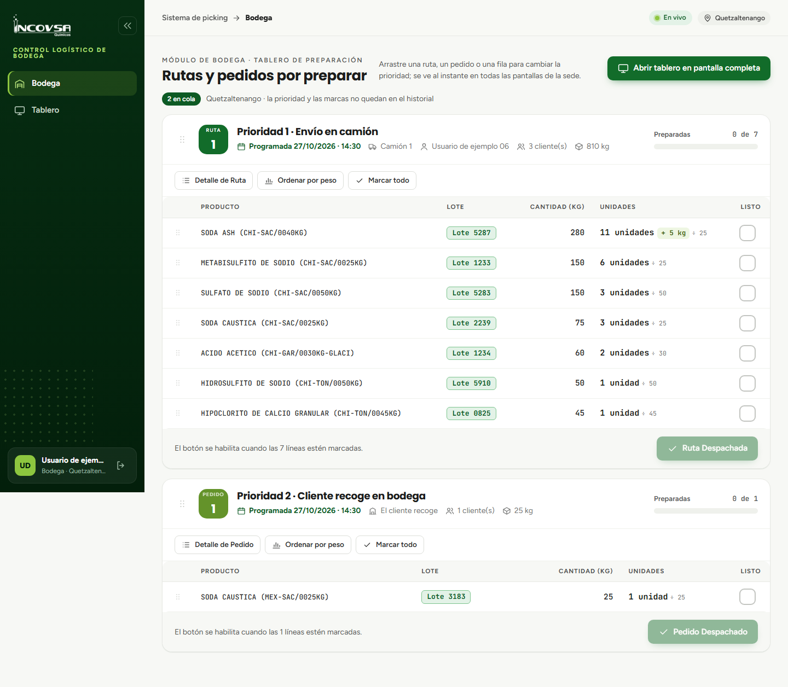

# Interpretación de kilogramos y unidades

## La regla de conversión de bodega (RN-01)

### Objetivo
Capacitar al personal de bodega y supervisores en la interpretación de las cantidades que figuran en las tarjetas de preparación, diferenciando las unidades físicas cerradas de las fracciones de producto que requieren pesaje.

### Requisitos previos
- Conocer el módulo de Bodega y los empaques comerciales de los productos.

### La regla de negocio RN-01

En la industria química y de materias primas, los pedidos de los clientes frecuentemente combinan compras de bultos completos con fracciones de producto. Para eliminar la necesidad de que los operarios realicen cálculos aritméticos manuales durante la carga física, el sistema aplica automáticamente la **Regla RN-01**:

1. **Unidades completas:** se calcula dividiendo el peso total en kilogramos entre el Peso de Conversión unitario, tomando la parte entera exacta. Representa los sacos, tambores o garrafas selladas de fábrica que se deben retirar de la estiba.
2. **Resto en kilogramos:** corresponde al sobrante de producto que no alcanza a completar una unidad entera. Es la cantidad que el operario prepara aparte de las unidades completas.

Tabla: Ejemplos prácticos de conversión bajo la regla RN-01 {#tab:ejemplos-rn01}

| Cantidad facturada | Peso de Conversión | Resultado en pantalla | Instrucción física para el bodeguero |
|---|---|---|---|
| 50.00 kg | 25.00 kg | **2 unidades** | Extraer 2 sacos completos cerrados |
| 60.00 kg | 25.00 kg | **2 unidades + 10 kg** | Extraer 2 sacos completos y pesar 10 kg sueltos |
| 10.00 kg | 25.00 kg | **0 unidades + 10 kg** | No retirar saco completo; pesar únicamente 10 kg |
| 50.00 kg | 50.00 kg | **1 unidad** | Extraer 1 tonel / tambor cerrado |
| 70.00 kg | 50.00 kg | **1 unidad + 20 kg** | Extraer 1 tonel cerrado y pesar 20 kg en garrafa |
| 75.00 kg | 25.00 kg | **3 unidades** | Extraer 3 sacos completos cerrados |

### Formato de visualización en las pantallas

En las tablas de preparación de Bodega (véase la {{fig:unidades-bodega}}), la columna **Unidades** presenta la información bajo las siguientes directrices de diseño:

- **Cantidad exacta sin sobrante:** si la división es exacta (resto igual a cero), el sistema muestra únicamente `N unidades` (o `1 unidad`), suprimiendo el texto `+ 0 kg` para mantener la lectura limpia.
- **Cantidad con fracción:** si existe sobrante, se muestra claramente `N unidades + R kg`.
- **Fracción pura:** si la venta no alcanza una unidad completa, se indica explícitamente `0 unidades + R kg` para advertir al operario que no debe bajar un bulto entero.

{#fig:unidades-bodega}

### Precisión del cálculo en el sistema

El sistema calcula todas las conversiones de forma matemática exacta sin pérdidas por redondeo, garantizando que cada gramo facturado coincida plenamente con lo preparado físicamente.

### Resultado esperado
El operario de almacén visualiza de un solo vistazo el trabajo exacto a realizar, reduciendo a cero los errores de despacho por confusiones entre bultos y kilogramos.

> **Advertencia:** Cuando visualice una cifra con `+ R kg`, verifique que el producto fraccionado sea embalado y rotulado con el nombre del producto, lote y peso neto antes de llevarlo al área de consolidación o carga vehicular.

