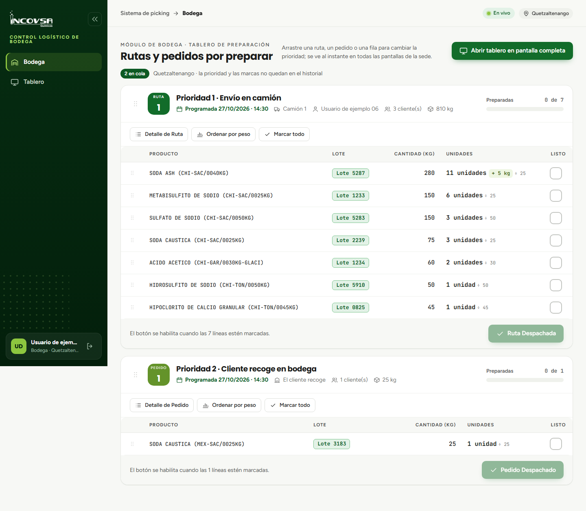

# Preparación de pedidos en bodega

## Visualización y agrupación consolidada de productos

### Objetivo
Capacitar al personal de almacén en la lectura del módulo de Bodega, comprendiendo cómo las órdenes de envío consolidan los productos por lote para optimizar las rutas de recolección física en los pasillos de la bodega.

### Requisitos previos
- Disponer de una cuenta con permiso sobre el módulo de Bodega (`pk.bodega`).
- Estar conectado en la sede correspondiente mediante una computadora, tableta o pantalla de televisión.

### Estructura de las tarjetas de preparación

Al ingresar a la opción **Bodega** del menú lateral, el sistema presenta una lista de tarjetas con todas las órdenes en estado **En Preparación** ordenadas según su hora de llegada (véase la {{fig:agrupacion-bodega}}):

{#fig:agrupacion-bodega}

Cada tarjeta contiene los siguientes elementos distintivos:

- **Identificador de tipo:**
  - **RUTA (Cuadro verde oscuro):** identifica envíos programados en camión institucional para reparto a múltiples clientes.
  - **PEDIDO (Cuadro verde lima):** identifica pedidos que serán recolectados directamente por el cliente en el mostrador de despacho.
- **Número correlativo:** número diario único de la sede (por ejemplo, `Ruta 1`, `Pedido 2`).
- **Fecha y hora programadas:** fecha y hora pactadas con el cliente para la salida o retiro de la carga (definidas en Facturación).
- **Transporte asignado:** en las rutas se indica claramente el camión y el nombre del piloto responsable.

### La regla de consolidación y agrupación (RN-51)

Para evitar que los operarios deban realizar múltiples viajes al mismo pasillo para abastecer a distintos clientes de un mismo camión, el sistema aplica la **Regla RN-51**:

1. **Criterio de agrupación:** se consolida en una sola fila la suma de productos que compartan exactamente el **mismo nombre comercial**, el **mismo número de lote** y el **mismo Peso de Conversión**.
2. **Separación por lote:** si dos clientes solicitaron el mismo producto químico pero en Odoo fueron asignados a lotes distintos, el sistema genera **filas separadas** para cada lote, impidiendo mezclas accidentales de partidas.
3. **Resaltado de lote:** el código de lote aparece resaltado prioritariamente en una etiqueta destacada verde, permitiendo que el bodeguero identifique de forma rápida la partida física que trae la orden de Odoo (RN-32).

Tabla: Ejemplo de consolidación en una misma ruta {#tab:consolidacion-lotes}

| Cliente en Odoo | Producto | Lote | Cantidad | Fila generada en Bodega | Conversión mostrada |
|---|---|---|---|---|---|
| Cliente A | SODA CAUSTICA EN ESCAMAS (CHI-SAC/0025KG) | 5287 | 25.00 kg | **Fila 1 (Lote 5287):** 40.00 kg | 1 unidad + 15 kg |
| Cliente B | SODA CAUSTICA EN ESCAMAS (CHI-SAC/0025KG) | 5287 | 15.00 kg | (Consolidada con la anterior) | |
| Cliente C | SODA CAUSTICA EN ESCAMAS (CHI-SAC/0025KG) | 9221 | 10.00 kg | **Fila 2 (Lote 9221):** 10.00 kg | 0 unidades + 10 kg |

### Resultado esperado
El personal de bodega visualiza el total neto consolidado que debe extraer del anaquel para surtir el camión de una sola vez, sin importar cuántos clientes compartan el lote.

> **Advertencia:** Respete el número de lote indicado en la tarjeta. Si el lote físico en tarima no coincide con el número resaltado en verde, notifique al supervisor de bodega y a facturación para verificar la orden.

