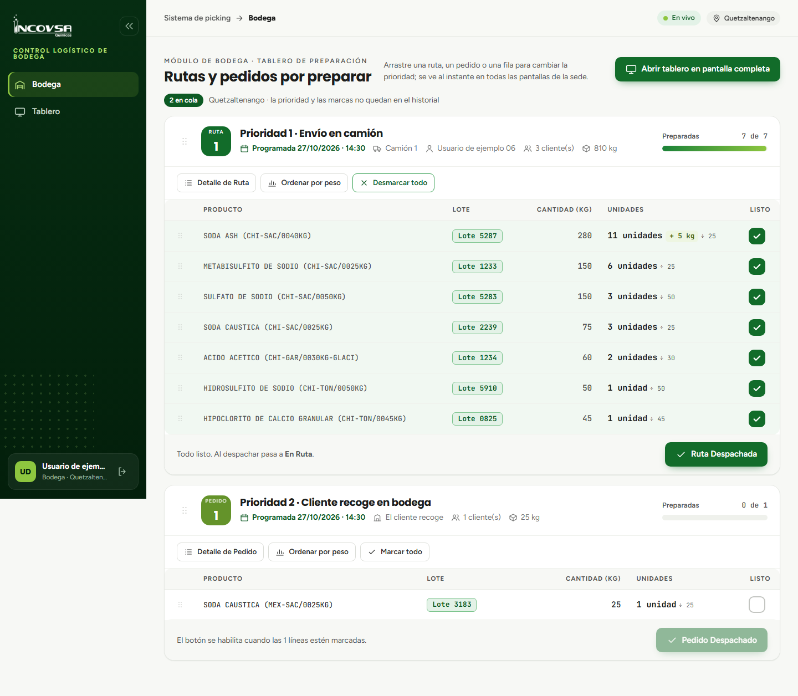

# Marcado de preparación y control de prioridad

## Flujo de alistamiento y reordenamiento operativo

### Objetivo
Instruir al personal de bodega sobre el uso de las casillas de verificación para registrar el avance del alistamiento físico, el uso de las opciones de marcado masivo y la gestión de prioridades mediante el reordenamiento manual y la función de ordenamiento por peso.

### Requisitos previos
- Disponer de acceso al módulo de Bodega.

### Procedimiento para el marcado de productos

A medida que los operarios recorren los pasillos de la bodega y trasladan los sacos y recipientes hacia el área de consolidación de carga:

1. **Marcado individual:** localice la fila del producto recolectado y haga clic (o toque en la pantalla táctil) sobre la casilla de la columna **Listo**.
2. **Confirmación visual:** la fila marcada cambiará inmediatamente de aspecto visual, indicando que el producto y su lote ya han sido verificados físicamente y colocados en la tarima correspondiente.
3. **Desmarcado:** si ocurrió un error en la selección o se detectó un daño en el empaque antes de la carga, vuelva a presionar la casilla para desmarcarla.
4. **Marcar todo / Desmarcar todo:** cada tarjeta cuenta con un botón de acción rápida para marcar simultáneamente todas las filas cuando la orden ha sido alistada por completo de una sola vez (véase la {{fig:marcado-bodega}}).

{#fig:marcado-bodega}

### Gestión de prioridades y orden de preparación

El sistema de picking ofrece flexibilidad total para que el equipo de bodega adapte la secuencia de trabajo a las contingencias del día:

- **Reordenamiento de rutas y pedidos:** si un camión llega antes de tiempo o un cliente se presenta al mostrador a recoger con urgencia, cualquier operario puede arrastrar la tarjeta hacia la parte superior de la pantalla. El nuevo orden de prioridad se reflejará al instante en todas las pantallas y televisores de la sede.
- **Reordenamiento manual de filas:** las filas dentro de una tarjeta pueden desplazarse hacia arriba o hacia abajo para coincidir con el recorrido físico habitual de los montacargas por los pasillos.
- **Función «Ordenar por peso»:** al hacer clic en este botón ubicado en la cabecera de la tarjeta, el sistema reorganiza automáticamente todas las filas de la orden colocando en primer lugar los productos con mayor cantidad de kilogramos y al final los de menor peso.

> **Buenas prácticas de estiba:** Utilice la función «Ordenar por peso» antes de iniciar la recolección física. Esto permite al bodeguero colocar primero en la tarima los sacos y tambores más pesados, dejando los envases livianos y fraccionados en la parte superior, evitando aplastamientos y roturas durante el transporte.

### Sincronización en tiempo real

Todas las acciones de marcado, desmarcado, reordenamiento de tarjetas y ordenamiento por peso se transmiten de forma instantánea entre todos los dispositivos conectados a la bodega mediante tecnología de eventos del servidor (SSE). Si un operario marca una casilla en una tableta en el pasillo 3, la pantalla de televisión principal y la computadora del supervisor se actualizarán de inmediato sin necesidad de recargar la página.

### Resultado esperado
Todo el equipo de bodega trabaja de manera sincronizada y coordinada, visualizando con certeza qué productos faltan por extraer y cuáles ya se encuentran listos para despacho.

> **Advertencia:** El marcado de preparación es una herramienta de control visual compartido; el sistema no registra el nombre de quién marcó la fila. En caso de corte momentáneo de red, la casilla volverá a su estado anterior y el sistema mostrará el aviso «No se pudo completar la operación. Inténtelo de nuevo.».

