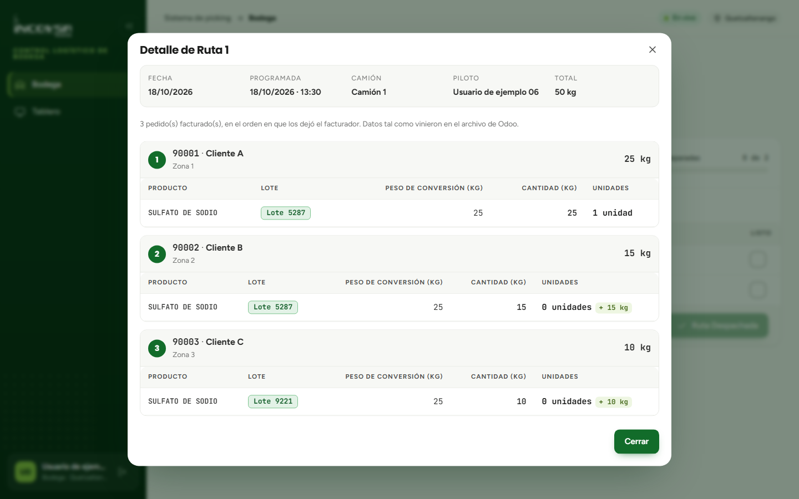

# Consulta de detalle y actualización de estados

## Desglose cliente por cliente y ciclo de vida de las órdenes

### Objetivo
Permitir que el personal de bodega y supervisores consulten en cualquier momento el desglose específico de los pedidos que componen una ruta, conociendo a qué cliente pertenece cada bulto y comprendiendo las transiciones de estado del flujo de alistamiento.

### Requisitos previos
- Disponer de acceso al módulo de Bodega o al Tablero en pantalla completa.

### Procedimiento para consultar el detalle de una orden

Aunque la tarjeta principal de Bodega agrupa los productos por lote para facilitar la recolección física, en ocasiones el operario necesita verificar qué cajas o sacos corresponden a un cliente en específico para su rotulación:

1. En la tarjeta de la orden, presione el botón **Detalle de Ruta** (o **Detalle de Pedido** si se trata de recolección en bodega).
2. Se desplegará una ventana emergente de consulta protegida (véase la {{fig:detalle-bodega}}).

{#fig:detalle-bodega}

3. **Estructura de la información en el detalle:**
   - **Nivel de cliente:** cada sección muestra el número de pedido de Odoo (por ejemplo, `03539`), el nombre del cliente (`Contacto`), el sector geográfico (`Contacto/Ciudad`) y el peso total acumulado para ese comprador.
   - **Nivel de línea de producto:** debajo de cada cliente se listan sus artículos individuales con su lote, Peso de Conversión, cantidad en kilogramos y la conversión a unidades físicas.
4. **Desplazamiento vertical:** si la ruta cuenta con múltiples clientes y decenas de productos, la ventana permite desplazarse verticalmente de forma fluida para revisar toda la lista.
5. Al concluir la verificación, presione el botón **Cerrar**.

### Ciclo de vida y transición de estados en Bodega

El sistema gestiona de manera rigurosa los estados de cada orden para evitar despachos incompletos:

1. **En Preparación:** estado inicial con el que una ruta o pedido llega desde Facturación. Las tarjetas permanecen visibles en las pantallas de bodega mientras se alistan los productos.
2. **Bloqueo de seguridad:** el botón de despacho (**Ruta Despachada** o **Pedido Despachado**) permanece deshabilitado e inactivo mientras exista al menos una fila sin marcar en la columna "Listo".
3. **Activación de despacho:** únicamente cuando el 100% de las filas de la orden han sido verificadas y marcadas con éxito, el botón se ilumina y queda disponible para su pulsación.
4. **Salida de bodega:** al presionar el botón de despacho, la orden culmina su fase de alistamiento y desaparece de la vista de Bodega, transfiriéndose a su siguiente etapa logística.

### Resultado esperado
El personal de bodega cuenta con una herramienta confiable para resolver dudas de empaque por cliente sin alterar la agrupación de recolección, y el sistema garantiza que ningún camión parta con mercancía pendiente de alistar.

> **Advertencia:** La ventana de detalle es de solo lectura; los datos provienen de la factura de Odoo y no pueden ser modificados en bodega. Si detecta una inconsistencia en la dirección o en el producto de un cliente, coordine inmediatamente con el área de Facturación.

