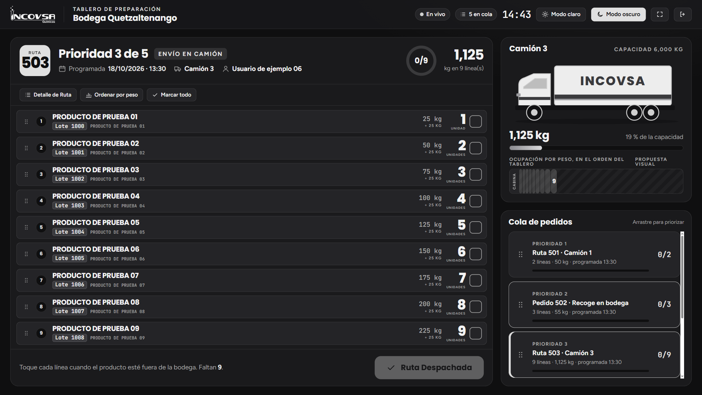

# Tablero de control de bodega en pantalla completa

## Visualización para televisores y monitores industriales

### Objetivo
Operar el módulo de Tablero en modo de pantalla completa, diseñado específicamente para proyectarse en televisores Smart TV, monitores industriales de pared y tabletas de operarios dentro de la nave de almacenamiento de INCOVSA.

### Requisitos previos
- Disponer de acceso al sistema con cualquier cuenta autorizada para el módulo de Bodega.
- Conectar la pantalla o Smart TV a la red interna de la empresa mediante cable de red o señal Wi-Fi estable.

### Procedimiento para activar el Tablero en pantalla completa

1. En el encabezado del módulo de Bodega, pulse **Abrir tablero en pantalla completa**, o elija **Tablero** en el menú lateral.
2. Se abre el tablero, una página sin menú lateral que muestra la ruta o el pedido en curso con letras grandes, el panel del camión y la cola.
3. En la barra superior del tablero encontrará los controles:
   - **Modo claro** y **Modo oscuro:** dos botones para elegir el modo de esa pantalla (véase la {{fig:tablero-oscuro}}). Si no se ha elegido un modo, o al reiniciar el navegador o abrir otra pestaña, el tablero abre en modo claro. El modo elegido se conserva al recargar esa pantalla y no cambia las demás.
   - **Pantalla completa** (botón con ícono, sin texto): pone el navegador en pantalla completa. Con la tecla `Esc` se sale de la pantalla completa, pero se sigue en el tablero.
   - **Volver al módulo** (botón con ícono, sin texto): regresa al módulo de Bodega.

{#fig:tablero-oscuro}

### Selección entre Modo Claro y Modo Oscuro

- **Modo claro:** fondo claro, tarjetas blancas y acentos verdes. La etiqueta del lote es verde y el cuadro del número de un **PEDIDO** es verde lima, para distinguirlo del de una **RUTA**.
- **Modo oscuro:** fondo y superficies en escala de negros y grises. La etiqueta del lote y el cuadro del número de un **PEDIDO** van en gris.

Elija el modo que se lea mejor en cada pantalla. El modo de una pantalla no cambia el de las demás.

### Lectura a distancia

El tablero está pensado para leerse bien proyectado en una TV y para usarse en una tableta: cantidades grandes, producto, lote y unidades claramente separados y estados visibles.
- Cada línea se marca o se desmarca tocándola completa, o con su casilla desde el teclado.
- Las líneas que cambian, también desde otra pantalla, se resaltan un momento.
- En tableta, escritorio y TV, si las líneas no caben, se desplaza solo el área de las líneas; la cabecera y las opciones quedan fijas. En el teléfono se desplaza toda la pantalla.

### Operación desatendida en televisores de bodega

Para utilizar un televisor en modo monitor permanente:
1. Abra el navegador del televisor y acceda con el usuario de bodega asignado a la estación (por ejemplo, `ejemplo.05`).
2. Abra el tablero, pulse **Pantalla completa** y elija el modo que se lea mejor en esa TV.
3. **No requiere recargas manuales:** la pantalla recibirá automáticamente todas las actualizaciones de Facturación y de los operarios mediante la conexión continua en tiempo real. Cuando una orden se despacha, desaparece de la pantalla sola; cuando llega una ruta nueva, se dibuja automáticamente en la lista.

### Resultado esperado
La nave de bodega cuenta con un tablero visual visible para todo el equipo operativo, sincronizado al segundo y sin requerir intervención técnica constante.
