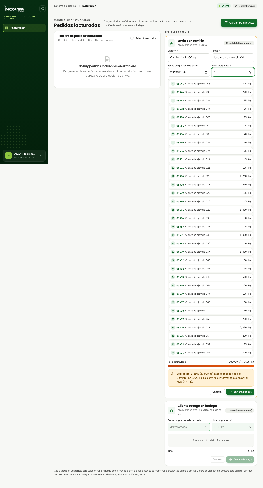

# Registro de carga y control de peso

## Monitoreo de capacidad vehicular y prevención de sobrepeso

### Objetivo
Capacitar a los facturadores y coordinadores de despacho en el control preventivo de la carga asignada a los camiones institucionales, asegurando el cumplimiento de los límites mecánicos de cada vehículo y la normativa vial vigente en el país.

### Requisitos previos
- Disponer de acceso al módulo de Facturación.
- Contar con la flota de camiones de la sede debidamente registrada en el módulo de Configuración.

### El mecanismo de control de peso preventivo

En el modelo logístico de INCOVSA, la prevención de sobrecargas se realiza directamente durante el armado de la ruta en la pantalla de Facturación (véase la {{fig:control-peso-camion}}):

1. **Capacidad máxima nominal:** cada camión registrado en la sede cuenta con un límite de carga útil expresado en kilogramos (por ejemplo, Quetzaltenango dispone habitualmente de dos camiones con capacidad de 3,400 kg y un camión con capacidad de 6,000 kg).
2. **Cálculo automático de la carga:** al seleccionar el vehículo en la lista desplegable de la opción «Envío por camión», el sistema calcula instantáneamente la sumatoria de kilogramos de todos los productos y pedidos incluidos en esa opción de envío.
3. **Barra gráfica de capacidad:** la línea «Peso acumulado» muestra los kilogramos asignados frente a la capacidad del camión (por ejemplo, `2,185 / 3,400 kg`), y debajo una barra muestra la ocupación en tiempo real.

{#fig:control-peso-camion}

### Gestión de alertas por sobrepeso (RN-13)

- **Carga dentro del límite:** mientras el peso total de los pedidos no sobrepase la capacidad nominal del camión, la barra se mantiene en su color normal.
- **Aviso de sobrepeso:** si la sumatoria de pedidos sobrepasa la capacidad del camión, el sistema muestra una alerta visual informando el exceso de kilogramos.
- **Naturaleza informativa de la alerta (RN-13):** la alerta de sobrepeso **solo informa: se puede enviar igual**. El sistema no bloquea el botón de envío a bodega, permitiendo que el facturador o coordinador decida si despacha la ruta tal como está o si redistribuye la carga.

### Procedimiento opcional ante un aviso de sobrepeso

Si el facturador decide ajustar la carga tras observar el aviso de sobrepeso:

1. Revise los pedidos asignados a la tarjeta «Envío por camión».
2. Arrastre los pedidos de mayor peso de regreso al tablero izquierdo de pedidos facturados.
3. Observe cómo la barra de peso recalcula el total acumulado dentro de la capacidad nominal del vehículo.
4. De forma alternativa, si dispone de un vehículo de mayor capacidad en la sede (por ejemplo, el camión de 6,000 kg), elija ese camión en la lista desplegable.

### Control del peso de la carga

El sistema no pide confirmar ni pesar la carga en Bodega. El peso de cada camión se controla en Facturación, con la barra de ocupación y la alerta de sobrepeso de la opción «Envío por camión» (RN-13).

### Resultado esperado
El personal de facturación conoce en tiempo real el peso acumulado en cada camión y dispone de alertas informativas para tomar decisiones operativas de transporte.

> **Nota (RN-13):** Conforme a la regla de negocio RN-13, la alerta de sobrepeso es informativa y no impide presionar «Enviar a Bodega». La decisión de enviar un camión con sobrepeso queda bajo el criterio del coordinador logístico.

