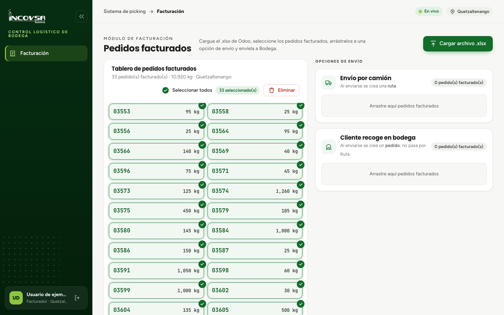

# Asignación de productos y pedidos al vehículo

## Consolidación y orden de estiba para el transporte

### Objetivo
Establecer el procedimiento mediante el cual los pedidos de diferentes clientes se vinculan formalmente a una unidad vehicular y a un piloto conductor, planificando la secuencia de carga física en el camión.

### Requisitos previos
- Disponer de acceso al módulo de Facturación.
- Contar con la lista de clientes y destinos programados para el reparto de la jornada.

### Procedimiento para la asignación de pedidos al vehículo

1. En el módulo de **Facturación**, localice la tarjeta de configuración **Envío por camión** en el lado derecho de la pantalla.
2. **Selección del vehículo:** haga clic en el campo desplegable **Camión** y seleccione la unidad disponible en la sede (por ejemplo, `Camión 2`).
3. **Selección del piloto responsable:** haga clic en el campo desplegable **Piloto** y elija al conductor encargado del reparto (por ejemplo, `Usuario de ejemplo 06`). Únicamente aparecerán los colaboradores que cuentan con el rol operativo de **Piloto** en la sede activa.
4. **Asignación de pedidos:**
   - Seleccione en el tablero izquierdo las órdenes facturadas que pertenecen a la misma ruta o circuito geográfico (por ejemplo, pedidos con destino a Salcajá, San Cristóbal o Coatepeque).
   - Arrastre las tarjetas hacia la zona de «Envío por camión» (véase la {{fig:asignacion-camion}}).

{#fig:asignacion-camion}

5. **Organización de la estiba preliminar:**
   - En la logística de transporte terrestre rige el principio LIFO (*Last In, First Out* - el último en cargar es el primero en descargar).
   - El facturador puede ordenar las tarjetas de los clientes dentro del camión arrastrándolas verticalmente para reflejar la ruta de entrega acordada con el piloto.
6. **Programación horaria:** defina en los campos de fecha y hora el momento exacto en que el camión debe estar cargado y listo para abandonar el andén de bodega.
7. **Transferencia a bodega:** presione el botón **Enviar a Bodega** y confirme en la ventana emergente.

### Vinculación de datos en la base del sistema

Al completarse este procedimiento, el sistema ejecuta las siguientes acciones automáticas:
- Genera un identificador único de **Ruta** con su correlativo del día (por ejemplo, `Ruta 2`).
- Consolida todos los productos de los distintos clientes bajo las reglas de agrupación de bodega (RN-51).
- Asocia el camión y el piloto seleccionado a la ruta creada.
- Habilita la orden en el módulo de Bodega para que los montacarguistas inicien el alistamiento.

### Resultado esperado
Los pedidos individuales quedan estructurados como una unidad logística de transporte con camión, piloto, fecha programada y manifiesto de productos consolidados.

> **Advertencia:** Verifique que el piloto seleccionado cuente con licencia de conducir vigente y esté presente en la sede para recibir la carga una vez completada la preparación en bodega.

