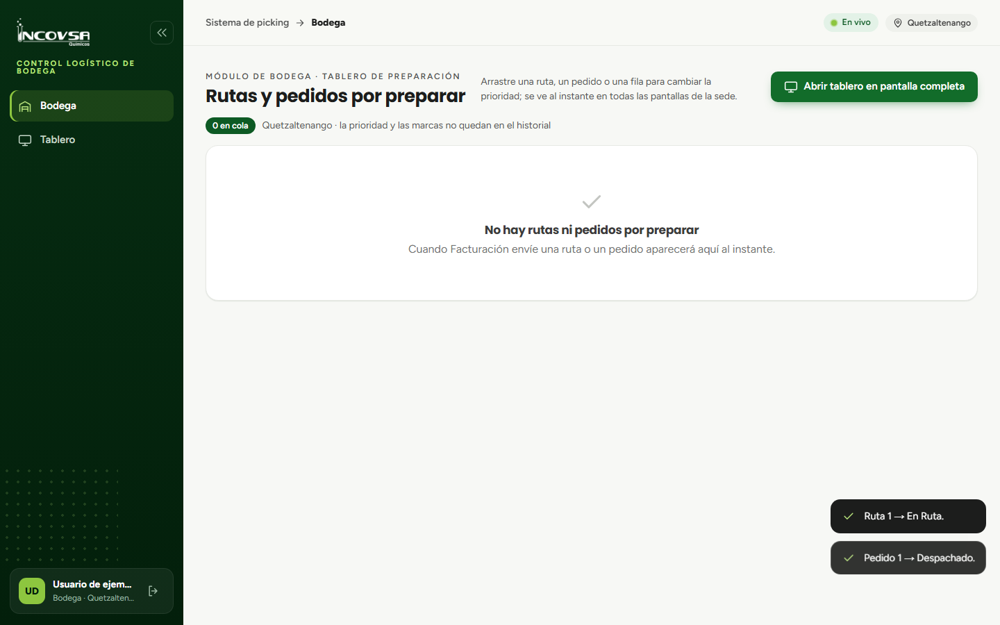

# Despacho de rutas y pedidos

## Cierre de preparación y salida física de almacén

### Objetivo
Completar formalmente la etapa de alistamiento en el almacén, transfiriendo la custodia de la mercancía al piloto en ruta o dando por entregada la orden de mostrador al cliente.

### Requisitos previos
- Haber completado la recolección física y marcado el 100% de las casillas en la columna "Listo" de la tarjeta de Bodega.
- Presencia del camión en rampa o del cliente en la ventanilla de entrega.

### Procedimiento para despachar una orden

1. En el módulo de **Bodega** (o en el **Tablero** de pantalla completa), ubique la tarjeta correspondiente a la orden finalizada.
2. Compruebe que no queden productos pendientes de alistar. Al estar todas las casillas marcadas, el botón de cierre se iluminará en color verde en la esquina inferior derecha de la tarjeta:
   - Para camiones de reparto mostrará el texto **Ruta Despachada**.
   - Para clientes en mostrador mostrará el texto **Pedido Despachado**.
3. Haga clic sobre el botón **Ruta Despachada** o **Pedido Despachado**.
4. El sistema procesará el cambio de estado de manera inmediata y segura en el servidor:
   - **Flujo de «Cliente recoge en bodega»:** el pedido adquiere el estado definitivo de **Despachado**. Con esto culmina exitosamente su ciclo operativo. La información queda archivada para fines estadísticos en el módulo de Reportes.
   - **Flujo de «Envío por camión»:** la orden adquiere el estado oficial de **En Ruta**. La tarjeta se retira de la vista de los bodegueros y se transfiere en tiempo real al módulo de **Ruta** del teléfono móvil del piloto asignado.
5. La tarjeta desaparecerá de la pantalla de alistamiento, dejando el espacio libre para las siguientes órdenes de la jornada (véase la {{fig:bodega-despachados}}).

{#fig:bodega-despachados}

### Concurrencia y protección contra doble despacho

El sistema logístico cuenta con salvaguardas avanzadas para prevenir errores en entornos con múltiples operadores trabajando simultáneamente:
- Si dos operarios intentan presionar el botón de despacho al mismo segundo desde dispositivos distintos, el sistema procesará únicamente la primera solicitud.
- La segunda pantalla recibirá un aviso transparente informando «El pedido ya no está en preparación.» y retirará la tarjeta automáticamente sin generar duplicados en la base de datos ni registrar dobles salidas.

### Resultado esperado
La orden concluye su fase de bodega; los camiones quedan autorizados para salir de las instalaciones y los pedidos de mostrador quedan registrados como entregados al cliente.

> **Advertencia:** Nunca presione el botón de despacho antes de que la mercancía esté físicamente cargada en el camión o entregada en manos del cliente. Una vez despachada, la orden no puede reactivarse en la pantalla de bodega.

