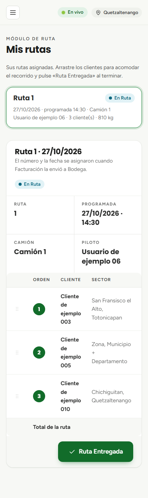
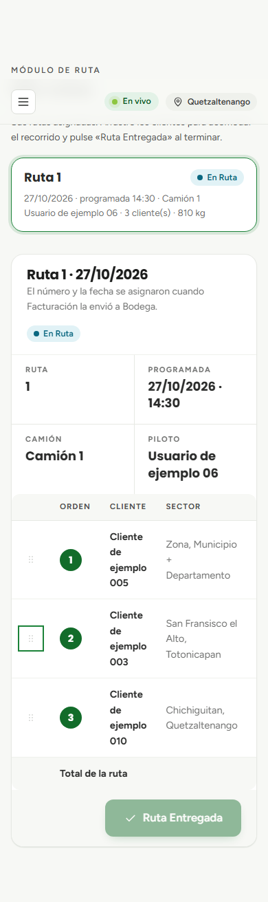
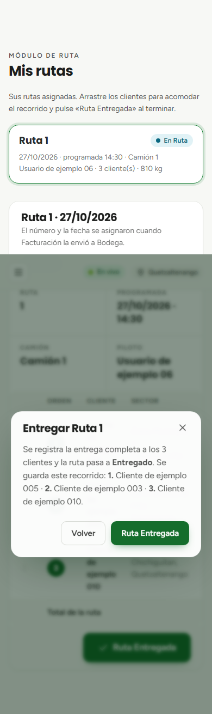

# Módulo de Ruta y registro de entregas

## Operación móvil para pilotos y confirmación en destino

### Objetivo
Instruir a los conductores y pilotos de transporte de INCOVSA en el uso del módulo móvil de Ruta para visualizar sus entregas asignadas, reorganizar la secuencia de paradas en carretera y confirmar la entrega satisfactoria de la carga.

### Requisitos previos
- Disponer de un teléfono inteligente o tableta con navegador web y conexión a internet móvil.
- Cuenta de usuario con rol de **Piloto** o permiso de consulta de rutas (`pk.ruta.propias` o `pk.ruta.todas`).

### Procedimiento para consultar las rutas en el teléfono

1. Ingrese con sus credenciales al sistema logístico desde su teléfono celular.
2. En el menú de navegación, seleccione la opción **Ruta**.
3. La interfaz móvil presentará las rutas activas que se encuentran en estado **En Ruta** asignadas a su nombre, ordenadas desde la más reciente hacia la más antigua (véase la {{fig:ruta-telefono}}).

{#fig:ruta-telefono}

4. **Información de cabecera de la ruta:**
   - Número de ruta y fecha de despacho.
   - Hora programada de llegada o salida.
   - Camión asignado y peso neto total transportado.

### Tabla de paradas y consolidación por cliente

Para facilitar la lectura durante el trayecto, la tabla de entregas agrupa los pedidos bajo una estructura limpia:
- **Una fila por cliente (RN-49):** si un cliente adquirió dos o más facturas distintas en el mismo camión, el sistema consolida automáticamente los kilogramos en un solo renglón para ese destinatario.
- **Datos visibles:** nombre del cliente (`Contacto`), sector o municipio de entrega (`Contacto/Ciudad`) y peso total en kilogramos a descargar en ese punto.

### Reordenamiento del recorrido en carretera (RN-29)

Las condiciones de tránsito, reparaciones de cinta asfáltica o emergencias comerciales pueden obligar al piloto a modificar el orden de visitas planificado:

1. El piloto puede reordenar las filas de los clientes en cualquier momento del viaje arrastrando la tarjeta del cliente hacia arriba o hacia abajo (véase la {{fig:ruta-reordenada}}).

{#fig:ruta-reordenada}

2. **Regla de registro de recorrido:** el orden exacto en que queden ubicadas las filas en la pantalla al momento de pulsar el botón final de entrega será el que se guardará de forma permanente en la base de datos como el **recorrido oficial ejecutado**.

### Procedimiento para registrar la entrega de la ruta

Al finalizar la descarga en el último cliente del circuito:

1. Desplácese hasta el final de la tabla de la ruta y presione el botón **Ruta Entregada** (alineado a la derecha).
2. Se desplegará una ventana de confirmación detallando el recorrido final que quedará registrado en auditoría (véase la {{fig:ruta-confirmar}}).

{#fig:ruta-confirmar}

3. Presione el botón **Ruta Entregada** en la ventana de confirmación.
4. La ruta pasará al estado oficial de **Entregado** y desaparecerá de la pantalla móvil del piloto, quedando registrada en el historial del módulo de Reportes.

### Resultado esperado
La empresa obtiene la confirmación digital de entrega en tiempo real desde el terreno, conociendo el circuito de entrega exacto cumplido por el vehículo.

> **Advertencia:** El botón «Ruta Entregada» da por entregada la totalidad de los productos de la ruta. El sistema logístico no registra devoluciones ni mermas en calle; cualquier producto devuelto físicamente debe reportarse a la administración de bodega para su trámite en Odoo.

