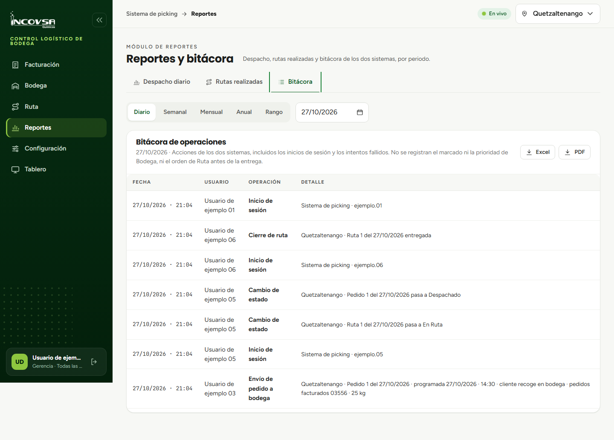

# Historial de operaciones y bitácora del sistema

## Auditoría y trazabilidad de eventos logísticos

### Objetivo
Capacitar a los supervisores de logística, administradores y personal de auditoría en la consulta del registro histórico de operaciones (bitácora), permitiendo rastrear cada acción realizada en el sistema con fecha, hora y usuario responsable.

### Requisitos previos
- Disponer de una cuenta con permiso sobre el módulo de Reportes (`pk.reportes`).
- Estar posicionado en la sede que se desea auditar.

### Procedimiento para consultar la bitácora de operaciones

1. En el menú lateral izquierdo, seleccione la opción **Reportes**.
2. En la parte superior del módulo, haga clic sobre la pestaña **Bitácora**.
3. **Selección del periodo de consulta:**
   - Utilice el selector de periodo para definir la ventana temporal de interés: **Diario** (día en curso), **Semanal** (de lunes a domingo), **Mensual**, **Anual** o un **Rango** específico entre dos fechas (escribiendo las fechas en formato `dd/mm/aaaa` o utilizando el calendario interactivo).
4. El sistema cargará el listado cronológico de eventos registrados en la sede seleccionada (véase la {{fig:bitacora-reportes}}).

{#fig:bitacora-reportes}

### Estructura del registro de auditoría

La tabla de bitácora detalla los siguientes campos obligatorios para cada transacción:

- **Fecha y hora:** marca temporal exacta en hora oficial de Guatemala (`America/Guatemala`), registrada directamente por el servidor en la misma transacción de base de datos.
- **Usuario:** identificador de la cuenta que ejecutó la operación (por ejemplo, `ejemplo.03`).
- **Operación:** tipo de acción procesada por el sistema.
- **Detalle:** información contextual de la operación, tales como número de orden, placas del camión, piloto asignado o pesajes involucrados.

Tabla: Principales eventos registrados en la bitácora {#tab:eventos-bitacora}

| Operación | Cuándo se registra | Datos almacenados en el detalle |
|---|---|---|
| **Inicio de sesión** | Al autenticarse exitosamente un usuario | Nombre de usuario y sede de ingreso |
| **Carga de archivo** | Al importar una planilla `.xlsx` de Odoo | Cantidad de pedidos importados y kg totales |
| **Envío de ruta a bodega** | Al confirmar una ruta en Facturación | Número correlativo, camión, piloto y clientes |
| **Envío de pedido a bodega**| Al confirmar un pedido en Facturación | Número correlativo y cliente que recoge |
| **Cancelación de opción** | Al regresar pedidos al tablero | Número de pedidos devueltos |
| **Despacho de ruta** | Al pulsar "Ruta Despachada" en Bodega | Identificador de ruta y hora de salida |
| **Despacho de pedido** | Al pulsar "Pedido Despachado" en Bodega | Identificador de pedido y hora de entrega |
| **Entrega de ruta** | Al pulsar "Ruta Entregada" por el piloto | Recorrido final de entrega ejecutado |

### Inmutabilidad y seguridad de los registros (RN-39)

La bitácora del sistema logístico ha sido construida bajo principios estrictos de seguridad y no repudio:
- Ningún usuario, ni siquiera las cuentas con rol de **Gerencia** o **Soporte**, tiene facultades dentro de la aplicación para modificar, alterar o eliminar registros de la bitácora.
- Si una operación de base de datos falla, la transacción completa se revierte, asegurando que solo los eventos efectivamente consumados queden asentados en el registro.

### Resultado esperado
La empresa cuenta con un expediente digital transparente y verificable para respaldar auditorías internas, investigar discrepancias de entrega y verificar el cumplimiento de los horarios pactados.

> **Advertencia:** Los intentos fallidos de acceso con contraseñas erróneas también quedan registrados en la bitácora de seguridad del sistema para la prevención de accesos no autorizados.

