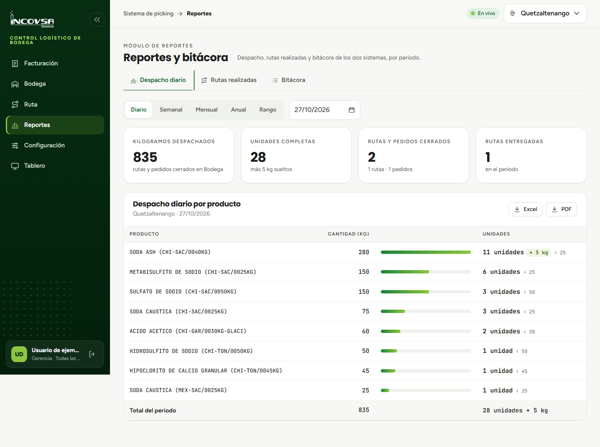
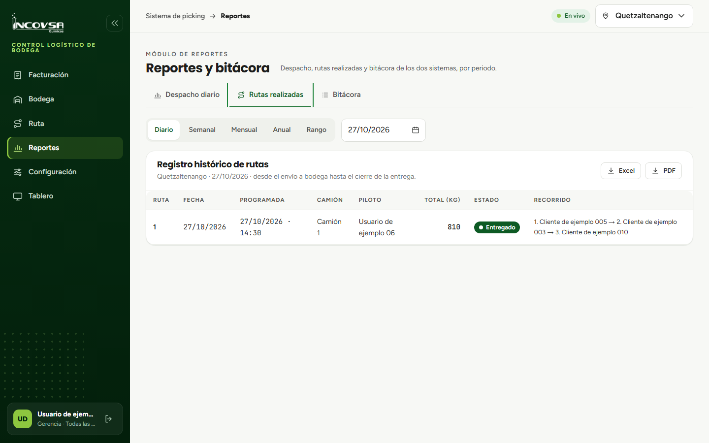

# Reportes logísticos y exportación de datos

## Indicadores de despacho, rutas realizadas y exportación oficial

### Objetivo
Permitir que la gerencia, supervisores de logística y jefes de planta consulten los indicadores de productividad operativa en diferentes rangos de tiempo y exporten reportes consolidados en formatos estándar de oficina (Excel y PDF).

### Requisitos previos
- Disponer de acceso con permiso sobre el módulo de Reportes (`pk.reportes`).

### Estructura del módulo de Reportes

Al ingresar a la opción **Reportes** del menú lateral, el sistema ofrece una interfaz analítica dividida en tres pestañas operativas y un panel superior de filtrado temporal:

1. **Selector de periodo (RF-SL-59):** permite segmentar la información de cualquiera de las tres pestañas bajo los siguientes criterios:
   - **Diario:** actividad acumulada en el día de hoy (configuración por defecto al abrir el módulo).
   - **Semanal:** resumen consolidado de la semana en curso (de lunes a domingo).
   - **Mensual:** consolidado del mes calendario seleccionado.
   - **Anual:** acumulación de todo el año fiscal en curso.
   - **Rango:** selección personalizada de fecha inicial y fecha final (escribiendo en formato `dd/mm/aaaa` o seleccionando en el calendario interactivo).

### Pestaña «Despacho»: indicadores y productos

La primera pestaña presenta el balance general de volumen movilizado en la bodega (véase la {{fig:reportes-despacho}}):

{#fig:reportes-despacho}

- **Tarjetas de indicadores superiores:**
  - **Kilogramos despachados:** sumatoria del peso neto de todas las rutas y pedidos que salieron de la bodega durante el lapso elegido.
  - **Unidades completas:** sumatoria de sacos, tambores y bultos cerrados preparados bajo la regla RN-01, más el resto neto en kilogramos fraccionados.
  - **Rutas y pedidos cerrados:** conteo diferenciado de cuántas rutas partieron en camión y cuántos pedidos fueron retirados por clientes en mostrador.
  - **Rutas entregadas:** cantidad de camiones que completaron satisfactoriamente su circuito y fueron marcados como «Ruta Entregada» por los pilotos.
- **Tabla consolidada por producto:** lista cada artículo despachado en el periodo con sus kilogramos totales, una barra visual proporcional a su volumen y la conversión exacta a unidades físicas y sobrante.

### Pestaña «Rutas realizadas»: registro histórico

La segunda pestaña constituye el archivo histórico de transporte de la sede (véase la {{fig:reportes-rutas}}):

{#fig:reportes-rutas}

- **Columnas de la tabla de transporte:** número correlativo de la ruta, fecha de envío, fecha y hora programada, camión utilizado, piloto responsable, peso total transportado, estado actual (**En Ruta** o **Entregado**) y la secuencia exacta de clientes registrada como **Recorrido final**.

### Procedimiento para exportar reportes

Para presentar informes ejecutivos a la dirección de la empresa o realizar análisis en herramientas externas:

1. Seleccione la pestaña que desea documentar: **Despacho**, **Rutas realizadas** o **Bitácora**. Las tres se exportan.
2. Configure el periodo deseado en los controles de fecha.
3. En la esquina superior derecha de la tabla, localice los botones de exportación:
   - **Botón Excel:** descarga un archivo `.xlsx` de una sola hoja con las filas de la pestaña en el periodo elegido. El archivo no lleva colores ni formato.
   - **Botón PDF:** descarga un documento `.pdf` en tamaño A4 horizontal con el logotipo de INCOVSA, el título de la pestaña, la sede (salvo en la Bitácora), el periodo y la tabla.
4. El nombre del archivo indica la pestaña, la sede (salvo en la Bitácora) y el periodo; por ejemplo, `despacho-quetzaltenango-16-10-2026.xlsx`. Si el archivo no se puede descargar, la pantalla muestra «No se pudo completar la operación. Inténtelo de nuevo.».

### Resultado esperado
La empresa obtiene reportes formales, inmediatos y confiables de la operación logística, eliminando el armado manual de planillas en papel.

> **Advertencia:** Los reportes representan exclusivamente la actividad de la sede activa en la barra superior. Para obtener el consolidado de otra sede, cambie la ubicación en el selector superior antes de pulsar los botones de exportación.

