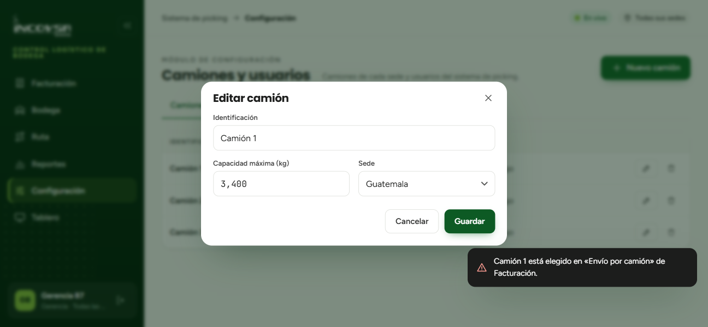

# Configuración de camiones, usuarios y roles

## Administración de recursos y control de accesos

### Objetivo
Capacitar al personal con funciones de Gerencia y Soporte técnico en la administración de la flota de transporte y en la gestión de cuentas, roles y permisos de acceso para los colaboradores del sistema logístico.

### Requisitos previos
- Para la pestaña **Camiones**: disponer del permiso «Administrar camiones» (`pk.cfg.camiones`) en sus sedes asignadas, o contar con rol de Gerencia o Soporte.
- Para la pestaña **Usuarios**: disponer de una cuenta con rol de **Gerencia** o **Soporte** (únicos roles facultados para administrar usuarios del picking).

### Administración de la flota de camiones

En la pestaña **Camiones** del módulo de Configuración se definen los vehículos disponibles para las operaciones de reparto de cada sede (véase la {{fig:configuracion-modulo}}):

{#fig:configuracion-modulo}

- **Procedimiento para registrar un camión nuevo:**
  1. Haga clic en el botón **Nuevo camión**.
  2. Ingrese el nombre o placa identificadora del vehículo (por ejemplo, `Camión 3`).
  3. Indique la **Capacidad máxima** en kilogramos (debe ser un valor numérico estrictamente mayor que cero).
  4. Seleccione la **Sede** física a la que estará asignado el automotor.
  5. Presione **Guardar**. El camión aparecerá de inmediato disponible en la lista desplegable de Facturación.
- **Protección de camiones en uso:**
  - El sistema prohíbe eliminar o cambiar de sede un camión que se encuentre actualmente seleccionado en una opción de envío en Facturación o en una ruta activa, mostrando el mensaje de alerta «<camión> está elegido en «Envío por camión» de Facturación.».

### Administración de usuarios del sistema de picking

En la pestaña **Usuarios** se crean y regulan las cuentas del personal operativo y administrativo:

- **Procedimiento para crear un nuevo colaborador:**
  1. Haga clic en el botón **Nuevo usuario**.
  2. Complete los campos de identificación:
     - **Nombre completo:** nombres y apellidos del trabajador.
     - **Usuario:** nombre de usuario para el inicio de sesión (único dentro del sistema de picking).
     - **Contraseña:** clave de acceso inicial que se entregará al usuario.
     - **Rol:** título del puesto de trabajo (por ejemplo, `Facturador`, `Bodega` o `Piloto`).
     - **Correo electrónico:** dirección opcional (los pilotos y bodegueros pueden operar sin correo).
  3. **Asignación de sedes:** marque con casillas las bodegas a las cuales el colaborador tiene autorización de ingreso (**Quetzaltenango**, **Guatemala**, **Escuintla**).
  4. **Asignación de permisos:** seleccione con casillas los privilegios específicos que correspondan a su labor:
     - Facturación (`pk.facturacion`): cargar archivos de Odoo y armar opciones de envío.
     - Bodega (`pk.bodega`): marcar preparación, reordenar y despachar rutas.
     - Ruta para pilotos (`pk.ruta.propias`): consultar y entregar sus rutas asignadas.
     - Reportes (`pk.reportes`): consultar estadísticas, rutas realizadas y bitácora.
     - Administrar camiones (`pk.cfg.camiones`): crear, editar y eliminar vehículos de la flota.
  5. Presione **Guardar**.

### Restablecimiento de contraseñas y desactivación de cuentas

- **Restablecimiento manual (RF-SL-48):** si un piloto o bodeguero olvida su clave, Gerencia o Soporte localiza al usuario en la lista y presiona el botón **Contraseña** ubicado en su fila de la tabla. En la ventana modal emergente escribe la nueva clave y hace clic en **Guardar**, aplicándose el cambio al instante sin requerir enlaces ni confirmaciones por correo electrónico.
- **Eliminación y desactivación lógica:** cuando un trabajador concluye su relación laboral con INCOVSA, su cuenta se desactiva o elimina de forma lógica. El usuario queda inhabilitado para iniciar sesión, pero todos los registros históricos, despachos y marcas de bitácora en los que participó se conservan intactos para auditoría.
- **Protección de administradores:** Gerencia y Soporte no pueden eliminar ni desactivar su propia cuenta de usuario en sesión.

### Resultado esperado
La infraestructura de transporte y los permisos del personal se adaptan con agilidad a los cambios operativos de la empresa sin depender de soporte técnico externo.

> **Advertencia:** Los pilotos deben ser registrados asignándoles exactamente el rol `Piloto` y el permiso `pk.ruta.propias` para que el sistema los reconozca en las listas de selección vehicular y en el módulo móvil.

