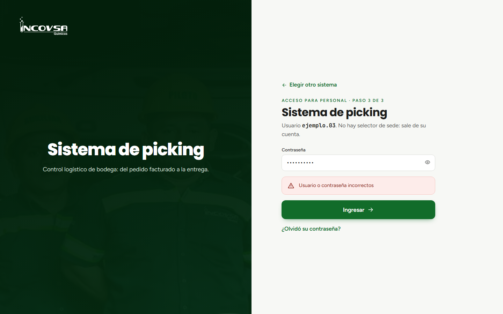

# Resolución de problemas frecuentes

## Guía de diagnóstico y solución rápida de incidencias

### Objetivo
Brindar al personal operativo de bodega, facturación, transporte y supervisión una guía práctica de contingencia para resolver de forma autónoma e inmediata las dudas e incidencias más comunes durante la jornada laboral.

### Requisitos previos
- Disponer de conexión a la aplicación institucional.

### Catálogo de incidentes y soluciones

A continuación se detallan los problemas frecuentes organizados por módulo, explicando su causa raíz y el procedimiento paso a paso para su resolución:

#### 1. Problemas de inicio de sesión y credenciales

- **Síntoma:** Al ingresar usuario y contraseña aparece el mensaje de alerta «Usuario o contraseña incorrectos» (véase la {{fig:problemas-error}}).

{#fig:problemas-error}

- **Causa probable:** Error mecanográfico al escribir la clave, tecla Bloq Mayús activada en el teclado, o la cuenta ha sido desactivada temporalmente por Gerencia.
- **Solución:**
  1. Verifique que el teclado no tenga las mayúsculas bloqueadas e intente escribir la clave con calma.
  2. Recuerde que el sistema diferencia estrictamente mayúsculas, minúsculas, números y caracteres especiales.
  3. Si olvidó su clave, acérquese con el encargado de **Gerencia** o **Soporte**. Ellos pueden acceder a Configuración > Usuarios y utilizar el botón **Contraseña** para asignarle una nueva clave al instante.

#### 2. Permisos y visualización de módulos faltantes

- **Síntoma:** Un colaborador ingresa al sistema pero no ve en el menú lateral el módulo que necesita (por ejemplo, Facturación o Reportes).
- **Causa probable:** La cuenta fue creada sin la casilla de permiso correspondiente al módulo solicitado.
- **Solución:**
  1. Notifique a Gerencia o Soporte.
  2. El administrador ingresará a **Configuración > Usuarios**, buscará el nombre del colaborador y presionará **Editar**.
  3. Marcará la casilla del permiso faltante (por ejemplo, `pk.facturacion` o `pk.reportes`) y guardará los cambios.
  4. El colaborador solo debe recargar la página en su navegador para ver reflejado el nuevo módulo.

#### 3. Errores al cargar el archivo de Odoo en Facturación

- **Síntoma:** El sistema rechaza el archivo y muestra «No se pudo leer el archivo. Verifique que sea el .xlsx exportado de Odoo.» o notifica «Hay referencias de una bodega que no se reconoce. Se esperan los prefijos XE, GT o ESC.».
- **Causas probables:**
  - El archivo fue guardado en un formato distinto a `.xlsx` (por ejemplo `.csv` o `.xls` antiguo).
  - El archivo contiene pedidos con prefijos de otra sede (por ejemplo, pedidos con prefijo `GT` de bodega Guatemala mientras el usuario está posicionado en Quetzaltenango `XE`).
  - Una o más líneas de producto traen cantidad en cero o Peso de Conversión vacío o en 0 (regla RN-50).
- **Solución:**
  1. Abra el archivo en Excel y compruebe que todas las referencias comiencen con el prefijo de la sede activa.
  2. Verifique que no existan líneas con peso o cantidad igual a cero.
  3. Asegúrese de que el archivo no supere el tamaño máximo de 2 MB.
  4. Vuelva a exportar el archivo desde Odoo asegurando que el filtro de exportación sea de la bodega correcta en estado "Hecho".

#### 4. En Bodega no se habilita el botón «Ruta Despachada» o «Pedido Despachado»

- **Síntoma:** El botón en la esquina de la tarjeta de Bodega permanece en color gris deshabilitado y no permite hacer clic.
- **Causa:** La orden tiene una o más casillas sin marcar en la columna "Listo". Por seguridad industrial, el sistema impide despachar órdenes incompletas.
- **Solución:**
  1. Revise detalladamente toda la tabla de la tarjeta hacia abajo.
  2. Ubique la fila que no tiene la casilla marcada y complétela una vez verificado el producto en la tarima física.
  3. Si la orden completa ya fue consolidada, presione la opción **Marcar todo** en la cabecera de la tarjeta. El botón de despacho se iluminará inmediatamente en verde.

#### 5. El piloto no visualiza su ruta en el teléfono móvil

- **Síntoma:** El piloto entra a la opción **Ruta** en su teléfono pero la pantalla indica que no hay rutas activas.
- **Causas probables:**
  - La ruta aún se encuentra en estado "En Preparación" en la bodega y ningún bodeguero ha pulsado el botón "Ruta Despachada".
  - El piloto tiene seleccionada una sede diferente en el selector superior de su teléfono.
- **Solución:**
  1. Verifique en el tablero de bodega que la orden haya sido completada y despachada formalmente.
  2. En el teléfono del piloto, revise la barra superior y asegúrese de que el selector de sede indique la misma ubicación física donde se armó la ruta (por ejemplo, Quetzaltenango).
  3. Al coincidir la sede y estar despachada, la ruta aparecerá de inmediato en la pantalla del conductor.

#### 6. Mensaje «No se pudo completar la operación. Inténtelo de nuevo.»

- **Síntoma:** Al marcar una casilla en bodega o intentar mover una fila aparece un mensaje flotante de error.
- **Causa:** Pérdida momentánea de señal Wi-Fi o congestión en la red inalámbrica de la planta.
- **Solución:**
  1. Compruebe que el dispositivo mantenga conexión a la red de la empresa.
  2. Espere unos segundos y repita la acción. Los datos ingresados previamente se encuentran a salvo en el servidor.

### Canales de soporte y asistencia

Si después de seguir las instrucciones de esta guía persiste algún inconveniente técnico:
- **Operaciones de despacho:** comuníquese con el supervisor de bodega o el área de facturación.
- **Cuentas, permisos y vehículos:** solicite asistencia a los usuarios con rol de **Gerencia** o **Soporte**.
- **Inconsistencias en pedidos o datos de Odoo:** consulte con el área administrativa responsable de la emisión de facturas y exportación de archivos en Odoo.

### Resultado esperado
Las operaciones logísticas de INCOVSA mantienen su continuidad sin interrupciones prolongadas, garantizando el despacho puntual de los pedidos a nuestros clientes.

